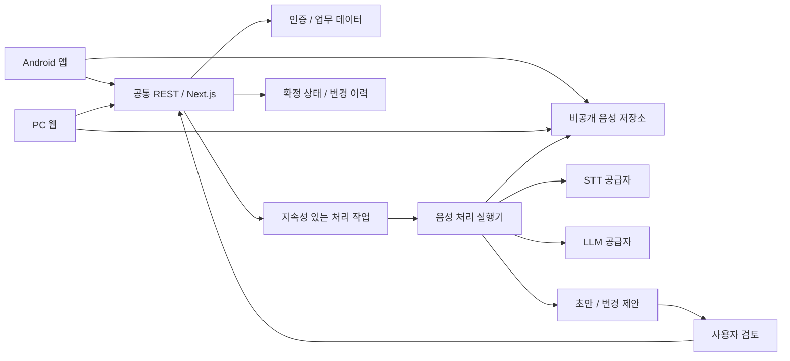

# WorkBrain 아키텍처 계획

버전 0.2 · 2026-10-16 · 구현 전 기준안

## 1. 선택 상태와 대안 비교

| 영역 | v0.2 기준안 | 대안과 판단 | 확정 수준 |
|---|---|---|---|
| 모바일 | Kotlin + Jetpack Compose | Flutter/React Native보다 네이티브 녹음·폴더블 요구에 맞음 | 사용자 지정 |
| 웹 | Next.js + TypeScript | 별도 SPA+API보다 1인 운영 대상 감소 | 사용자 지정/계획 채택 |
| 업무 API | Next.js 내부 업무 모듈 + 공통 REST | 별도 API 서버는 배포 대상·계약 관리 증가, 필요 시 분리 | 계획 기본값 |
| 인증·업무 DB | **Supabase Free** (Auth + PostgreSQL + RLS) | bkend는 DEC-18로 제외(서비스 확인 불가). 사용자 선택 DEC-20. 무료 유지 전제, Pro($25)는 예산 초과 | 사용자 확정, 휴면·백업은 운영 보완 |
| 파일 | 비공개 GCS | Supabase Free 파일 1GB는 음성 여유 적음 → 음성은 GCS | 비용 검증 조건부 |
| 웹 실행 | Cloud Run, min instances=0 후보 | Vercel은 별도 작업 실행기와 운영 환경이 갈림, 상시 VM은 유지관리 부담 | 지역·요금 검증 조건부 |
| 비동기 | 동일 저장소의 작업 실행기를 Cloud Run Jobs로 실행 | 웹 요청 내부 장시간 처리/종료 후 무보장 백그라운드 실행은 피함 | G1/G2 통과 전 조건부 |
| STT | gpt-transcribe($0.0045/분) 평가 | gpt-4o-mini-transcribe는 2027-02-26 종료 예정이라 제외. 한국어 정확도 미달 시 다른 STT와 비용 재비교 | 실측 미완료 |
| LLM | gpt-6-luna vs Haiku 5.5 비교(DEC-19) | 품질 미달 시 사용자 승인 후 상향; 중복 호출은 기본 끔 | P0 실측 후 확정 |
| 검색 | P1 프로젝트/기간/키워드 | P2 의미 검색. Supabase에서 pgvector 사용 가능하나 채택은 G6 | P1 범위 확정 |

**2026-10-17 개정(DEC-18/20)**: bkend는 도메인 조회 실패·내보내기 미지원으로 제외하고 **Supabase Free**를 채택했다. Free 조건: DB 500MB·파일 1GB·이그레스 5GB, **자동 백업 없음**, **1주 미사용 시 일시정지**, 활성 프로젝트 2개. 보완: ① 기존 계획의 일 1회 암호화 내보내기를 GCS에 저장(RPO 24시간 목표 유지), ② 일시정지되면 대시보드에서 재개하고 앱은 '서버 휴면' 안내를 표시, ③ 음성은 GCS. Pro(월 $25)는 단독으로 예산을 넘어 채택하지 않는다. 서울 리전 제공 여부는 프로젝트 생성 시 확인한다. [공식 가격](https://supabase.com/pricing)

## 2. 시스템 경계

API가 업로드 권한과 파일 소유자를 검증한 뒤 제한된 업로드 권한을 제공한다. 파일 업로드 완료를 서버가 확인하기 전 분석 작업을 시작하지 않는다. 사용자 토큰으로 가능한 최소 권한을 사용하고 관리자 키는 서버에서만 사용한다.

bkend의 사용자별 접근 제어와 서비스 자격 증명 동작을 G1에서 확인한다. 클라이언트에 숨긴 화면만으로 접근을 막지 않는다. 직접 BaaS 접근 경로가 있다면 동일한 권한 제한을 적용한다.

## 3. 공통 인터페이스 계획

웹/Android 모두 동일한 업무 REST 계약을 사용한다. 버전 접두사는 `/api/v1`을 계획 기준으로 두며 상세 요청/응답 명세는 Design 산출물이다.

| 계약 영역 | 필요한 동작 | 불변 조건 |
|---|---|---|
| 인증 | 로그인/갱신/로그아웃/본인 확인 | JWT 검증·만료 처리, 본인 계정 허용 목록, 공개 가입 차단 |
| 프로젝트·PARA | 목록/조회/생성/변경/보관 | 소유자 검사, 버전 일치 시 수정 |
| 기록·업로드 | 업로드 준비/완료/상태/삭제 | 크기·형식·소유자·해시 확인, 서명 권한 제한 |
| 처리 작업 | 시작/재시도/취소/조회 | 동일 입력+버전+실행 키의 중복 효과 방지 |
| 회의록·전사 | 버전 조회/사용자 편집/재분석 요청 | 기존 승인·수동 버전 보존 |
| 제안·승인 | 제안 목록/수정/승인/거절 | 근거 존재, 대상 최신 버전, 승인 효과 1회 |
| 기본 할 일 | 생성/편집/완료/조회 | AI 변경은 제안 승인 경유 |
| 검색·설정 | 권한 범위 검색, 보관·비용 설정, 내보내기 | 삭제/만료·확정 여부 필터 |

오류는 인증 실패, 권한 없음, 버전 충돌, 유효하지 않은 입력, 처리 실패, 비용 대기로 구분한다. 유료 작업 재시도는 호출자가 임의로 강제 실행할 수 없고 서버 예산 검사를 다시 거친다.

## 4. 장시간 처리·승인 신뢰성

- P1 입력 상한의 계획 기본값: 파일 200MB, 녹음 120분, m4a/mp3/wav/webm. 실제 포맷/코덱은 안전한 파일 검사와 변환 검증 후 허용한다. 상한 초과는 업로드 전에 안내한다.
- STT 요청은 공급자 허용 크기 이하로 분할하고 구간 인덱스·오프셋을 저장한다. 문장 경계·겹침 처리에서 중복 텍스트를 제거한다. 현재 문서상 파일 전사 제한은 25MB다. [STT 문서](https://developers.openai.com/api/docs/guides/speech-to-text)
- 작업 상태: 업로드 대기 → 업로드 확인 → 전사 대기/실행 → 분석 동의 대기 → 분석 대기/실행 → 검토 가능. 실패·취소·예산 대기는 별도 상태다.
- 처리 실패는 완료 구간을 재사용한다. 재시도는 단계별 최대 3회, 지수 지연, 영구 오류는 자동 재시도하지 않는다. 재과금 가능성과 실제 사용량을 기록한다.
- 작업 큐와 실행 상태를 영속화한다. 웹 인스턴스 메모리만으로 큐·락·예산 예약을 유지하지 않는다. 실행 중 종료 후 lease 만료와 재실행을 시험한다.
- G1에서 고유 키·조건부 갱신·승인 이력과 상태의 일관성 보장 방법을 확인해야 한다. 클라이언트의 순차 실행이나 인스턴스 수 1만으로 정확성을 보장하지 않는다.
- 일괄 승인은 항목별 성공/실패를 반환한다. 원자적 일괄 승인을 보장하지 않는 경우 '전체 성공'으로 표시하지 않는다. 승인 항목과 감사 이벤트는 연결되어야 한다.
- 알림용 실시간 채널은 갱신 신호로만 사용하고 서버 상태를 다시 읽는다. P1 기본안은 전경 화면의 가벼운 폴링이다. 연결 복구 시 누락 상태를 재조회한다.

## 5. AI 전송과 공급자 교체

음성 외부 전사 전 사용자 동의와 데이터 허용 범위를 확인한다. 음성의 민감정보를 완전히 사전 탐지할 수 있다고 주장하지 않는다. 회사 자료는 초기 사용 대상에서 제외한다.

전사 후 별도 분석 동의를 받고 전화번호·이메일 등 패턴 탐지와 수동 가림 미리보기를 제공한다. 가림 처리된 텍스트로 분석하고 원문과의 근거 매핑은 서비스 내부에서 유지한다. 탐지 누락/오탐 가능성을 표시한다.

LLM은 도구 실행 권한 없이 구조화된 후보만 생성한다. 입력의 명령문, URL, 연락처는 데이터다. 임의 URL 가져오기·발송·데이터 수정·다른 사용자의 프로젝트 조회를 유발하지 않는다. 출력은 허용 필드·타입·근거 범위·대상 ID를 서버에서 검증한다.

STT/LLM 어댑터는 입력, 출력, 사용량, 오류, 공급자 요청 ID, 모델/프롬프트 버전만 추상화한다. 범용 에이전트 프레임워크나 자동 모델 라우팅은 초기 범위에서 제외한다.

MCP는 P3 읽기 전용으로 제공하며 WorkBrain 사용자 인증·권한·토큰 철회·접근 기록을 사용한다. ChatGPT/Claude/Claude Code/Codex 각각의 인증·연결 지원을 출시 때 검증한다. 4개가 같은 설정으로 동작한다고 가정하지 않는다.

## 6. 비용 모델: 10/20/30시간

계산 기준일 2026-10-16. **계획용 환산 1달러=1,500원**, 세금·결제 여유 계수 1.10을 사용한다. 실제 환율/세율의 주장이나 견적이 아니다. 개발 도구 구독·도메인·스토어 등록은 제외한다.

### AI 사용량과 단가

- H=월 원본 음성 시간. STT 중복·재시도 10%를 가정: `60×H×1.10`분.
- gpt-4o-mini-transcribe 공시 예상 단가 $0.003/분: `0.198×H`달러. 실제 음성 토큰 청구는 사용량으로 대조한다. [OpenAI 가격](https://developers.openai.com/api/docs/pricing)
- 분석 입력은 음성 1시간당 40,000토큰, 출력은 추론 토큰을 포함해 6,000토큰, 재분석 20%를 가정한다. 한국어 실제 토큰량은 G2에서 측정한다.
- LLM 예산 계산에는 **내부 선정 상한** $1/백만 입력 토큰, $4/백만 출력 토큰을 쓴다. 특정 모델의 실제 요금이 아니다. 이 가격 이내 모델 중 G2 품질을 통과한 모델을 채택한다. 합계는 `1.2×(0.04×1+0.006×4)×H = 0.0768×H`달러다.
- 과거 저가 모델의 가격만 보고 고정하지 않는다. 조회한 GPT-4.1 Mini와 GPT-5 Mini 문서에는 Deprecated 표시가 있어 새 제품 확정 모델에서 제외한다. [모델 문서](https://developers.openai.com/api/docs/models/gpt-5-mini)

### 인프라 가정과 검증

- 오디오는 예산 모델상 64kbps, 시간당 약 28.8MB. 원본 30일+복구 7일, 월 30시간이면 약 1.07GB의 음성량이다. WAV 업로드·보조 변환 파일은 더 클 수 있으므로 200MB/파일 및 총 저장량으로 제한한다.
- 처리기: 음성 10분당 총 실행 2분, 1vCPU/0.5GiB 가정. 30시간 입력이면 월 21,600초이며 네트워크 대기·재시도 포함 여부를 실측한다.
- 웹/API: 월 10,000회 × 평균 과금 1초, 1vCPU/0.5GiB. 최소 인스턴스 0 후보. 무료 제공량을 다른 프로젝트와 공유할 수 있어 무료라고 단정하지 않는다.
- 예산 계산용 상한 단가: 처리기 $0.000025/vCPU초+$0.000003/GiB초, 웹 $0.000030/vCPU초+$0.000004/GiB초. 해당 지역 실제 단가가 이보다 높으면 재산정한다.
- 저장/임시파일/백업 3GB, 전송 3GB, 오브젝트 요청, 이미지 저장·빌드·로그·스케줄러·비밀 관리 합산 **월 3,000원 배정**. 위 사용량의 실제 합계가 배정액을 넘으면 G2 미통과다. [Cloud Run 가격](https://cloud.google.com/run/pricing), [GCS 가격](https://cloud.google.com/storage/pricing)
- 백엔드 월 비용을 **B원(세전)**으로 둔다. Supabase Free 채택(DEC-20)으로 **B=0원**이며, 무료 한도 초과나 Pro 전환이 필요해지면 사용자 결정으로 재산정한다.
- **2026-10-17 G2 갱신(DEC-19)**: STT `gpt-transcribe` 기준 445.5×H원, 분석+회의록 문서 생성(저가 후보 $0.10/$0.50) 약 25×H원 → `월 총액 ≈ 1.10 × (470.5×H + 3,000 + B)`원. 월 30시간·B=0이면 **약 18,830원**. 아래 표는 v0.2 원래 계산(내부 상한 단가)이며 참고용으로 남긴다.

| 월 음성 | STT(재시도 포함) | 분석(상한 단가/재분석 포함) | 인프라 배정 | 세금·결제 여유 포함, B 제외 | B=3,000원 가정 합계 |
|---|---:|---:|---:|---:|---:|
| 10시간 | 2,970원 | 1,152원 | 3,000원 | 7,834원 | 11,134원 |
| 20시간 | 5,940원 | 2,304원 | 3,000원 | 12,368원 | 15,668원 |
| 30시간 | 8,910원 | 3,456원 | 3,000원 | 16,903원 | 20,203원 |

식: `월 총액 = 1.10 × (412.2×H + 3,000 + B)`원, 표는 원 단위 반올림. 월 30시간에서 유료 대기 기준 24,000원 내 여유를 남기려면 B는 약 6,452원 이하여야 한다. 이는 bkend의 실제 요금 확인이 아니라 **채택 가능 조건**이다.

스트레스 시나리오: 30시간, STT 재시도 30%, 분석 재실행 100%, 인프라 6,000원, B=3,000원이면 약 27,819원이다. 이 경우 월말까지 무조건 처리하지 않고 예상 비용 예약 단계에서 대기시킨다.

### 비용 통제

비용 장부는 확정 사용량+진행 작업 예약액+예상 잔여 고정비를 합산한다. 20,000원 경고, 새 작업 포함 예상액 24,000원 초과 시 신규 STT/분석을 대기한다. 값은 v0.2 기본값이며 사용자가 변경할 수 있다. 30,000원은 운영 목표이지 청구 차단 보증이 아니다.

월 초기화는 공급자 청구 주기를 기록해 처리한다. 공급자 간 주기가 다르면 모두 달력 월로 0원 처리하지 않고 아직 청구되지 않은 비용을 유지한다. 사용량 불명/계측 실패 시 새 유료 작업은 안전하게 대기한다.

사용자는 대기 작업 취소/다음 주기 재개를 선택할 수 있다. 저장소·네트워크 비용은 분석 대기 중에도 발생하므로 저장량 상한·업로드 예상 비용 검사를 별도로 적용한다.

## 7. 전제와 Design 진입 조건

G1: bkend 공식 근거와 시험 계획으로 사용자 격리, 고유성/조건부 쓰기, 내보내기·복구, 가격을 확인한다. 필요한 보장이 없으면 공급자 예외/범위 조정을 사용자에게 결정받는다.
G2: 실제 사용 가능한 비폐기 LLM 모델, 한국어 토큰량, 처리 시간, 지역별 비용으로 위 계산을 갱신한다. 모델 정밀도 목표와 월 예산을 동시에 만족하지 못하면 자동으로 비싼 모델을 사용하지 않는다.

현재 문서는 서비스 생성·모델 호출·실측 수행을 의미하지 않는다. 세부 DB 스키마와 실행 계약은 G1/G2 근거 확인 및 Design 승인 이후 작성한다.
