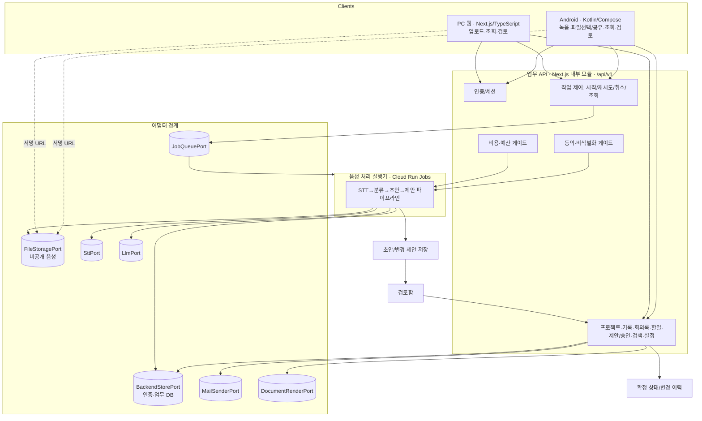
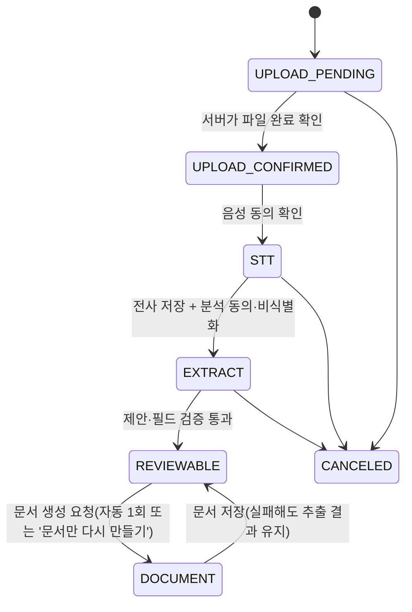
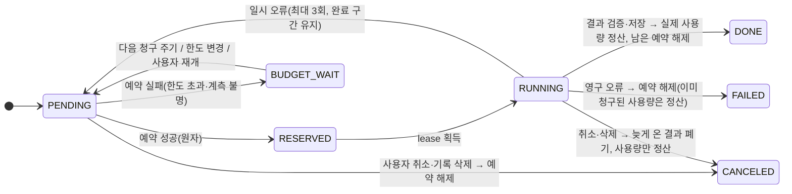
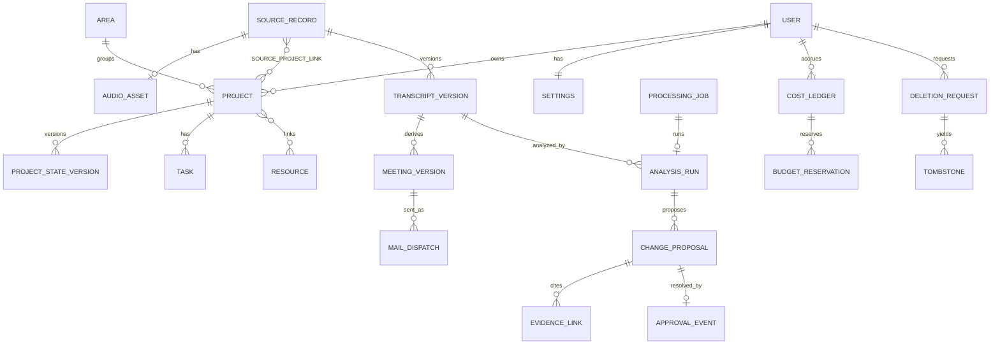

# WorkBrain Design Document

> **요약**: 음성 기록을 수집·전사하고 기존 프로젝트와 비교해 변경을 제안하며, 사용자가 승인하면 근거·이력과 함께 업무 지식이 축적되는 개인 AI 프로젝트 매니저의 기술 설계.
>
> **프로젝트**: WorkBrain
> **버전**: 0.1.34 (Draft) — v0.1.9 개정(FR-07 회의록 승인·Q5 3년 보관/근거 문장) 사용자 승인(2026-11-03, DEC-61), v0.1.10 FR-28 Android 구현 규칙(DEC-63), v0.1.11 FR-02 1단계 PARA 트리(DEC-65), v0.1.12 S03 화면을 목업 모양대로(DEC-66), v0.1.13 S02 오늘을 목업 모양대로(DEC-67), v0.1.14 녹음·검토함·기록 상세 목업 맞춤(DEC-68), v0.1.15 FR-02 2단계 ① 기록↔프로젝트 연결(DEC-69), v0.1.16 ② 한 줄 빠른 입력(DEC-70), v0.1.17 ④ 기록 참조 자료(DEC-71), v0.1.18 ③ 길게 눌러 끌어서 옮기기(DEC-72), v0.1.19 빠른 입력을 화면 아래 떠 있는 띠로(DEC-73), v0.1.20 상세 할 일 카드의 이전 완료 접기(DEC-74), v0.1.21 FR-06 AI 프로젝트 연결 제안(DEC-75), v0.1.22 연결 제안 이유 한 줄(link-v2), v0.1.23 모든 할 일 기한 없음 접힌 줄(DEC-78), v0.1.24 이름 붙은 화자 담당·받는 사람(DEC-76·77, 지시문 v4·0035), v0.1.25 회의록 만들기 한 번만(DEC-79, 0036), v0.1.26 빠른 입력 '#' 조각 맞추기·후보 고르기(DEC-80), v0.1.27 '#' 이어지는 낱말·회의록 화면 다시 불러오기(DEC-82·83), v0.1.28 지시문 v5 한 약속 한 번만(DEC-84), v0.1.29 남은 후보 창에서 접힌 후보 빼기(DEC-85), v0.1.30 FR-09 프로젝트 현재 상태(DEC-86, state-v1·0037), v0.1.31 FR-33 주간·월간 업무계획(DEC-87·88, plan-head-v1), v0.1.32 Android 기록 탭·빠른 입력 마이크(DEC-89), v0.1.33 할 일 밀어 지우기(DEC-90)·넣을 곳 기억에 옮긴 곳 포함(DEC-91), v0.1.34 할 일 목록 ⋮ 메뉴·선택해서 이동/삭제·정렬 방식, 밀어 지우기 철회(DEC-92)
> **작성자**: Claude Code (PDCA Design)
> **작성일**: 2026-10-16 (Asia/Seoul)
> **상태**: **사용자 승인(2026-10-18, v0.1.7, Q5 → DEC-25)**. G1/G2 문서 근거 충족(2026-10-17): 백엔드 Supabase Free(DEC-20), 모델 저가 후보 비교 방침(DEC-19). 실측(격리·동시성·복원·한국어 품질·비용)은 P0에서 하며, 결과에 따라 이 문서를 고친다.
> **Plan 원본**: [workbrain.plan.md](../../01-plan/features/workbrain.plan.md) · [PRD](../../01-PRD.md) · [아키텍처 계획](../../02-ARCHITECTURE-PLAN.md) · [데이터 모델 계획](../../03-DATA-MODEL-PLAN.md) · [UX 계획](../../04-UX-PLAN.md) · [로드맵](../../05-ROADMAP.md) · [위험·결정](../../06-RISK-AND-DECISIONS.md) · [추적표](../../REQUIREMENTS-TRACEABILITY.md)
> **검토·미확정 사항**: [DESIGN-OPEN-ISSUES.md](../DESIGN-OPEN-ISSUES.md) ← Codex 검증 대상

---

## 0. 이 문서의 성격과 경계

- 이 문서는 **설계**이며, 서비스 생성·유료 가입·모델 호출·실측·배포·코드 구현을 포함하지 않는다(DEC-14, todo, 사용자 지시).
- Plan 문서는 원칙적으로 수정하지 않는다. 단 사용자 요청(2026-10-17)으로 다음 범위 변경이 생겨 PRD·추적표·로드맵·결정 기록을 함께 갱신했다(DEVELOPMENT-GUIDE "범위 변경 시 함께 수정" 규약). 그 외 Plan 내용은 변경하지 않았다.
  - **FR-28 검토 미루기** 신규(TC-23, DEC-15).
  - **FR-29 회의록 Word 다운로드**·**FR-30 회의록 작성 지침 편집** 신규, **FR-22 회의록 메일**의 본인 주소 발송을 P4→P1로 당김(TC-24/25, DEC-16, R-13/14).
- Plan이 규정한 **Design 진입 조건**(G1 백엔드 적합성, G2 비용·모델)은 2026-10-17에 **문서 근거 단계까지 충족**했다: bkend 제외·Supabase Free 채택(DEC-18/20), 저가 모델 비교 후 상향 방침(DEC-19). 남은 것은 P0 실측과 사용자 Design 승인이다(`designApproved:false`). 본 설계는 다음 원칙을 따른다.
  - **공급자 중립(provider-neutral) 코어는 완전 상세 설계**한다.
  - 백엔드는 **Supabase(PostgreSQL)**를 기준으로 상세 설계하되, `BackendStorePort` 경계는 유지해 공급자 교체 비용을 낮춘다.
  - 모든 조건부 항목은 §11과 [DESIGN-OPEN-ISSUES.md](../DESIGN-OPEN-ISSUES.md)에 G1~G6 기준으로 모은다.
- 범위 기준선은 **P1(MVP)**이다. 사용자 1순위인 "AI 프로젝트 매니저"는 Plan상 **P1(추출·제안·승인·근거)과 P2(구조화 수명 관리)에 걸쳐** 있어, P1을 구현 상세로, P2를 전방 설계(forward design)로 구분한다(FR-18/DEC-08).

---

## 1. 개요

### 1.1 설계 목표

1. 사용자 입력·관리 부담 최소화: 수집→전사→분류→초안→제안까지 AI가 자동 생성하되, **운영 데이터 반영은 전적으로 사용자 승인 경유**(DEC-04/12, DEVELOPMENT-GUIDE 불변 조건).
2. 모든 사실에 **출처·행위자·시각·전후 버전**을 부착해 변경 이력과 근거를 추적한다(FR-11, NFR-01).
3. 웹·Android **업무 기능 동등성**을 단일 REST 계약으로 보장한다(DEC-01, 단 입력 방식은 플랫폼별 상이).
4. **공급자 교체 가능**한 어댑터 경계로 STT/LLM/백엔드/파일저장을 추상화한다(NFR-09).
5. **비용 안전장치**: 모델 호출 전 비용 예약, 월 목표 초과 시 유료 작업 대기(FR-16, NFR-07).
6. **AI 입력 안전**: 원문 속 명령을 데이터로만 취급, LLM에 도구 실행·운영 데이터 쓰기 권한 없음(NFR-08, DEC-12).

### 1.2 설계 원칙

- **승인 경계 분리**: "AI 초안/후보 저장"과 "운영 상태 반영"은 서로 다른 저장 경로·상태다. AI는 전자까지만 자동 수행한다.
- **버전 불변성**: 전사·회의록·프로젝트 상태는 덮어쓰지 않고 새 버전을 추가한다. 사용자 수정은 보존한다(데이터 모델 계획 §3).
- **포트/어댑터**: 외부 의존(백엔드·파일·STT·LLM)은 인터페이스(Port)로 분리하고 공급자별 구현(Adapter)을 교체한다. → G1/G2 리스크 격리의 핵심 수단.
- **출처 없는 확정 금지**: 담당자·기한·결정은 근거 없으면 생성하지 않고 "미지정/확인 필요"로 둔다(NFR-02).
- **낙관적 동시성**: 수정·승인은 대상 버전 일치 검사를 거친다. 원자성 보장은 G1 확인 전제(데이터 모델 계획 §3, R-02).
- **색만으로 상태 표현 금지, 접근성 내장**(NFR-05).

### 1.3 G1/G2 조건부 상태 요약

| 게이트 | 미해소 내용 | 설계에 준 영향 |
|---|---|---|
| G1 | ~~bkend 미확인~~ → **Supabase Free 채택(DEC-20)**. 남은 실측: RLS 격리·동시 승인·내보내기/복원 | §4.3 스키마를 기준 스키마로 확정. 자동 백업 없음·휴면은 운영 보완(일 1회 GCS 내보내기) |
| G2 | 활성 비폐기 LLM/STT 모델·한국어 토큰량·지역 비용 미확정(R-05/11) | 모델/프롬프트 버전은 설정값·실행 기록으로 외부화. 비용식은 Plan 수치를 참조만, 재확정 금지 |
| G6 | 의미 검색·벡터 저장 방식 미정 | RAG/임베딩은 P2/P3 전방 설계로만, pgvector 자동 채택 금지 |

---

## 2. 아키텍처

### 2.1 컴포넌트 구성과 포트/어댑터



- **업무 API**는 Next.js 내부 업무 모듈로 시작한다(아키텍처 계획 §1). 별도 API 서버 분리는 필요 시 후속.
- **BackendStorePort**: 인증·업무 데이터 CRUD·조건부 갱신·고유성 보장을 추상화. 구현체는 `SupabaseAdapter`(Auth+PostgreSQL+RLS, DEC-20). bkend 어댑터는 DEC-18로 폐기. → NFR-09, R-01/02 격리.
- **FileStoragePort**: 비공개 GCS 기준. 업로드 완료 서버 확인 전 분석 불가. 서명 URL 소유자 검증(NFR-01).
- **SttPort/LlmPort**: 입력·출력·사용량·오류·공급자 요청 ID·모델/프롬프트 버전만 추상화. 범용 에이전트 프레임워크·자동 모델 라우팅 제외(아키텍처 계획 §5).
- **JobQueuePort**: 큐·락·예산 예약을 **영속 저장**한다. 웹 인스턴스 메모리로 상태를 유지하지 않는다(아키텍처 계획 §4).
- **DocumentRenderPort**: 회의록 문서(섹션 구조)를 .docx로 변환. 서버에서 실행하며 외부 호출·비용 없음(FR-29, §3.8).
- **MailSenderPort**: 회의록 메일 발송만 추상화. 기본 구현 `GmailSmtpAdapter`(앱 비밀번호), 대안 `GmailApiAdapter`(OAuth `gmail.send`). 자격 증명은 서버 비밀 저장소에만 둔다(FR-22, R-14, §3.8).

### 2.2 데이터 흐름(수집→반영)

```
[외부 저장 허용 확인] → 녹음/업로드 → 업로드 확인 → [음성 동의] → [비용 예약] → STT(구간 분할) → 전사 버전 저장
  → [분석 동의 + 비식별화] → [비용 예약] → LLM 구조화 추출(분류/회의록 필드/제안 후보)
  → 서버 출력 검증(필드·타입·근거·대상 ID) → 초안/제안 저장(검토함)
  → [지침·참고 자료 전송 동의 확인] → [비용 예약] → 회의록 문서 생성(지침 적용, §3.8)
  → 사용자 검토/수정/승인 → 운영 상태 반영 + ActivityLog/EvidenceLink 기록
```

핵심 불변: **"→ 초안/제안 저장"까지는 AI 자동**, **"→ 운영 상태 반영"은 승인 경유만**. 두 단계 사이에 사용자 개입이 없으면 운영 데이터는 바뀌지 않는다.

### 2.3 처리 작업 상태 기계(ProcessingJob)

작업은 **유료 단계 3개(STT · EXTRACT · DOCUMENT)**로 나누고, 각 단계가 같은 모양의 하위 흐름을 가진다. 단계마다 따로 비용을 예약·정산하므로, 한 단계만 실패하거나 예산 대기에 걸려도 앞 단계를 다시 과금하지 않는다(C7).





- `processing_job.stage`(STT/EXTRACT/DOCUMENT)와 `stage_state`(위 하위 흐름)를 따로 저장한다. `BUDGET_WAIT`는 **멈춘 단계로 돌아간다**(전사 대기면 전사부터, 문서 대기면 문서만).
- 예약은 DB 함수 하나에서 `청구 주기 확정액 + 진행 중 예약 + 새 예약 ≤ 대기 한도`를 검사하고 삽입한다(동시 예약 원자 처리, NFR-07). 예약은 작업·단계·청구 주기에 연결된다.
- 재시도: 단계별 최대 3회, 지수 지연. 영구 오류는 자동 재시도하지 않고 즉시 안내(아키텍처 계획 §4, TC-05).
- 실패 시 **완료 구간 재사용**(STT 구간 인덱스/오프셋). 문서 생성만 실패하면 EXTRACT 결과는 그대로 두고 DOCUMENT만 다시 시도한다.
- 실행 중 기록이 삭제되면(§4.9) 다음 저장 시점에 tombstone을 재검사해 결과를 버린다. 응답이 늦게 와도 재게시하지 않는다(TC-11).
- **멱등성**: `(inputVersionId, analysisConfigHash, executionKey)`가 같은 재시도는 동일 실행으로 취급. 사용자의 명시적 재분석만 새 실행(데이터 모델 계획 §3-3, NFR-03).

### 2.4 의존성

| 컴포넌트 | 의존 | 목적 | 확정 수준 |
|---|---|---|---|
| 업무 API | BackendStorePort | 인증·업무 데이터 | 포트 확정 / 구현체 G1 조건부 |
| Worker | FileStoragePort, SttPort, LlmPort, BackendStorePort | 전사·추출·제안 저장 | 포트 확정 / 공급자 G1·G2 조건부 |
| 모든 경로 | 소유 범위 검사 | 교차 사용자 차단 | 확정(NFR-01) |
| 비용 게이트 | CostLedger/BudgetReservation | 유료 작업 대기 | 로직 확정 / 단가 G2 조건부 |

---

## 3. AI 프로젝트 매니저 상세 설계 (1순위)

> 사용자 1순위. Plan상 **P1 범위**(추출·제안·승인·근거·재분석)를 구현 상세로, **P2 범위**(구조화된 결정/요구/이슈 수명 관리)를 전방 설계로 구분한다(FR-06~12/18, DEC-08).

### 3.1 회의록으로부터 상태 자동 업데이트 파이프라인 (P1)

입력: 승인된 전사 버전 + 비교 대상(연결된 프로젝트의 현재 `ProjectStateVersion`, 기존 `Task`, 최근 `MeetingVersion`). 출력: **검토함에 쌓이는 변경 제안(ChangeProposal)과 회의록 초안(MeetingVersion.draft)** — 운영 반영 아님.

1. **분류(FR-06)**: 기록을 업무/개인/불확실로 라벨링하고 **프로젝트 연결 후보**(SourceProjectLink, status=`proposed`)를 생성. 하나의 기록이 여러 프로젝트에 걸치면 항목 단위로 분할 연결 제안. **사용자 확인 전 확정 연결 없음.**
2. **회의록 초안 추출(FR-07)**: 제목/일시/참석자/목적/논의/**결정 후보**/미결정/할 일/담당자/기한/프로젝트/이전 회의 근거 필드. 불명은 "미지정". 기한은 날짜만/시각/시간대/모호 상태를 구분(데이터 모델 계획 §2).
3. **변경 제안 생성(FR-09)**: 비교 대상과 대조해 프로젝트 **요약·진행 상태·기존 할 일**의 전후 차이와 근거를 담은 ChangeProposal 생성. **최근 업로드가 무조건 최신 사실이 되지 않음**(늦게 업로드된 과거 회의는 자동 승격 금지).
4. **서버 출력 검증(NFR-08)**: LLM 출력은 허용 필드·타입·근거 범위·대상 ID를 서버가 검증. 검증 실패는 폐기가 아니라 **검토 대기(격리)**로 둔다.

### 3.2 요구사항·결정·이슈·할 일 추출의 범위 구분 (P1 후보 vs P2 확정)

| 산출물 | P1 취급 | P2 취급(FR-18) |
|---|---|---|
| 할 일(Task) | **승인 시 운영 Task로 등록**(FR-08) | 반복/하위/태그는 P4 |
| 결정(Decision) | 회의록의 **결정 후보**로만 존재. '논의된 결정'과 '사용자가 확정한 결정' 구분 | 독립 Decision 엔터티·유효/대체 수명 관리 |
| 요구사항(Requirement) | 회의록 후보 텍스트 | 독립 Requirement 엔터티·추적 |
| 이슈/위험(Issue/Risk) | 회의록 후보 텍스트 | 독립 Issue 엔터티·해결 제안·상충 근거 비교 |
| 프로젝트 요약/상태 | **승인 시 ProjectStateVersion 반영**(FR-09) | 범위/마일스톤 자동 관리 |

> **설계 결정**: P1에서는 결정/요구/이슈를 **확정 엔터티로 만들지 않는다.** 회의록 내 후보로만 두어 "현재 프로젝트 사실"로 오인되지 않게 한다(PRD §3). P2 엔터티는 §4.6에 전방 설계.

### 3.3 과거 지식과 신규 정보 연결

- **근거 연결(EvidenceLink)**: 모든 제안·후보는 `(sourceRecordId, transcriptVersionId, segment/sentence ref)`를 가진다. 실제 시간 정렬이 없는 전사에 가짜 초 단위를 부여하지 않는다(데이터 모델 계획 §2).
- **재분석 고정(FR-11, 데이터 모델 계획 §3)**: 재분석 시작 시 입력 전사 버전과 비교 대상(프로젝트/할 일) 버전을 **스냅샷 고정**한다.
- **중복/충돌 탐지**: 새 후보는 기존 승인 항목의 원본 연결·내용 유사성과 대조. 동일 근거의 기존 항목은 새 할 일 대신 **변경 또는 중복 후보**로 분류. 유사성만으로 자동 병합 금지. 거절했던 후보가 같은 입력으로 재생성되면 기존 거절을 표시하고 기본 검토 목록에서 숨김(새 근거 있으면 재검토 표시).

### 3.4 AI 자동 반영과 사용자 승인 기준 (핵심 정책)

| 작업 유형 | AI 자동 가능 | 승인 필요 | 승인 방식 |
|---|---|---|---|
| 전사/회의록 초안 생성·저장 | ✅ 초안 저장까지 | — | 자동(운영 반영 아님) |
| 프로젝트 연결 후보 | ✅ 후보 생성 | ✅ 확정 연결 | 개별/수정 |
| 할 일 신규 등록 | ❌ | ✅ | 일괄 승인 가능 |
| 프로젝트 **상태 변경** | ❌ | ✅ | **상세 확인 후** 적용(일괄 불가) |
| 할 일 **기한 변경** | ❌ | ✅ | **상세 확인 후** 적용 |
| 분류/단순 후보 묶음 | ❌ | ✅ | 선택 일괄 승인 |

규칙(FR-10, UX 계획 §4):
- **AI는 운영 상태를 절대 자동 반영하지 않는다.** 자동 산출물은 전부 "검토함(S06)"에 쌓이는 **AI 자동 처리 결과 = 승인 대기함** 항목이다.
- 상태 전환·기한 변경 같은 **중요 변경은 일괄 승인에서 제외**하고 상세 확인을 강제한다.
- **승인 효과는 1회**(중복 승인 멱등). 일괄 승인은 항목별 성공/실패를 반환하고, 원자적 일괄을 보장하지 못하면 '전체 성공'으로 표시하지 않는다(아키텍처 계획 §4).
- 승인 직전 **대상 최신 버전과 비교**해 다른 기기 편집/승인으로 달라졌으면 **충돌 상태**로 전환하고 새 차이를 보여준다(FR-10). 근거가 삭제되었으면 승인 차단·재검토(S06, TC-08).
- AI 신뢰도 숫자를 사실성 보증처럼 강조하지 않고 **연결 이유·근거**를 우선 표시(UX 계획 §1).
- **승인 위치(DEC-23)**: **새 할 일 후보**는 회의록을 본 자리인 기록 상세(S05)에서 골라 바로 추가한다. 제목·담당·기한을 고친 뒤 추가하면 검토함과 같은 `POST /proposals/approve`(수정값 포함)로 처리되어 같은 ApprovalEvent가 남고, 검토함 목록에서도 사라진다. 버린 후보는 `reject`와 같다. **상태 변경·기한 변경·충돌·근거 삭제 제안은 기록 상세에서 승인하지 않고** 검토함(S06)에서 전후를 비교한다. 오늘 화면(S02)에는 승인 버튼을 두지 않는다.
- **담당 구분(DEC-23)**: 추출은 할 일마다 `owner_kind`를 제안한다. 말에서 다른 사람이 맡겠다고 한 일은 `other`(팔로업, 그 사람 이름), 담당자가 말에 없으면 `unknown`(확인 필요)이다. `unknown`을 '나'로 바꾸거나 이름을 추정하지 않는다(NFR-02). 팔로업은 내 할 일과 따로 모아 '챙길 일'로 보여 준다.

### 3.5 변경 이력 및 근거 추적

- 승인된 각 변경에 **근거·작성 주체·시각·전후 버전**을 남긴다(FR-11).
- `ChangeProposal`(대상/기준 버전/전후/근거/중복 실행 키) → `ApprovalEvent`(검토 결과/행위자/시각) → `ActivityLog`(ID 중심, 원문 미기록) → 대상 엔터티의 새 버전(`ProjectStateVersion`/`Task`).
- **사용자 수정 우선 보존**: 재분석의 새 AI 값은 제안으로만 표시하고 사용자 수정 필드를 덮지 않는다. 되돌리기도 새 변경으로 기록(데이터 모델 계획 §3-7).

### 3.6 AI 안전 경계 (NFR-08 / DEC-12)

- LLM은 **도구 실행 권한 없이 구조화 후보만** 생성. 입력의 명령문·URL·연락처는 **데이터**다. 임의 URL 가져오기·발송·데이터 수정·타 사용자 프로젝트 조회를 유발하지 않는다.
- 출력은 서버에서 **스키마(JSON Schema) 검증** 후에만 저장. 허용 대상 ID 외 참조는 거부.
- 분석 입력은 **비식별화된 텍스트**를 사용하고 원문↔근거 매핑은 서비스 내부에서만 유지(§8.3).

### 3.7 검토 미루기 (스누즈) — FR-28 / DEC-15

사용자가 특정 날짜에 검토를 못 하거나 뒤로 미뤄야 할 때를 위한 기능. **제안을 삭제하지 않고 지정일까지 "미룬 항목"으로 보관**한다.

- **미룸 설정**: 제안에 상대일(내일/이번 주말/다음 주)·지정일을 설정(`snoozed_until`). 검토함의 "오늘" 목록에서 빠지고 "미룬 항목" 탭으로 이동한다.
- **운영 상태 무변경**: 미룸은 승인과 무관하다. 미뤄도 프로젝트 상태·할 일은 바뀌지 않는다(DEC-15, AI 자동 반영 금지 원칙 유지).
- **근거 만료 상호작용(핵심, DEC-21)**: 미룸은 보관 수명을 연장하지 않는다(DEC-15). 미룸 중에도 음성(30일)·전사(6개월) 만료가 계속 진행된다. **음성만 만료되고 근거 전사가 남아 있으면** '원본 음성 만료' 경고만 표시하고 검토·승인을 허용한다. **제안이 인용한 전사 근거가 모두 만료·삭제되면** 승인을 차단하고 재검토로 보낸다. 미룬 항목 상세에는 두 만료 예정일을 따로 표시한다.
- **재노출**: 지정일 도달 시 "오늘" 목록에 다시 노출한다. **푸시/인앱 리마인드 알림은 P4(FR-24)**와 연계하며, P1에서는 지정일 재노출·만료 경고까지만 보장한다(알림 미구현 상태에서도 기능이 성립해야 함).
- **해제**: "지금 검토"로 미룸을 해제해 즉시 오늘 목록으로 되돌린다. 미룸 설정/해제는 ActivityLog에 기록한다(상태 변경이 아닌 검토 메타 변경으로 구분).
- **승인 대기 집계**: 오늘 화면(S02)의 "검토 대기"와 검토함 배지는 미룬 항목을 포함하되, "오늘 검토" 수와 "미룬" 수를 구분해 표시한다(FR-12 확장). 오늘 화면은 승인 버튼 없이 **기록별 대기 건수 요약과 이동**만 보여 준다(DEC-23). → **Android 메뉴 배지는 '오늘 검토' 수만 센다(DEC-63)**: 미룬 것은 그날까지 재촉하지 않고, 미룬 수는 검토함 '미룬 항목' 탭에 보인다.

**Android 구현 (v0.1.10, DEC-63)**

- **서버**: `wb_snooze_proposals(p_ids uuid[], p_until date)` 하나로 미루기·미루기 변경·지금 검토(`p_until` null)를 한다. 대기 중(`pending`)인 내 후보만 바뀌고, 날짜는 내일~1년 뒤만 받는다. `snoozed_until` = 그 날짜 0시(설정 시간대, 기본 Asia/Seoul). 승인 대상이 바뀐 것이 아니므로 `revision`은 올리지 않는다. 후보마다 `activity_log`에 `snoozed:YYYY-MM-DD` 또는 `unsnoozed`를 남긴다.
- **검토함 탭**: 위쪽에 **오늘 N · 미룬 항목 N · 처리됨**. '오늘'은 미루지 않았거나 미룬 날이 된 후보, '미룬 항목'은 미룬 날이 아직 오지 않은 후보.
- **오늘 탭 아래 줄**: [버리기] [미루기] [선택한 할 일 추가]. 체크한 후보를 한 번에 미룬다(버리기와 같은 방식). 미루기를 누르면 "언제 다시 볼까요?" 시트에 **내일 · 다음 주 월요일 · 날짜 고르기**(원안의 '이번 주말'은 빼고, 한 주는 월요일 시작 DEC-31). 날짜 고르기는 내일부터 고른 후보의 근거 전사 보관 마지막 날 전날까지만 고를 수 있다(그 뒤에는 승인할 수 없으므로). 시트에 근거 보관 기한을 함께 보여 준다.
- **미룬 항목 탭**: 카드에 '미룸 MM/DD(요일)' 칩과 '근거 보관 MM/DD까지 · 음성 MM/DD까지(지났으면 만료)'를 따로 표시. 아래 줄 [버리기] [미루기 변경] [지금 검토]. 승인은 '지금 검토'로 오늘 탭에 돌린 뒤 한다(목업과 같음). 처음에는 체크하지 않는다.
- **처리됨 탭**: 최근에 처리한 후보(추가됨·버림·충돌/확인 필요) 최신순 100건, 처리 시각과 '회의록 보기'. 체크·버튼 없음.
- **기록 상세**: 미룬 후보도 그대로 보이되 '미룸 MM/DD' 칩을 달고 처음에는 체크하지 않는다(모르고 추가하지 않게). 미룸은 승인과 무관하므로 체크해서 추가할 수는 있다.

### 3.8 회의록 지침·Word 다운로드·본인 메일 발송 — FR-30 / FR-29 / FR-22 (DEC-16)

사용자가 Claude 스킬로 만들던 회의록 작성 방식(7섹션 실무형 문서 → Word → 본인 Gmail에서 회사 메일로 전달)을 앱 안으로 옮긴다.

**① 두 산출물의 분리 (핵심 설계 결정)**

- 생성 시점(DEC-56): 문서는 기록 상세의 **'회의록 만들기' 버튼**을 눌렀을 때만 만든다(자동 생성은 문서에만 약 2분이 걸려 철회). 처리 함수를 `action: "document"`로 부르면 할 일 정리가 끝난 기록의 최신 회의록 초안에 문서를 덮어쓴다. 올리기 처리(STT→CORRECT→EXTRACT→REVIEWABLE)는 그대로다.
- 한 번만 만들기(DEC-79): 앱은 누를 때마다 요청 열쇠를 하나 만들어 `request_key`로 보내고, 앱 작업이 멈췄다 다시 돌아도 같은 열쇠를 쓴다. 처리 함수는 `wb_claim_document`로 그 기록의 처리 작업에 잠금(`processing_job.document_key·document_lease_until`, 170초)을 걸고 끝나면 `document_result`(DONE·FAILED)를 남긴다. 같은 열쇠가 다시 오면 다시 만들지 않고 DONE(다 됨)·RUNNING(만드는 중)으로 답하며, 다른 열쇠는 잠금이 풀릴 때까지 '이미 만드는 중'으로 거절한다(비용 없음). 앱은 응답을 못 받으면(이동 중 끊김) 실패로 단정하지 않고 `wb_document_status`로 10초마다 최대 3분 확인해 다 됐으면 '회의록이 만들어졌어요'로 알린다. 작업이 멈출 때는 실패 알림을 띄우지 않는다. 열쇠가 없는 옛 앱은 부를 때마다 새 요청으로 본다.
- 다 된 뒤 화면 다시 불러오기(DEC-83): 다 된 직후에는 폰이 절전에서 막 깨어나 통신이 잠깐 막혀 있을 수 있다. 기록 화면은 바로·2초·5초·10초 뒤까지 다시 읽고, 그래도 못 읽으면 실패 띠 옆에 [다시 불러오기]를 두며, 못 읽은 채 앱을 나갔다 오면(잠금 풀기 포함) 다시 읽는다. 다시 읽을 때 추가할 곳·내 이름·프로젝트 이름(연결·제안 칩)도 함께 읽는다. '아직 회의록이 없어요'로 남은 화면에서 [회의록 만들기]를 다시 눌러 비용이 또 드는 일을 막기 위해서다(11/10 Fold8 시험에서 발견).

| 산출물 | 무엇 | 누가 형식을 정하나 | 용도 |
|---|---|---|---|
| 구조화 추출 `meeting_version.fields` | 제목/일시/참석자/결정 후보/할 일/담당자/기한 등 FR-07 필드 | **시스템 고정 스키마** | 검토함 제안·할 일·근거(§3.1) |
| 회의록 문서 `meeting_version.document` | 사람이 읽는 회의록(기본: 7섹션) | **사용자 지침(FR-30)** | 화면 미리보기·Word·메일 |

- 생성 순서는 **2단계**다. ① 지침 없이 구조화 추출(§3.1) → 서버 검증 → ② 검증된 `fields`와 전사를 입력으로 **지침을 적용해 문서 생성**. 지침이 추출 단계에 들어가지 않으므로 "할 일 생략" 같은 지침 문구가 제안·할 일을 바꿀 수 없다(R-13).
- 2단계 분리로 **"이 지침으로 문서만 다시 만들기"**가 가능하다. 문서만 다시 만들면 새 제안을 만들지 않고 비용도 문서 생성 1회분만 예약한다. 대신 기록당 LLM 호출이 1회 늘어나므로 **G2 비용표에 문서 생성 토큰을 포함**해 재확정한다.

**② 회의록 지침 — SKILL.md 가져오기 (FR-30)**

사용자의 지침 원본은 Claude의 `meeting-minutes` 스킬이다. 앱은 지침을 따로 편집하지 않고 **스킬 파일을 가져와 쓴다.** 두 곳에서 지침을 관리하지 않기 위해서다. 스킬을 고치면 파일을 다시 가져온다(앱이 Claude 계정의 스킬을 자동으로 읽을 방법은 없다).

- 설정(S09) "회의록 지침"에 **SKILL.md 가져오기** 버튼 하나와 현재 지침·참고 자료 미리보기(읽기 전용)만 둔다. 앱 내 편집·버전 이력·복원은 MVP에서 제외한다.
- **Android는 스킬 zip 한 파일을 기본으로 가져온다(DEC-56)**: 파일 고르기 또는 다른 앱의 '공유 → WorkBrain'으로 zip을 받으면 안의 `SKILL.md` 1개와 같은 위치의 `references/*.md`를 찾는다. 아래 폴더 선택 규칙(SKILL.md 개수 검사·`.md` 외 무시·확인 화면·상한)을 zip 안의 경로에 그대로 적용한다. 웹은 아래 방식.
- 가져오기 방법은 둘이다. **기본은 스킬 폴더 선택**: 사용자가 `meeting-minutes` 폴더 하나를 고르면 그 안의 `SKILL.md` 1개와 같은 위치의 `references/*.md`를 자동으로 찾는다. SKILL.md와 참고 파일이 다른 폴더에 있어 한 번에 고르기 어렵기 때문이다. SKILL.md가 없거나 2개 이상(상위 폴더 선택)이면 거부한다. `.md`가 아닌 파일(`assets/*` 등)은 무시하고 개수만 알린다. 웹은 디렉터리 선택(`webkitdirectory`), Android는 `ACTION_OPEN_DOCUMENT_TREE`를 쓴다. **대안은 파일 선택**(폴더 선택이 막힌 환경)이다.
- **가져오기 확인 화면(U6)**: 폴더나 파일을 고르면 바로 적용하지 않고 **후보 목록**(SKILL.md 1개 + 참고 파일, 각 글자 수·합계)을 먼저 보여 준다. 사용자가 후보에서 참고 파일을 선택 해제할 수 있고, 상한을 만족할 때만 [적용]이 켜진다. 적용 전까지 기존 지침·참고 자료는 그대로다. 파일 선택 대안도 SKILL.md가 정확히 1개인지 같은 규칙으로 검사한다.
- 적용된 참고 파일을 나중에 **빼기**하면 그것도 지침 교체로 보고 `guideline_rev`를 1 올린다(M20).
- 가져오기 처리: **SKILL.md는 필수**, 나머지(예: `references/context.md` 인물 사전·음성인식 교정표·쉬운 말 변환표)는 선택 참고 자료다. `.md`·UTF-8만 허용 → SKILL.md 앞머리(`---` frontmatter의 name/description) 제거 → SKILL.md 비었거나 **8,000자 초과**, 또는 참고 자료 포함 **합계 12,000자 초과**면 전체 거부하고 기존 지침 유지. 성공하면 `settings.minutes_guideline`·`minutes_guideline_refs`를 **함께 교체**하고 `guideline_rev`를 1 올린다(다시 가져오면 참고 자료도 새로 고른 것으로 바뀐다).
- 가져오지 않는 것: `assets/*`(Word 빌더 등 코드). Word 변환은 앱의 `DocumentRenderPort`가 한다.
- **실명 추정 허용 (DEC-17, Q7 종결)**: 사용자는 Claude에서 메모리로 참석자 이름을 맞혀 왔다. 앱은 Claude 메모리를 읽을 수 없으므로 **가져온 인물 사전 + 녹취 단서(호칭·소속·직책)**로 추정한다. 확신이 낮으면 이름 뒤에 `[확인 필요]`를 붙인다. 적용 범위는 **회의록 문서(`document`)에만** 한정한다. 전사 화자 라벨(FR-26), 구조화 추출(`fields`의 참석자·할 일 담당자), 검토함 제안에는 추정 이름을 자동으로 넣지 않는다. 담당자는 녹취에 명시되었거나 사용자가 매핑한 경우에만 확정한다(NFR-02). **회의록 문서 입력에만 화자를 붙인다(DEC-58)**: 가져온 txt의 화자 표시를 '[화자] 발언' 줄로 묶어 보내 이름과 발언을 연결하게 한다. 할 일 정리 입력에는 화자를 넣지 않는다(DEC-54).
- 스킬 안의 Claude 실행 환경 지시(파일 경로·도구 이름·PDF 변환 확인 등)는 앱에 해당하지 않는다. 시스템 규칙이 "문서의 구성·문체·분량만 따르고 도구·파일 지시는 무시"로 고정한다.
- 가져오기 전에는 사용자 스킬의 구성(회의 개요/핵심 요약 5줄/주요 논의/결정사항/후속 조치/추가 확인/업무 적용 메모, 쉬운 실무어, `[]` 머리글, 중복 제거)을 옮긴 **시스템 기본 지침**(`guideline_rev = 0`)을 쓴다.
- 각 회의록 버전은 생성 시점의 `guideline_rev`·`guideline_imported_at`·`guideline_input_hash`(SKILL.md+사용한 참고 파일 내용 해시)를 **고정 저장**하고 화면에 "10/16 가져온 지침 적용"처럼 표시한다(M20). 그래서 지침을 바꾼 뒤에도 예전 회의록의 적용 정보는 변하지 않는다. **지침을 다시 가져와도 기존 회의록은 자동으로 바뀌지 않는다.** 다시 만들기는 사용자가 고르고, 비용 예약을 거친다. 이전 지침 본문은 보관하지 않는다(MVP 단순화, 이력 UI 없음 — DEC-16 유지).
- **외부 전송 동의(DEC-21, Q10)**: SKILL.md와 참고 파일(인물 사전 등)은 문서 생성 때 선택된 LLM 공급자에 함께 전송된다. 가져오기 확인 화면에서 이를 따로 표시하고 `consent_grant(purpose='minutes-guideline-refs')`로 동의를 받는다. **동의하지 않으면 참고 파일은 전송하지 않고** SKILL.md 지침과 녹취 단서만으로 문서를 만든다(실명 추정 정확도가 낮아질 수 있음을 안내). 동의를 철회하면 대기 중인 DOCUMENT 단계를 다시 검사한다.
- **지침이 바꿀 수 없는 것**(프롬프트 상단 시스템 규칙이 우선): 구조화 추출 스키마, 없는 내용 생성 금지·미지정 표기(NFR-02), 원문 명령은 데이터(NFR-08), 출력 형식(섹션 배열 JSON). 지침은 문서의 **구성·문체·분량**에만 적용한다.
- 지침은 매 문서 생성의 입력 토큰이 되므로 비용에 반영한다.
- **P3 이후(B 경로)**: MCP(FR-21)로 전사를 Claude에 제공하면, 사용자는 Claude에서 스킬을 그대로 써서 회의록을 만들 수 있다. 이때 앱 내 문서 생성을 계속 둘지 다시 정한다(DEC-16).
- 가져온 지침 본문(인물 이름 등 포함 가능)은 DB(소유자 범위)에만 저장하고 저장소·로그에 남기지 않는다.

**③ Word 다운로드 (FR-29)**

- `DocumentRenderPort`가 `document`(섹션·표)를 .docx로 변환한다. 구현 후보는 Node `docx` 라이브러리(사용자 기존 스킬의 빌더와 같은 계열). 외부 호출이 없어 **비용·동의 게이트 대상이 아니다.**
- 파일명은 ASCII `meeting_minutes_YYYYMMDD.docx`(한글 파일명 다운로드 실패 사례 회피). 같은 날 여러 건이면 `_2`, `_3`.
- 승인 전(`draft`/`user-edited`) 문서는 머리글에 **"초안 — 검토 전"**을 넣는다. `미지정`/`[확인 필요]` 표기는 그대로 둔다.
- 웹은 브라우저 다운로드, Android는 시스템 저장 위치 선택(SAF) 또는 공유 시트로 저장한다(DEC-01 동등 제공). **Android는 공유 시트로 시작한다(DEC-60)**: 기록 상세 맨 위 줄 ↪ 공유 → 서버 `minutes-word`가 만든 .docx를 공유 창으로 넘긴다(Gmail 첨부 등).
- **문서 보관(DEC-21, Q8 → DEC-45 개정)**: **승인한 회의록**의 `document`는 승인 회의록 수명(기본 3년, 승인 시각 기준)을 따르고, **승인 전 초안**은 전사 수명(기본 6개월)을 따른다. 문서는 요약 중심이며 장문 원문 인용을 넣지 않는다(시스템 규칙, 인용으로 전사 만료를 우회하지 않음 — §4.4). 문서가 만료돼 비었으면 다운로드 대신 만료 안내를 표시한다.
- Word·메일은 사용자가 화면에서 본 **회의록 버전 ID**를 고정해 만든다. 그 사이 새 버전이 생기면 "새 버전이 있어요" 안내 후 사용자가 고른다(M14).

**④ 본인 메일 발송 (FR-22 P1 범위)**

- 발신: 사용자 본인 Gmail. 수신: **설정에 등록한 본인 주소(최대 3개)**. 발송 화면에는 등록된 주소가 읽기 전용으로 나오고 **임의 주소 입력란이 없다**(임의 수신자는 P4).
- 메일 구성: 제목 `[WorkBrain] 회의록 — {회의 제목} ({YYYY-MM-DD})`, 본문은 핵심 요약 + 앱 링크, 첨부는 ③과 같은 .docx. 초안이면 제목에 `[초안]`을 붙인다.
- **사용자 클릭으로만 발송**한다. LLM·파이프라인은 발송 경로에 접근할 수 없다(NFR-08, TC-15/24).
- **발송 단위 고정(M21)**: 클릭 1회 = `mail_dispatch` 1건. 클릭 당시의 **회의록 버전 ID·수신 주소 목록(스냅샷)**을 함께 저장하고, 대기 중 설정이 바뀌어도 새 주소를 자동 대입하지 않는다. `(owner_id, idempotency_key)` 고유 제약으로 같은 클릭의 재요청은 같은 건으로 묶는다. 전송 중에는 버튼을 비활성화하고, 이미 보낸 회의록은 "마지막 발송 10/17 14:02" 표시와 **다시 보내기** 확인을 거친다(다시 보내기는 새 키).
- **결과 3분류(DEC-21, Q9)**: ① **확실한 미접수**(연결 실패·SMTP 4xx·접속 전 오류)만 지수 지연으로 최대 3회 자동 재시도한다. ② **결과 불명**(DATA 전송 후 응답 유실·타임아웃, 접수 후 DB 저장 실패)은 자동 재전송하지 않고 `unknown`("발송 확인 필요 — 메일함을 확인해 주세요")으로 두며, 재발송은 사용자가 고른다. 외부 메일 서버의 중복 수신 가능성 때문이다([RFC 5321 §4.5.3.2.6](https://www.rfc-editor.org/rfc/rfc5321.html#section-4.5.3.2.6)). ③ **인증 오류**(앱 비밀번호 폐기 등)는 재시도 없이 "설정에서 다시 연결" 안내. 여러 주소 중 일부만 거부되면 수신처별 결과를 저장하고 거부된 주소만 재시도 대상으로 표시한다.
- **자격 증명**: 앱 비밀번호(또는 OAuth 갱신 토큰)는 서버 비밀 저장소에만 두고 DB 평문·클라이언트·로그에 남기지 않는다. 설정 화면에는 "연결됨/마지막 테스트 시각"만 보인다. 실제 비밀값 등록과 첫 발송은 구현 시 **별도 사용자 승인**(DEVELOPMENT-GUIDE).
- **연결 테스트**: 설정에서 "테스트 메일 보내기"로 등록 주소 수신 여부를 확인한다(회사 메일 보안 필터의 첨부 격리 여부 확인용).
- 발송 방식 선택: 기본 **Gmail SMTP + 앱 비밀번호**(설정 단순, 1인 사용). 대안 **Gmail API**는 OAuth 앱이 '테스트' 상태면 갱신 토큰이 7일 후 만료되므로 '프로덕션' 전환(미인증 앱 경고 감수)이 필요하다. 포트로 분리했으므로 구현 시 교체 가능하다.

### 3.9 회의록 버전 승인 — FR-07 (M14)

- 회의록 승인은 **특정 `meeting_version` 1개**에 대한 사용자 행위다. 승인하면 그 버전의 `state='approved'`, `approved_at`이 기록되고 ApprovalEvent(`target_type='meeting'`)가 남는다. 같은 기록의 이전 승인본은 `superseded`로 표시하되 지우지 않는다.
- 승인 범위는 그 버전의 `fields`(검토용 필드)와 `document`(사람이 읽는 문서) 둘 다다. 승인 화면은 둘 중 무엇을 보고 승인하는지 버전 ID와 함께 보여 준다.
- **회의록 승인 ≠ 운영 반영**: 회의록을 승인해도 할 일 등록·프로젝트 상태 변경은 일어나지 않는다. 그것들은 검토함 제안을 따로 승인해야 한다(§3.4). 반대로 제안 승인이 회의록을 자동 승인하지도 않는다.
- 승인본을 편집하거나 문서만 다시 만들면 **새 초안 버전**이 생기고, 승인본은 그대로 남는다(FR-11).
- 용어 정리: §3.1의 입력은 "승인된 전사"가 아니라 **분석에 사용한 전사 버전**(원전사 또는 사용자 수정본)이다. 전사에는 별도 승인 상태가 없다.
- 초안 Word 다운로드·메일 발송은 DEC-16대로 허용하며 '초안' 표시를 단다.

**구현 규칙 (v0.1.9, Q5 포함 — 사용자 승인 2026-11-03, DEC-61)**

- **승인 함수** `approve_meeting(p_meeting_version_id)`: SECURITY DEFINER 함수 하나로만 승인한다(Data API로 `state`를 직접 못 바꿈, M13). 한 트랜잭션에서 버전 잠금 → 소유 확인(남의 것은 '없음'과 같은 답) → 이미 승인됨 → 같은 기록에 더 새 버전이 있음 → 문서 없음 → 분석에 쓴 전사 본문 없음 순으로 검사한 뒤 승인한다. 결과: `approved` | `already-approved` | `stale-version`(화면을 다시 읽게) | `no-document` | `evidence-missing`.
- **승인 처리**: `state='approved'`, `approved_at = now()`, `retention_expires_at = 승인 시각 + settings.retention_knowledge_years년`(기본 **3년**, DEC-45). 같은 기록의 이전 승인본은 `superseded_at`만 채운다(지우지 않음). `approval_event(target_type='meeting', context='record')` 1건(같은 버전은 unique로 1회), `activity_log` 1건.
- **문서가 있어야 승인한다**: 사용자가 승인하는 것은 Word로 나가는 회의록이고, 문서는 '회의록 만들기'를 눌러야 생긴다(DEC-56). 같은 버전의 `fields`(추출 항목)도 함께 승인된다.
- **근거 문장 저장(DEC-45 A안)**: 회의록을 승인하면 `fields`의 결정 후보·미결 사항마다 근거 구간을 `evidence_link`(`meeting_version_id`, `segment_ref = {item, n, idx}`)로 남기고, 앞 2구간의 문장을 300자까지 `quote`에 복사한다. 할 일 제안 승인(`approve_proposal`)도 그 제안의 근거 링크 `quote`를 같은 방식으로 채운다. 이미 승인한 할 일 제안은 마이그레이션 때 한 번 채운다(지금은 전사가 모두 남아 있음). 승인 전 후보·초안에는 복사하지 않는다.
- **승인본 보호**: 승인한 버전의 `fields`·`document`·지침 정보·승인 시각·전사 연결은 DB 트리거가 바꾸지 못하게 막는다. 바뀔 수 있는 것은 `superseded_at`과, 보관 기한이 지난 뒤의 정리뿐이다(FR-11).
- **승인 뒤 다시 만들기**(DEC-61): 승인본에 덮어쓰지 않고, 같은 전사·추출 항목으로 **새 초안 버전**(`parent_version_id` = 승인본)을 만들어 거기에 문서를 쓴다(처리 함수 v20). 만드는 도중에 승인한 경우에도 문서를 쓰는 순간 승인본이면 새 초안으로 돌린다. 화면은 최신 버전(새 초안)을 보여 주고 머리 줄에 '승인본 MM/DD 있음'을 함께 표시한다. 새 초안을 승인하면 이전 승인본은 `superseded`가 된다.
- **화면**(DEC-61): '회의록 문서' 탭에서 **문서가 있고 초안일 때만** 화면 맨 아래 고정 줄에 [이 회의록 승인] 버튼을 둔다(추출 항목 탭의 '선택한 할 일 추가' 줄과 같은 자리, 문서를 다 읽고 누르는 흐름). 누르면 확인 창을 한 번 띄운다("승인하면 Word의 '초안' 표시가 빠지고 3년 보관돼요. 할 일은 바뀌지 않아요" + 승인/취소). 승인 뒤에는 이 줄이 사라진다. 승인하면 문서 머리 줄이 '초안 · …'에서 '승인 MM/DD · …'로 바뀌고, Word 머리글의 '초안 — 검토 전'이 빠진다(`minutes-word`가 이미 `state`로 판단). 회의록을 만드는 중에는 승인 버튼을 끈다. **승인 취소는 두지 않는다**: 고치려면 다시 만들어 새 버전을 승인한다.
- **보관 기한의 실제 삭제**: 지금 자동 삭제는 음성뿐이다(DEC-35). 전사·회의록·근거 문장의 만료 정리와 '전사가 없으면 저장한 근거 문장 보여 주기'는 FR-15 삭제·보관 작업 때 만든다. 이번에는 기한 값만 바르게 기록한다.
- API: §5.2 `POST /meeting-versions/:vid/approve` = RPC `approve_meeting`.

### 3.10 AI 분석 확신 정보 — FR-06/18 (M12)

- 저장 단위: 프로젝트 연결 후보(`source_project_link`)와 변경 제안(`change_proposal`)마다 `confidence`(`high`/`medium`/`low`/`unrated`)와 `uncertainty_reasons`(코드 배열: `speaker_unclear`, `date_vague`, `project_ambiguous`, `transcript_low_quality`, `conflicting_evidence` 등)를 저장한다. 어떤 실행이 매겼는지는 `analysis_run_id`로 추적한다.
- 산출 주체: LLM이 구조화 출력의 필드로 제안하고, 서버가 규칙으로 보정한다(예: 근거 구간이 없으면 `low`, 모델이 값을 주지 않으면 `unrated`).
- **정확도 확률로 표시하지 않는다.** 화면은 숫자 대신 "확인 필요 이유"를 보여 준다(U3 방향 유지). 모든 운영 반영은 확신 등급과 무관하게 승인을 거친다.
- P2 구조화 지식(§4.6)도 같은 필드를 상속한다.

### 3.11 AI 프로젝트 연결 제안 — FR-06 구현 규칙(DEC-75, 2026-11-08)

- **범위(사용자 결정)**: **기록 단위** 제안만 만든다(`item_ref = {"scope":"record"}`, 한 기록에 최대 3개). 할 일 후보마다 프로젝트를 따로 정하는 항목 단위 분할(M16)은 필요해지면 나중. 그래서 승인한 할 일이 들어갈 곳은 '추가할 곳' 하나로 정한다: '정리 안 됨'이면 AI가 후보에 적어 둔 `project_id`도 쓰지 않도록 앱이 `project_id`·`area_id`를 비워 보낸다(이전에는 화면에 보이지 않는 AI 값으로 들어갔음).
- **만드는 때**: ① 할 일 정리(EXTRACT)가 끝난 직후 같은 호출에서(실패해도 처리 결과는 그대로). ② 앱이 켜질 때 '밀린 제안' 정리: 처리 함수 `action: "suggest_links"`가 한 번에 4건씩 만들고 남은 수를 돌려주면 앱이 0이 될 때까지(최대 15번) 부른다. 지난 기록(사용자 결정: 한 번 모두)과 ①에서 실패한 기록을 같은 길로 채운다. 대상 = 내 기록 중 처리 끝(REVIEWABLE)·보관 안 됨·분류가 개인이 아님·최신 전사 버전에 연결 제안 실행(`analysis_run.prompt_version = 'link-v1'`)이 없음, 그리고 그 기록 공간에 진행 중 프로젝트가 있을 때. 예산 대기선을 넘으면 만들지 않는다.
- **AI 호출(link-v1)**: 할 일 추출 지시문(prompt-v2, DEC-28 평가)은 건드리지 않고, 연결 제안만 묻는 짧은 호출을 따로 둔다. 입력 = 기록 제목·종류, 공간의 진행 중 프로젝트(ID·이름·목적), 최신 전사 구간. 출력 = `links[{project_id, segments, confidence(high·medium·low), reasons}]`. 이유 코드: `name_not_mentioned`(이름이 직접 안 나옴)·`brief_mention`(짧게만 다룸)·`project_ambiguous`(비슷한 프로젝트가 여럿)·`transcript_low_quality`(받아쓰기 불분명)·`conflicting_evidence`(엇갈림). 비용은 1건 약 1원(평균 입력 6천 토큰).
- **이유 한 줄(link-v2, 2026-11-09 사용자 선택 '이유 한 줄 + 문장 하나')**: v1 근거는 AI가 구간을 회의 순서대로 줘서 회의 초반 예시 대화가 보였고, 왜 그 프로젝트인지 와닿지 않았다. v2는 `reason`(왜 그 프로젝트인지 60자 안팎 한 줄)을 쓰고, 구간은 중요한 순서로 주되 첫 번째를 가장 분명한 문장으로 고른다. 근거 문장은 그 첫 구간 하나(200자까지). 서버 0034: `source_project_link.rationale`(200자까지). v1로 만든 기록은 다시 만들지 않는다(`analysis_run.prompt_version`이 link-v1·link-v2면 끝난 것). 앱은 이유가 없으면 근거 문장만 보인다.
- **서버 검증(NFR-08)**: 목록에 있는 ID만, 근거 구간은 범위 안에서 최대 5개, 제안은 최대 3개, 이유는 한 줄 80자까지. 근거가 없으면 `low` + `no_evidence`, `high`면 이유를 비운다, 값이 없으면 `unrated`(§3.10). 같은 기록·프로젝트 행이 이미 있으면(연결·해제·거절 모두) 새로 만들지 않는다 → 거절한 제안은 다시 나오지 않는다.
- **저장**: `source_project_link`(`created_by='ai'`, `status='proposed'`, 전사 버전, `confidence`, `uncertainty_reasons`, `analysis_run_id`) + `evidence_link`(`source_project_link_id`, `segment_ref`, `quote` = 앞 2구간 300자). 실행은 `analysis_run`(`prompt_version='link-v1'`, 사용량). 서버 0033: 처리 함수(service_role)에 이 표 읽기·쓰기 권한, `confidence` 값 제한.
- **확인**: [연결] = `wb_link_record_project(기록, 프로젝트, true)` → 같은 행이 `confirmed`(만든 주체 'ai'는 남는다), [아니요] = `(…, false)` → `rejected`. 서버 함수 변경 없음. 트리·관련 기록·'추가할 곳'은 지금처럼 확정 연결만 쓴다.
- **화면**
  - 기록 상세 머리 프로젝트 칩 줄: 확정 칩 뒤에 제안 칩(점선 테두리, '📁 이름 · 제안'). 분류가 개인·불확실이면 맨 앞에 '개인'/'불확실' 칩. 어느 칩을 눌러도 '관련 프로젝트' 창(제목은 목업 S05 탭 이름).
  - '관련 프로젝트' 창(목업 S05 '관련 프로젝트'): 맨 위 '분류' [업무|개인|불확실](목업 .cls, 누르면 바로 저장), 'AI 제안' 묶음(줄마다 프로젝트 이름 · 'AI 제안' 칩, 이유 한 줄, 확신이 high가 아니면 '확인 필요 · 이유', 작은 글씨 '근거 “문장”', [아니요] [연결]), 그 아래 '연결된 프로젝트'(지금 그대로).
  - 검토함 '오늘'·'미룬 항목'의 기록 묶음 줄 아래에 그 기록의 제안 칩(같은 점선 칩). 누르면 제안만 담은 창([연결] [아니요]). 연결하면 '추가할 곳' 처음 값이 따라간다(DEC-69 규칙 그대로).
  - 확률 숫자는 보여 주지 않는다(§3.10). 보관된 프로젝트에 대한 제안은 숨긴다(연결할 수 없음).
- **분류**: AI 값(work·personal·uncertain)을 그대로 보여 주고 사용자가 고친다(`source_record.classification`, 기존 수정 권한). 개인이면 새 제안을 만들지 않는다(이미 있는 제안은 그대로 보인다).

### 3.12 프로젝트 현재 상태 — FR-09 구현 규칙(DEC-86, 2026-11-10)

- **무엇인가**: 프로젝트 전체가 지금 어디쯤인지 적은 짧은 메모. 요약 2~3줄(회의에서 나온 사실·숫자·막힌 이유) + 상태(진행 중 `active` · 멈춤 `paused` · 완료 `done`). 할 일 하나하나의 완료와는 다르다. 버전으로 쌓고(`project_state_version`, 지금 버전 = `project.current_state_version`), 바꾸는 길은 둘뿐이다: AI 제안 승인(`approve_proposal`) · 직접 쓰기(`wb_set_project_state`). 둘 다 사용자가 본 버전을 함께 보내 겹치면 쓰지 않는다.
- **카드(S03 상세 '현재 상태', `projects/StateCard.kt`)**
  - 있으면: 요약 + 상태 칩(진행 중 초록 · 멈춤 노랑 · 완료 회색) + '마지막 반영 M/D · 직접 수정|AI 제안 승인' + [변경 이력 ›], 머리에 [고치기].
  - 비었으면: '아직 확정된 상태가 없어요' + [연결된 기록으로 정리하기](연결된 회의가 있을 때만, 최근 3개를 오래된 것부터, '회의 하나에 약 1~3원') + [직접 쓰기]. AI 정리는 제안으로 올라오고 승인해야 반영된다(DEC-86 ④).
  - 비었는데 AI 제안이 기다리고 있으면: '아래 AI 제안을 확인해 반영하거나, 직접 적을 수 있어요' + [직접 쓰기]만(정리 버튼·비용 줄 숨김 — 버튼과 제안 상자가 함께 보여 헷갈렸음, 2026-11-10 Fold8 확인 뒤 사용자 선택).
  - 만드는 중이면 'AI가 연결된 회의로 현재 상태를 정리하는 중…' 줄, 끝나면 카드가 다시 읽는다. 대기 제안이 있으면 그 아래 제안 상자. 아카이브한 프로젝트는 읽기만.
- **만드는 때(DEC-86 ②)**: 기록↔프로젝트 연결이 확정되는 네 곳 — 기록 상세 '관련 프로젝트'에서 연결, 검토함 연결 제안 [연결], 트리에서 기록을 다른 프로젝트로 끌어 옮기기, 녹음 화면에서 고른 프로젝트(정리가 끝난 뒤) — 에서 앱이 `StateWorker`를 시작한다(WorkManager, 프로젝트마다 이름 `state-{id}`로 차례로, 통신 필요, 일시 실패는 30초부터 늘려 3번까지, 알림 없음). 예산 대기·키 없음은 다시 하지 않는다.
- **처리 함수 `action: "project_state"`(record_id + project_id)**: 내 프로젝트·보관 안 됨, 연결이 `confirmed`(AI 연결 제안 단계는 아님), 기록 보관 안 됨, 최신 전사 본문이 있을 때만 부른다. 지금 상태의 `source_record_ids`나 대기 제안의 `after_json.records`에 이 기록이 있으면 호출하지 않는다(`ALREADY`, 0원 → 다시 돌아도 비용이 두 번 들지 않음). 결과: `PROPOSED` · `NO_CHANGE` · `ALREADY` · `NOT_LINKED` · `NO_TRANSCRIPT` · `NO_PROJECT` · `NO_RECORD` · `RACED` · `BUDGET_WAIT` · `WAITING_KEY` · `FAILED`.
- **AI 호출(state-v1, `process-record/state.ts`)**: 할 일 정리 지시문(prompt-v5)과 따로 둔 짧은 호출. 입력 = 프로젝트 이름·목적, 지금 상태, 검토 대기 제안, 회의 제목·날짜·종류, '과거 회의' 표시, 전사 구간(화자 이름 포함). 출력 = `{changed, summary, status, reason, segments}`. 규칙: 요약 2~3문장 300자 이내, 회의에 나온 사실·숫자만(모르는 숫자는 안 씀), 이 회의가 다루지 않은 지금 요약 내용은 지우지 않음, 대기 제안도 함께 넣어 하나로, 멈춤·완료는 회의에서 분명히 말할 때만, 바뀐 게 없으면 `changed=false`. 평가: 가상 8건(`eval/llm/state.json`, `run-state.ts`) 8/8 × 2회, 약 7원.
- **서버 검증(NFR-08, `cleanState`)**: `changed`가 아니거나, 요약이 비었거나, 근거 구간이 하나도 없거나, 요약·상태가 지금과 같으면 제안을 만들지 않는다. 요약은 띄어쓰기를 모아 400자까지(DB 제약 600자), 상태가 세 값이 아니면 지금 상태(없으면 진행 중), 이유는 80자까지(비면 '회의 내용으로 현재 상태를 고침'), 근거 구간은 범위 안에서 최대 5개.
- **과거 회의(DEC-86 ⑥, `basisOf`)**: 이 회의 시각(`occurred_at`, 없으면 `ingested_at`)이 지금 근거 시각(대기 제안의 `basis_at`, 없으면 지금 상태의 `basis_at`)보다 이르면 과거 회의다. 지시문에 표시해 더 새로운 내용을 덮지 않고 빠진 유효 결정(범위·기준·방식)만 보태게 하고, 서버가 상태를 지금 값으로 고정한다. 근거 시각은 둘 중 늦은 쪽이라 뒤로 가지 않는다(늦게 올린 과거 회의가 최신이 되지 않음, PRD FR-09). 화면에 '과거 회의 기준' 칩.
- **프로젝트당 대기 제안 하나(DEC-86 ⑤)**: 승인 안 한 현재 상태 제안은 프로젝트마다 하나다(0037 부분 유일 색인). 대기 제안이 있는데 기록을 또 연결하면 그 제안 내용까지 넣어 다시 만들고, **같은 제안 행을 고쳐 쓴다**(revision +1, 근거 문장 더함, `records`에 기록 추가). 결정 문구의 '앞 제안을 닫고 새 제안 하나'를 행 하나 고쳐 쓰기로 구현했다: 고친 사이 보던 화면이 옛 내용을 승인하면 `stale-revision`으로 다시 보게 한다. 두 호출이 동시에 새로 만들면 하나는 23505 → `RACED`(다음 연결 때 합쳐진다).
- **저장 모양**: `change_proposal`(`target_type='project_state'`, `target_id` = 프로젝트, `base_version` = 만들 때 지금 버전, `before_json` = 지금 `{summary,status}` 또는 null, `after_json` = `{summary, status, basis_at, records[], past, record_title, record_at}`, `rationale` = 이유) + `evidence_link`(`segment_ref = {idx:[…]}`, `quote` = 근거 앞 구간) + `analysis_run`(`prompt_version='state-v1'`, 실패도 남김).
- **승인(DEC-86 ③, 둘 다)**: 검토함 '오늘' 맨 위 '프로젝트 현재 상태 제안 · N' 묶음과 프로젝트 상세 카드. 하나씩 [반영]·[아니요](상태 전환이라 묶음 고르기·미루기·추가할 곳에 섞지 않음). 위치는 둘 다 `inbox`로 남긴다(같은 전후 비교를 보여 주므로). `approve_proposal`의 `project_state` 분기: 지금 버전 ≠ `base_version`이면 `conflict`(제안이 닫힘), 같으면 새 버전(`applied_by='ai-approved'`, `change_reason` = 이유, `basis_at`·`source_record_ids` = `after_json`). 근거 전사 본문이 없으면 `evidence-missing`(격리). 거절은 기존 `reject_proposal`. 처리됨 탭에도 같은 상자(버튼 없이).
- **제안 상자(`StateProposalBox`, 상세·검토함 공용)**: 제목(상세 'AI 제안' / 검토함 프로젝트 이름) + '과거 회의 기준'·'회의 N개' 칩, '최근 반영 회의: 제목 M/D', '지금'(회색) → '바뀐 상태'(지금이 없으면 '처음 상태'), 상태 칩 전 → 후(같으면 후만), '이유: …', 근거 문장 한 줄. 상세에서 기준 버전이 지금과 다르면 '이 제안을 만든 뒤 현재 상태가 바뀌었어요. 반영하면 충돌로 닫혀요' 안내. 확률 숫자는 보여 주지 않는다(§3.10).
- **직접 쓰기·고치기(DEC-86 ⑧)**: 아래 서랍(요약 칸 600자 + 상태 칩 3개 + [저장], '완료로 바꿔도 아카이브되지는 않아요' 안내). `wb_set_project_state(project, summary, status, base_version)`: 요약 1~600자·상태 세 값(WB400), 없거나 남의 프로젝트 WB404, 아카이브 WB409, 본 버전이 다르면 저장하지 않고 `conflict`('다른 기기에서 먼저 바뀌었어요'). 새 버전은 `applied_by='user'`, '직접 수정', `basis_at` = 지금, `source_record_ids`는 앞 버전 그대로 이어 같은 기록을 다시 제안하지 않는다. `activity_log` `state:user`. 대기 중인 AI 제안은 기준 버전이 달라져 승인하면 충돌로 닫힌다(다음 연결 때 새 기준으로 고쳐 쓰이면 풀린다).
- **변경 이력**: 아래 서랍, 최근 30개 버전(상태 칩 · 날짜 · 직접 수정/AI 제안 승인 · 요약 · AI면 이유).
- **완료(DEC-86 ⑦)**: AI는 '완료'도 제안만 한다. 승인해도 아카이브하지 않는다(아카이브는 사용자가 [아카이브로]).
- **다른 화면과의 경계**: 기록 상세·오늘 화면의 할 일 후보에는 현재 상태 제안을 넣지 않는다(`target_type='task'`만). 검토함 '오늘 N'·메뉴 배지에는 센다. 배지는 메뉴를 바꿀 때 세므로, 프로젝트 상세에서 반영·거절하거나 백그라운드에서 새 제안이 생기면(`PROPOSED`) 신호(`review/ReviewBadge`)로 바로 다시 센다(11/10 Fold8에서 반영 뒤 배지 1이 남던 결함). 옛 앱은 `target_type`을 몰라 현재 상태 제안을 할 일 변경처럼 보일 수 있어 두 기기 모두 새 앱이 필요하다.
- **서버 0037**: `project_state_version.basis_at`·`source_record_ids`, 요약 1~600자 제약, 대기 제안 하나 색인, `(project_id, version DESC)` 색인, `wb_set_project_state`, `approve_proposal` 갱신(0035 + `project_state` 근거 시각·기록), 처리 함수 권한(상태 읽기, 제안의 내용 칸만 고치기 — 상태·대상은 못 바꿈). DROP·DELETE 없이, 다시 실행해도 같은 결과. DB 시험 `tests/p1/fr09_project_state.sql` 13개(끝 RAISE로 모두 되돌림), 처리 함수 deno `tests/functions/state_test.ts`, 앱 `ProjectStateTest`.
- **진행 단계(DEC-88 ④)**: 따로 칸을 두지 않는다. 직접 쓰기 서랍의 '진행 단계 예시 ›'(접힘)에 사용자 단계 표 ①~⑨(① 컨셉정의 ~5% … ⑦ 통합 TEST 진행 ~85% … ⑨ 이관 완료(오픈) 100%)를 보여 주고, 요약 첫머리에 직접 적게 안내한다. 업무계획 □ 줄 AI가 이 표기를 알아보고 살린다(§3.13).

### 3.13 주간·월간 업무계획 — FR-33 구현 규칙(DEC-81·87·88, 2026-11-10~11)

- **무엇인가**: 매주 화요일 주간·매월 마지막 주 화요일 월간 업무계획에 붙여 넣을 회사 양식 4칸 표 `전주 (M.D ~ M.D) | 담당자 | 금주 (M.D ~ M.D) | 담당자`(월간은 `전월 | 담당자 | 금월 | 담당자`)를 Word로 받는다. 표는 내 줄 하나. 결과는 저장하지 않는 초안이고 고치기는 Word에서 한다(1단계). FR-15 내보내기와 별개.
- **기간(규칙, `_shared/work-plan.ts` `periods`)**: 기준일이 속한 주의 월요일부터 — 전주 칸 = 이번 주, 금주 칸 = 다음 주. 표 머리는 월~금, 포함은 일요일까지(주말에 끝낸 일도 그 주 실적). 월간은 이번 달 1일~말일 / 다음 달. 서울 날짜 기준.
- **넣는 것(DEC-87 ①)**: 프로젝트·반복실행마다 □ 묶음(프로젝트 → 반복실행, 각각 앱 트리처럼 한국어 이름 순). 전주 칸 = 그 기간에 끝낸 할 일(`done_at`, 보관한 곳도 실적이라 넣음) + 그 기간 기한인데 안 끝난 일(보관한 곳은 뺌) + 그 기간 회의·통화(사용자가 확정한 기록 전체 연결, 개인 분류 제외)인데 할 일 출처로 이미 보인 회의는 빼고 따로 한 줄. 금주 칸 = 다음 기간 기한인데 안 끝난 일. '정리 안 됨' 할 일·기한 없는 일은 넣지 않는다.
- **줄 모양(DEC-87 ②·DEC-88 ②)**: `□ 묶음` / `- 할 일 (완료 11/11)` · 전주 칸의 안 끝난 일은 예정일에 끝낸다고 보고 날짜만 `- 할 일 (11/9)`(실적 칸이라 지난 기한이 '예정'으로 보이지 않게, 2026-11-11 사용자 결정) · 금주 칸은 `- 할 일 (11/18 예정)` · 모호 기한은 그 말 그대로(`(다음 주 중 예정)`) · 팔로업은 `(w.박지훈, 11/12)`·`(w.박지훈, 11/18 예정)` · 회의는 `- 회의 제목 (11/12 회의)`(제목에 회의·통화·미팅이 있으면 날짜만) / `* 11/9 출처 회의 제목`(AI 제안 승인으로 생긴 할 일, 같은 묶음 안에서 같은 회의는 한 번만). 괄호 안 띄어쓰기는 줄바꿈 없는 공백이라 좁은 칸에서 괄호째 다음 줄로 넘어간다. ○·· 단계는 쓰지 않는다.
- **□ 줄(DEC-88 ③)**: 전주 칸 □ 줄만 AI가 '프로젝트명 + 진행 상태' 한 줄로 다듬는다(예: 'CRM 이관 12건 중 8건 이관 완료'). 처리 함수 `action: "work_plan"`이 업무계획 한 장에 한 번 부른다(지시문 `plan-head-v1`, `process-record/plan-head.ts`, 약 1원). 입력 = 기간 + 곳마다 이름·현재 상태(FR-09) 전체·그 기간 줄. 규칙: 이름으로 시작, 개조식 끝맺음, 45자 안팎, 숫자·날짜·%는 입력에 있는 것만(계산한 % 금지), 현재 상태에 적힌 진행 단계·%는 살리고 없으면 짐작하지 않음, 입력 속 명령문은 데이터. 서버 검증(`cleanHeads`): 받은 id만·한 번만, 60자 이내, 끝 마침표 뺌, 숫자는 그 곳 입력에 있는 것만 — 어긋나면 그 줄은 규칙 줄. AI를 못 쓰면(키 없음·예산 대기선·실패) 규칙 줄 '이름 : 현재 상태 첫 문장'(현재 상태 없으면 이름). 금주 칸 □는 이름. 비용은 `cost_ledger`, 모델·지시문 판·사용량은 함수 로그(기록 단위가 아니라 `analysis_run`에 못 남김). 평가: 가상 8건(곳 11개) 11/11 × 2회(`eval/llm/plan-head.json`, `run-plan-head.ts`).
- **처리 함수 자료 읽기(`process-record/plan-data.ts`)**: 서버 키로 읽으므로 모든 조회에 `owner_id`. 끝낸 일(`done_at` 범위)·날짜 기한·시각만 있는 기한·회의(회의 시각, 없으면 올린 시각)를 따로 읽고, 할 일 출처는 `task_revision → approval_event → change_proposal → analysis_run → transcript_version → source_record`(앱 `Para.sources`와 같은 길). 담당자 = `settings.my_names` 첫 이름. 필요한 권한은 이미 열려 있어 마이그레이션 없음.
- **Word(`_shared/plan-docx.ts`, `minutes-word` 함수)**: 앱이 미리보기로 받은 계획(JSON)을 그대로 보내면 같은 글로 표를 그린다(AI를 다시 부르지 않음, DB 안 읽음). 서버는 모양·크기만 검사(`checkPlan`: 제목 120자·이름 40자·칸 머리 40자·칸마다 500줄·줄 400자). 세로 A4 꽉 찬 표, 머리 회색(D9D9D9) 굵게 가운데, 담당자 칸은 한글 3글자 폭, 글씨체 바탕체. 글자(DEC-88 ①): 주간 □·- 10pt(□ 굵게)·* 8pt, 월간 12pt·* 8pt, * 색 #0000FF. 표 위에 제목 한 줄('주간 업무계획 (11.9 ~ 11.20)').
- **화면**
  - 오늘 탭(S02): 화요일에만 날짜 줄 바로 아래 맨 위 카드 — 글래스 문서 아이콘 + '주간 업무계획 만드는 날' + '이번 주 실적·다음 주 계획 표 초안' + [만들기 ›]. 그달 마지막 화요일이면 '주간·월간 …' + [주간 ›][월간 ›]. ×를 누르면 그날은 이 기기에서 숨긴다(`today/PlanDayCard.kt`).
  - 더보기(S09): '회의록' 아래 '업무계획' 묶음에 '주간·월간 업무계획 · 회사 양식 표 ›'. 화요일 카드는 더보기의 이 화면을 그 종류로 바로 연다.
  - 미리보기(`more/WorkPlanScreen.kt`): ← 더보기 · '업무계획 회사 제출용 표 초안' · [새로 만들기](AI 다시, 약 1원) · [주간|월간] · ‹ 11.9 ~ 11.13 · 11.16 ~ 11.20 › · '담당자 이름 · 더보기 내 이름·호칭의 첫 이름'(비어 있으면 경고 띠) · 카드 안 [전주 (…) | 금주 (…)] 탭(DEC-88 ⑥)과 칸 글(□ 굵게 · - 들여 씀 · * 작은 파란 글씨) · AI 안내 한 줄(다듬음 / 예산 대기 / 못 함) · 아래 고정 [Word 받기 ↪] → 공유 창(회의록과 같은 `DocxShare`, 파일 `weekly_plan_YYYYMMDD.docx`·`monthly_plan_YYYYMM.docx`, 메일 제목 '[WorkBrain] 주간 업무계획 (…)'). 같은 기간을 다시 보면 화면에 둔 결과를 써 AI를 또 부르지 않는다.
- **시험**: deno `tests/functions/work_plan_test.ts`(기간·줄 모양·자정 경계·월간·□ 규칙 줄·AI 입력·끼우기·NBSP·Word)·`plan_head_test.ts`(검증·숫자 검사·계획 모양 검사), 합성 자료 `work_plan_fixture.ts`, 견본 `scripts/work-plan-sample.ts`, 앱 `PlanDatesTest`(화요일·마지막 화요일·넘기기·파일 이름).
- **2단계(나중, DEC-81 ⑥)**: 몇 주 써 보고 Word에서 고치는 양을 본 뒤 할 일 줄 다듬기(앱 안 또는 P3 MCP·Claude 스킬)를 정한다. PC 웹이 생기면 [표 복사].

---

## 4. 데이터 아키텍처 (2순위)

> **기준 스키마**: 백엔드가 **Supabase Free(PostgreSQL)**로 확정되어(DEC-20) 아래 DDL이 기준 스키마다. 소유자 격리는 Supabase RLS로 구현한다(§4.7). pgvector는 §4.5(G6)까지 채택하지 않는다. 이전의 bkend 조건부 전제와 C1 충돌은 DEC-18/20으로 해소.

### 4.1 논리 ER (P1)



### 4.2 PARA 분류 모델

- **Project**(기한/목표 있는 활성 작업) ↔ **Area**(지속 책임 영역). Project는 0..1 Area에 연결.
- **Resource**(자료)는 여러 Project/Area에 **N:M** 연결(`resource_link`).
- **Archive**는 별도 저장소가 아니라 각 Project/Resource의 `archived_at` 상태다. 보관해도 ID·이력 유지(데이터 모델 계획 §1).
- **Workspace**(업무 공간)가 PARA 위에 있다. P1은 `본업(보상시스템 기획)` 공간 하나만 쓰고, 부업 공간 추가 UI는 P4(DEC-22). 데이터는 P1부터 `workspace_id`를 가져 공간을 늘려도 이전 작업이 없다. 공간이 다르면 AI 연결 후보·제안·검색 범위가 섞이지 않는다.
- 화면 이름은 사용자 PARA 폴더와 같게 **1. 프로젝트 / 2. 반복실행(Areas) / 3. 관심영역(Resources) / 4. 아카이브**로 쓴다.
- UX상 PARA를 4개 앱으로 나누지 않고, 프로젝트 화면 왼쪽의 **페이지 트리** 하나로 보여 준다(UX 계획 §1, DEC-22). 프로젝트 아래에는 연결된 기록이 하위 페이지로 펼쳐진다.
- 할 일은 Project 또는 Area(반복 할 일)에 속한다. 트리 맨 위 **'모든 할 일'**은 공간 전체 할 일을 프로젝트·반복실행별로 묶어 보여 준다(S07).
- **깊이 고정(DEC-24)**: 트리는 `칸(1~4) → 항목(프로젝트·반복실행·자료) → 하위 기록`까지만이다. 폴더 속 폴더(임의 중첩)는 만들지 않는다. 사용자가 폴더 구조를 관리하는 부담을 없애고, AI 연결 후보와 외부 AI(P3 MCP)가 같은 구조를 읽게 하기 위해서다.
- **추가(DEC-24)**: 칸 이름에 마우스를 올리면(터치 기기는 항상) (+)가 보이고, 그 칸에 맞는 것만 만든다 — 1 → 프로젝트, 2 → 반복실행, 3 → 자료(링크/메모/기록 참조). 4. 아카이브에는 (+)가 없고 '아카이브로'나 끌어 놓기로만 들어간다.
- **끌어서 옮기기(DEC-24)**: 아래 4가지만 허용한다. 놓을 수 없는 곳은 강조하지 않고(놓기 불가 커서), 놓은 뒤 토스트에 '되돌리기'를 준다. 모두 기존 API의 같은 동작이며 `baseVersion`·변경 이력을 그대로 따른다. 키보드·스크린리더는 같은 동작을 버튼·편집 서랍('아카이브로', '어디에', '연결 편집')으로 한다. Android는 길게 눌러 끈다.

| 끌기 | 놓는 곳 | 동작 | API |
|---|---|---|---|
| 진행 중 프로젝트 | 4. 아카이브 칸 | 보관(ID·이력 유지) | POST `/projects/:id/archive` |
| 보관된 프로젝트 | 1. 프로젝트 칸 | 복원 | POST `/projects/:id/restore` |
| 할 일 | 다른 프로젝트·반복실행 | 소속 변경(`task_revision`) | PATCH `/tasks/:id` |
| 프로젝트 아래 기록 | 다른 프로젝트(기록은 프로젝트에만 연결, DEC-69) | 기록 연결 재배정. 이미 만든 할 일은 그대로 | RPC `wb_move_record_project`(0032) |
| 자료 | 프로젝트·반복실행 | 연결 추가(이미 연결된 곳은 불가) | POST `/resources/:id/links` |

- **AI 정리 제안은 P2(DEC-24)**: "3주 동안 기록이 없고 할 일을 모두 끝낸 프로젝트 → 아카이브할까요?", "이 할 일은 지급심사 쪽 같아요 → 옮길까요?" 같은 정리 제안을 검토함에 올리고, 승인하면 위 표와 같은 동작을 한다. 자동 이동은 하지 않는다(§3.4). P1에서는 기록의 프로젝트 연결 후보(FR-06)만 AI가 제안한다.
- **1단계 구현(DEC-65, 2026-11-04)**: Android S03에 트리·만들기·고치기·아카이브/복원·자료 연결·할 일 옮기기를 먼저 만든다. 끌어서 옮기기는 같은 동작의 버튼(편집 서랍 '어디에', ⋮ '아카이브로', '+ 연결')으로 대신하고 2단계에 더한다.
  - 접힘은 트리 → 항목을 누르면 상세 전체 화면(뒤로 가기로 트리), 펼침은 왼쪽 트리 / 오른쪽 상세(DEC-47). 펼침에서 아무것도 안 골랐으면 오른쪽에 '모든 할 일'.
  - 칸 안은 이름순(한글 사전 순). 4. 아카이브는 보관된 프로젝트·반복실행·자료를 종류 표시와 함께 모은다.
  - '모든 할 일'은 '정리 안 됨'(어디에도 속하지 않음) → 프로젝트 → 반복실행 순 묶음. 범위(다음 7일·지연·전체)·담당(내 할 일·팔로업) 탭은 2단계.
  - 할 일 고치기 서랍(제목·어디에·담당·기한)은 오늘 탭과 같은 것을 쓴다. 오늘 탭 카드에는 속한 곳 이름 칩(S02 '프로젝트 표시').
  - **할 일 목록 ⋮ 메뉴·선택(DEC-92, DEC-90 개정, 2026-11-11)**: 오늘 탭·프로젝트 탭 제목 줄 오른쪽 위 ⋮(`tasks/TaskSelect.kt` `TaskListMenu`, 갤럭시 '내 파일'처럼). 오늘 = 선택·정렬 방식·업무계획·새로고침, 프로젝트 = 선택·정렬 방식(접은 화면 상세는 '← 프로젝트' 줄 오른쪽). 할 일 목록이 없거나 보관된 곳이면 '선택'을 뺀다. 선택 모드(`TaskSelection`, 접기·펼치기에도 남음): `TaskLine`의 앞 체크가 고르기, 줄 어디를 눌러도 고르기(완료·수정·칩·끌기 막음, 고른 줄은 옅은 파랑). 제목 줄 자리 `SelectionHeader`('[ ] 전체 · N개 선택 · 취소', 전체 = 보이는 할 일), 아래 입력 띠 자리 `SelectionBar`[이동][삭제]. 뒤로 가기·다른 항목 고르기면 끝. 이동 = `MoveTargetSheet`(정리 안 됨·1. 프로젝트·2. 반복실행) → `moveTasks`가 한 건씩 버전 확인(M18)·이미 그곳이면 건너뜀 → '할 일 N개를 ‘곳’(으)로 옮겼어요 · 되돌리기'(원래 곳으로), 옮긴 곳을 넣을 곳으로 기억(DEC-91). 삭제 = `tasks/TaskDeletes`(줄은 바로 숨기고 알림 3초 + 0.5초 뒤 `DELETE task` id + 버전, 되돌리면 서버 호출 없음, 실패면 다시 보이며 이유 알림, 휴지통·확인 창 없음). 할 일 줄 밀어 지우기는 없앴다(기록 탭은 공용 `ui/SwipeToDelete.kt` 그대로). 정렬 방식(`TaskSort`, 기기에 하나): 우선순위순(우선순위 → 날짜 → 시각 → 제목, 목업 기본) ↔ 기한순(날짜 → 시각(같은 날은 시각 있는 일 먼저) → 우선순위 → 제목, 기한 없음·모호는 맨 뒤). 상세·모든 할 일은 안 끝난 것 먼저. 보기 방식(목록·캘린더·매트릭스)은 P4 때 이 메뉴에. 검색(FR-13)은 만들 때 ⋮ 옆 🔍.
  - 아카이브한 프로젝트·반복실행의 안 끝난 할 일은 '오늘'·'모든 할 일'에서 빠지고 복원하면 다시 보인다. 안 끝난 할 일이 있을 때만 확인 창을 띄우고, 나머지 동작은 화면 아래 3초 '되돌리기'.
  - 서버 규칙(0030): 보관된 항목은 복원 전까지 이름·목적·내용을 못 고치고, 보관된 프로젝트·반복실행으로 할 일을 넣거나 자료를 잇거나 프로젝트를 보관된 반복실행에 붙이지 못한다(WB409). 이미 들어 있던 할 일은 그대로 둔다. 보관 시각은 서버 시각. 보관·복원과 자료 연결·풀기는 `activity_log`(`archived`·`restored`·`linked:<종류>:<id>`·`unlinked:…`)에 남고, 할 일 소속 변경은 `task_revision`에 남는다.
  - 2단계(범위 확정 DEC-69, 2026-11-06): ① 기록↔프로젝트 연결(기록 상세·녹음 화면에서 고르기, 트리 하위 기록, `source_project_link` 확정 연결, **프로젝트만**) ② 한 줄 빠른 입력(FR-08·TC-26) ③ 길게 눌러 끌어서 옮기기 ④ 기록 참조 자료. 후보 승인 때 '추가할 곳'은 DEC-68에서 끝남. AI 연결 제안(FR-06)·현재 상태(FR-09)는 ① 이후 따로. 상세 설계는 각 항목 시작 전에 이 절에 더한다.
  - **2단계 ① 기록↔프로젝트 연결(구현 규칙, 2026-11-06)**: 서버 0032 — 기록 전체 연결은 `source_project_link`에 `item_ref = {"scope":"record"}`, `created_by = 'user'`, `status = 'confirmed'`, 전사 버전 없이(올리기 직후 연결 가능). 항목 단위 연결(AI, FR-06)은 전사 버전 필수(CHECK). 기록·프로젝트 쌍마다 하나(부분 유일 색인). 쓰기는 `wb_link_record_project(기록, 프로젝트, 연결/해제)`·`wb_move_record_project(기록, 옛, 새)`로만(앱은 표를 읽기만): 내 기록·내 프로젝트가 아니면 WB404, 아카이브된 곳에 새로 연결 WB409(풀기는 됨), 공간이 다르면 WB422, 해제는 지우지 않고 `rejected`(다시 연결하면 같은 행·버전+1), `activity_log`에 `linked:project:<id>`·`unlinked:…`. DB 시험 17/17(`tests/p1/fr02_record_link.sql`).
    - 기록 상세 머리: 길이·시각 알약 아래 '📁 프로젝트' 칩들 + '+ 프로젝트(연결)'. 누르면 '연결된 프로젝트' 창(목업 '관련 프로젝트' 탭 내용: 줄마다 '사용자 확인됨'·[연결 해제], [+ 다른 프로젝트에 연결]은 진행 중이고 아직 안 이은 프로젝트). 탭 대신 창(사용자 선택). 분류(업무/개인/불확실)는 FR-06 때.
    - '추가할 곳' 처음 값: 연결된 프로젝트가 하나면 그 프로젝트(사용자가 바꾸면 그대로 둠).
    - 결정 후보 '할 일로 만들기'(DEC-48) 서랍에도 '어디에'(제목 아래, 할 일 수정 서랍과 같은 순서). 처음 값은 '추가할 곳'과 같고, 고른 곳의 `project_id`/`area_id`로 만든다. 만든 뒤 알림은 들어간 곳 이름(오늘 탭은 오늘 마감·지연만 보여서). 사용자 선택 A안(11/06 실기기 확인 중 '할 일로 만들기'로 만든 할 일이 '정리 안 됨'으로 들어간 것을 발견).
    - 검토함(S06) '오늘' 탭에도 '추가할 곳'(아래 버튼 줄 바로 위, 기록 상세와 같은 줄 `AddPlaceRow`, 목업 S05 xt-bar를 옮겨 씀 — 11/06 사용자 요청). 처음 값: 고른 후보가 모두 '프로젝트 하나에 연결된 기록'에서 왔고 그 프로젝트가 같으면 그곳, 섞이면 '정리 안 됨'. 사용자가 고르면 그대로 두고, 추가한 뒤 다시 처음 값으로. 새 할 일 후보에만 붙이고 변경 제안(이미 있는 할 일)은 자리를 바꾸지 않는다. 미룬 항목 탭은 추가 버튼이 없어 줄도 없다. 추가 뒤 알림은 '할 일 N개를 ‘곳’에 추가했어요'.
    - 녹음 화면(S04 .rec-meta): 참석자 줄 앞 '📁 프로젝트는 나중에 ▾'. 녹음 전에는 '다음 녹음 프로젝트'(기기), 시작하면 그 녹음 세션으로 옮기고 비움(참석자와 같은 방식). 올리기에서 서버 기록을 만든 직후 연결(실패해도 올리기는 계속, 기록 상세에서 다시 잇는다).
    - 트리: 프로젝트 줄 앞 펼침 화살표(연결된 기록이 있을 때), 프로젝트를 고르면 함께 펼침. 하위 기록 줄 = 아이콘·이름·'M/d', 누르면 기록 상세. 상세를 닫으면 보던 프로젝트로 돌아온다.
    - 프로젝트 상세 '관련 기록' 카드: 최근 회의부터 '이름 · M/d · 녹음 N분'(받아쓴 글은 길이 없음), 누르면 기록 상세. 반복실행 상세는 '기록은 프로젝트에만 연결해요'.
  - **2단계 ② 한 줄 빠른 입력(구현 규칙, DEC-70, 2026-11-06)**: 목업 QUICK_BAR(입력 줄 + [추가] + 아래 미리보기 칩). 앱이 규칙으로 해석해 `task`에 바로 넣는다(AI 호출 없음, 서버 변경 없음 — 기존 insert 권한·`wb_check_links` 트리거·아카이브 거부 WB409 그대로). 해석기는 화면과 떼어 놓은 순수 함수(`tasks/QuickParse.kt`)이고 JVM 시험(`app/src/test`)으로 TC-26을 확인한다.
    - 자리(목업): '오늘' 카드 머리 바로 아래(S02 .qa-wrap), '모든 할 일' 소개 글 아래 카드(S07 .quick-card), 프로젝트·반복실행 상세 할 일 카드 머리 아래(S03 .card-qa, 보관된 곳은 없음). **'오늘'·'모든 할 일'은 DEC-73(아래)로 화면 아래 떠 있는 띠로 바뀜.**
    - **아래 떠 있는 입력 띠(DEC-73, 2026-11-08 사용자, 갤럭시 캘린더 참고)**: '오늘'·'모든 할 일'은 카드 안 입력 대신 화면 아래에 한 줄 알약 띠를 띄운다. 스크롤해도 그 자리이고, 목록·캘린더·매트릭스(P4) 어느 보기든 같은 띠를 쓴다(캘린더는 고른 날, 매트릭스는 고른 칸을 기본값으로 — P4 때). 프로젝트·반복실행 상세는 '그 카드에 넣는다'는 뜻이 분명하고 화면이 짧아 지금처럼 카드 안.
      - 평소: 알약(높이 52dp, 흰 바탕·옅은 테두리·그림자, 접은 화면 좌우 16dp, 펼친 화면 가운데 최대 640dp) = 안내 '+ 빠르게 추가 · 예: 내일3시 업체 미팅' + 오른쪽 둥근 (+). 비었을 때 (+)나 띠를 누르면 입력 칸에 초점(키보드). 글자가 있으면 (+) 자리가 [추가](바로 넣기, 지금 규칙 그대로).
      - 입력 중(초점 + 키보드가 떠 있을 때): 띠가 키보드 바로 위로 올라가고, 그 위 작은 카드에 미리보기 칩(글자가 있을 때)·단축어 설명 줄·저장 실패 띠·오른쪽 아래 '자세히 ›'. 키보드를 내리면 카드는 접히고 적던 글은 띠에 남는다. 설명 줄은 이 두 화면에서는 입력할 때만 보인다(11/06 '늘 보임'을 바꿈, 상세 카드 안 입력은 늘 보임 그대로).
      - '자세히 ›': 적은 글을 해석한 값(제목·어디에·담당·기한·우선순위)으로 채운 **새 할 일 서랍**을 연다(할 일 수정 서랍과 같은 서랍, 제목 '새 할 일'·버튼 [추가]). 서랍에서 [추가]하면 같은 방식으로 넣고(사용자가 직접 만든 할 일, `task_revision` 첫 행), 띠의 글을 비운다. 넣은 곳은 '이 기기에서 마지막에 넣은 곳'(DEC-70)으로 기억한다.
      - 목록 맨 아래가 띠에 가리지 않게 아래 여백을 둔다. 프로젝트 탭의 화면 아래 알림(되돌리기)은 '모든 할 일'을 볼 때 띠 위로 올린다. 끌어서 옮기기의 '옮길 곳' 띠(DEC-72)는 이 띠 위에 덮인다.
    - 띄어쓰기 규칙 '시간 (띄고) 본문'(DEC-70, 11/06 사용자): 날짜·시각끼리는 붙여 써도 된다(`내일3시`, `다음주월요일3시`, `11/7오후3시`). 본문과는 띄어 써야 알아본다(`내일3시미팅`·`회의금요일3시`·`내일3시간`은 그대로 제목). `#`·`!`·`@` 앞도 띄어 쓴다(`C#`·메일 주소 보호).
    - 입력 줄 아래 설명 줄(11/06 사용자 요청, 목업에 없음): `#프로젝트 넣을 곳 · !높음·!낮음 우선순위 · @이름 팔로업 · 내일3시·금요일·10/24 기한 · 본문과는 한 칸 띄어 쓰기`, 늘 보인다. 안내 문구는 접은 화면에서 잘리지 않게 '+ 빠르게 추가 · 예: 내일3시 업체 미팅'으로 줄였다.
    - 알아보는 말(토큰은 앞뒤가 띄어쓰기여야 한다. 뒤에 붙은 '까지'·'에'는 함께 떼어 낸다 — 목업에 더한 것): `오늘·내일·모레` / `M/D`(올해, 이미 지났으면 다음 해 — 미리보기에 연도 표시) / `X요일`(오늘 포함 가장 가까운 날) · `이번 주 X요일` · `다음 주 X요일`(한 주는 월요일 시작, DEC-31) / 시각 `3시`·`3시 반`·`3시 30분`·`오후 3시`·`15:00`(오전·오후 없이 1~7시는 오후로 봄, 날짜가 없으면 오늘) / 모호 `다음 주`·`이번 주`·`다음 달`·`이번 달`·`월말`(날짜로 바꾸지 않고 `due_ambiguous` + `due_text`, 시각이 같이 있으면 원문에 붙여 둔다) / `!높음·!보통·!낮음·!1~3` / `#이름`(보관 안 된 프로젝트·반복실행, 띄어쓰기·대소문자 무시. 세 단계로 찾고 앞 단계에서 맞으면 멈춘다: 이름이 똑같은 곳 → 이름에 그대로 들어 있는 곳 → **조각 맞추기**(띄어쓰기·문장부호와 영문·숫자·한글이 바뀌는 곳에서 자른 덩어리가 이름에 순서대로 다 있음, 예: `#CRM12` → 'CRM) 이관 12건', DEC-80). 여럿이면 **띄어 쓴 다음 낱말을 하나씩(최대 3개) 붙여 좁히고**, 붙여서 하나도 안 맞으면 그 낱말은 본문이라 멈춘다. 하나로 좁혀지면 그곳에 넣고 붙인 낱말은 제목에서 뺀다. 하나로 정해진 뒤에도 다음 낱말이 그 이름에 순서대로 이어 들어 있으면(합쳐 최대 3개) 이름의 일부로 보고 함께 뺀다(DEC-82, `#CRM 이관 12건 보고서` → 'CRM 이관'에서 정해져도 제목은 '보고서'). 그래도 여럿이면 넣지 않고 경고 + **후보 칩(최대 5곳)**, 누르면 입력의 `#…`(좁히는 데 쓴 낱말 포함)이 띄어쓰기 뺀 정확한 이름 `#CRM)이관12건`으로 바뀐다) / `@이름`(팔로업, `assignee`).
    - 못 알아본 말은 제목에 남긴다. 없는 날짜(`13/40`)·없는 시각(`25시`)·못 찾은 `#`·여럿 걸린 `#`은 미리보기에 경고 칩. `3시간`은 시각이 아니다. 제목이 비면 추가하지 않는다. 제목은 200자까지.
    - `#`이 없을 때 넣을 곳: 프로젝트·반복실행 상세는 그곳, '오늘'·'모든 할 일'은 **이 기기에서 마지막에 할 일을 넣거나 옮긴 곳**(DEC-70, DEC-91로 '옮긴 곳' 포함: 고치기 서랍 '어디에'·끌어 놓기로 옮기면 그곳을 기억. '정리 안 됨'으로 옮기면 정리 안 됨. 후보 승인의 '추가할 곳'과 옮기기 되돌리기는 기억을 바꾸지 않음. 처음엔 '정리 안 됨', 그곳이 보관·삭제됐으면 '정리 안 됨'). 기억한 값은 기기에 하나만 두고 모든 입력 줄이 같이 본다. 미리보기에 들어갈 곳이 늘 보인다.
    - '오늘'에서 기한 없이 적으면 오늘 마감으로 넣는다(목업 S02: 안 그러면 넣자마자 화면에서 사라짐). 오늘 화면에 안 보이는 할 일(내일 이후·모호)은 알림에 '곳 · 날짜'를 함께 쓴다.
    - 미리보기와 저장이 같아야 한다(TC-26): 추가를 누를 때 날짜가 바뀌었으면(자정) 넣지 않고 미리보기를 새로 그린 뒤 다시 누르게 한다. 저장 실패는 입력을 그대로 두고 띠를 보여 준다(목업 '미저장 표시'). 출처 줄은 '직접 추가'(출처 칸이 없어 목업의 '빠른 입력' 대신).
    - 미리보기 칩: 제목 · 기한(오늘/M/D/다른 해는 YYYY. M/D, 시각) · 모호('다음 주 · 확인 필요') · 우선순위(보통이 아닐 때) · 들어갈 곳 · 팔로업 · 경고. 이모지 대신 선 글리프(§6.5).
  - **2단계 ④ 기록 참조 자료(구현 규칙, DEC-71, 2026-11-06)**: 서버 변경 없음. `resource.kind = 'record-ref'` + `source_record_id`는 만들 때만 넣는다(0031 CHECK '기록 필수', `wb_check_links`가 내 기록인지 확인, 열 권한상 나중에 바꿀 수 없음 — 다른 기록이면 새로 만들고 예전 것은 아카이브).
    - 만들기(목업 .tn-new + 사용자 선택 '기록 먼저 고르기'): '3. 관심영역' (+) 줄 종류 [링크 | 메모 | 기록 참조]. 기록 참조를 고르면 이름 칸 위에 '기록 고르기 ▾' → 아래 서랍에 기록 목록(최근 회의부터, 아이콘·이름·'M/d · 녹음 N분'/'받아쓴 글'). 고르면 이름 칸에 기록 제목이 채워지고(80자, 고칠 수 있음) [추가]. 기록을 안 골랐으면 [추가]가 안 된다. 목록은 서버 기록 중 보관 안 된 것이고, 이 기기 휴지통에 넣은 녹음은 뺀다(기록 삭제는 기기에서만 하므로).
    - 자료 상세 '내용'(사용자 선택 '기록 줄 + 메모'): 담은 기록 한 줄(아이콘·이름·날짜·길이·›, 누르면 기록 상세, 닫으면 이 자료로 돌아옴) + 그 아래 메모(`note`, [수정]에서 '어느 부분을 왜 참고하는지'). 기록을 못 읽으면 '기록을 찾지 못했어요'. 목업의 구간(12:30~18:05) 고르기는 범위 밖.
    - 트리·칩 아이콘: 기록 참조 = 마이크 글리프(목업 🎙️). 수정 서랍: 이름 + 메모, 기록은 보여 주기만.
  - **2단계 ③ 길게 눌러 끌어서 옮기기(구현 규칙, DEC-72, 2026-11-08)**: 서버 변경 없음. 위 표의 동작을 지금 버튼과 같은 서버 호출로 한다 — 프로젝트 보관·복원 = 버전 확인 고치기(0030 서버 시각·`activity_log`), 할 일 = `updateTask`(버전 확인·`task_revision`), 기록 = `wb_move_record_project`(0032, 새 곳 연결과 옛 곳 해제를 한 트랜잭션, 실패하면 옛 연결 그대로), 자료 = `resource_link` 추가. 놓을 수 있는지는 화면과 떼어 놓은 순수 함수(`projects/DropRules.kt`)가 정하고 JVM 시험으로 확인한다.
    - 끄는 것(목업 draggable): 1. 프로젝트의 프로젝트, 4. 아카이브의 프로젝트(복원), 진행 중 프로젝트 아래 기록 줄, 3. 관심영역의 자료, 할 일 줄(프로젝트·반복실행 상세, 모든 할 일). 보관된 곳의 할 일(읽기 전용)·반복실행·보관된 반복실행·보관된 자료는 끌지 않는다(옮길 곳이 없거나, 복원한 뒤 버튼으로).
    - 놓는 곳: 1·4 칸 머리(복원·보관), 보관 안 된 프로젝트·반복실행 줄. 지금 있는 곳·이미 연결된 곳·보관된 곳에는 못 놓는다(끄는 동안 강조 없음). 기록은 프로젝트에만, 이미 연결된 프로젝트에는 못 놓는다.
    - 놓을 수 없는 놓는 곳에서 손을 떼면 화면 아래 3초 알림으로 이유를 알린다(DEC-72 ③, 11/08 사용자 — 휴대폰엔 PC의 '놓기 불가' 커서가 없어 이미 연결된 자료를 놓았을 때 고장처럼 보였음): '이미 ‘곳’에 연결된 자료예요'·'이미 ‘곳’에 있는 할 일이에요'·'기록은 프로젝트에만 연결해요'·'이미 ‘곳’에 연결된 기록이에요'·'이미 1. 프로젝트에 있어요 · 보관하려면 4. 아카이브에 놓아요' 등(`blockReason`). 놓는 곳이 아닌 빈 곳이나 자기 줄 위에서 떼면 조용히 취소.
    - 모양(목업 CSS): 길게 누르면 진동 한 번, 끄는 줄은 흐리게(.is-dragging), 손가락 위로 이름 칩이 따라온다(브라우저 끌기 그림 대신), 놓을 수 있는 곳에 올라가면 점선 테두리 + 옅은 파랑 바탕(.drop-ok). 놓을 수 있는 접힌 칸 머리에 올라가면 그 칸을 펼친다(목업). 트리 위·아래 가장자리(48dp)로 가면 트리가 저절로 스크롤된다.
    - 할 일: 펼친 화면은 오른쪽 할 일 줄을 왼쪽 트리의 프로젝트·반복실행 줄에 놓는다(목업). 접은 화면은 트리가 다른 화면이라, 할 일을 길게 누르면 화면 아래에 **'옮길 곳' 띠**가 올라온다(DEC-72 ①, 목업에 없음): 머리 '여기에 놓으면 옮겨요', '1. 프로젝트'·'2. 반복실행' 묶음별 이름 칩(지금 있는 곳 빼고 이름순), 높이는 화면 절반까지이고 넘치면 띠 안에서 스크롤(가장자리 자동 스크롤). 띠 밖에서 손을 떼면 취소. 옮길 곳이 없으면 '옮길 곳이 없어요'.
    - 놓은 뒤: 화면 아래 3초 알림 + '되돌리기'(되돌리기도 새 변경으로 남는다). 문구 — 보관·복원은 버튼과 같음, 할 일 '‘곳’에 넣었어요'(서랍과 같음), 기록 '기록 ‘이름’을(를) ‘프로젝트’에 연결했어요 · 그 기록에서 나온 할 일은 그대로', 자료 '‘자료’을(를) ‘곳’에 연결했어요'. 기록을 옮기면 받은 프로젝트를 펼친다(목업). 다른 기기에서 먼저 바뀌었으면 저장하지 않고 버튼과 같은 충돌 알림.
    - 안 끝난 할 일이 있는 프로젝트를 4. 아카이브에 놓으면 [아카이브로] 버튼과 같은 확인 창을 한 번 띄운다(DEC-72 ②, DEC-65).
    - 범례(목업 .para-legend 둘째 줄): '길게 눌러 끌기: 프로젝트 → 4. 아카이브 · 기록·할 일 → 다른 프로젝트 · 자료 → 프로젝트에 연결'. 같은 동작의 버튼('어디에'·[아카이브로]·'연결 편집')은 그대로 둔다(TalkBack 포함). '오늘' 탭의 할 일은 끌지 않는다(트리가 없는 화면, '어디에'로).
- **화면은 목업 S03 모양(DEC-66, 2026-11-04)**: 새 화면은 목업 HTML을 띄워 캡처한 뒤 같은 배치로 만든다. S03은 머리 [+ 새로 만들기], 흰 트리 패널(공간 버튼·칸 아래 이름 입력 줄·범례), 상세 경로·칩·[수정][아카이브로], 목적 한 줄/점선 상자, 현재 상태·관련 기록 카드(기능 전 빈 상태), 할 일 카드(체크·제목·출처·우선순위·기한 줄), 모든 할 일 보기 전환(P4 자리)·범위·담당 탭·완료 포함·묶음 카드, 할 일 수정 서랍(날짜+시각·모호·우선순위·저장 실패 시 입력 유지). Android에서 다른 점은 접힘 화면 이동(§6.3)·아래 서랍·선 글리프(§6.5)뿐이다. `area.description`(0031)은 목업 '무엇을 계속 맡는 일인지' 한 줄, 자료는 이름·종류만으로 먼저 만들고 내용은 [수정]에서 채운다.
- **상세 '할 일' 카드의 완료한 할 일(DEC-74, 2026-11-08 사용자)**: 목업 S03은 완료한 할 일을 기한 없이 모두 카드 맨 아래에 취소선으로 남겨, 오래 쓰면 쌓인다. 프로젝트·반복실행 상세에서는 **오늘(서울) 완료한 것만** 지금처럼 목록 안(안 끝난 것 아래)에 취소선으로 남기고('오늘' 탭 DEC-64와 같은 기준), 어제 이전에 완료한 것(완료 시각이 없는 0029 이전 완료 포함)은 카드 맨 아래 **'이전 완료 N개 ›'** 한 줄로 접는다. 누르면 그 자리에서 펼쳐 최근에 끝낸 것부터 보여 주고, 같은 줄('이전 완료 N개 접기')로 다시 접는다. 다른 항목으로 갔다 오면 다시 접힌 상태. 머리 숫자는 안 끝난 수 그대로, 펼친 이전 완료도 체크로 다시 열기·끌어 옮기기가 된다. 보관된 프로젝트·반복실행(읽기 전용)도 같은 규칙. 안 끝난 것과 오늘 완료가 하나도 없으면 빈 안내 대신 접힌 줄만 보인다. '오늘' 탭·'모든 할 일'(완료 포함 체크)은 그대로. 서버 변경 없음.
- **'모든 할 일'의 기한 없는 할 일(DEC-78, 2026-11-09 사용자)**: 기본 탭 '다음 7일'은 날짜가 있는 할 일만 보여, '정리 안 됨'으로 넣은 기한 없는 할 일을 '전체'를 눌러야 찾았다. '다음 7일' 탭에서만 묶음 카드들 맨 아래에 카드 하나로 **'기한 없음 N개 ›'** 접힌 줄을 둔다(DEC-74 이전 완료와 같은 모양, 누르면 펼치고 '기한 없음 N개 접기'로 다시 접음). 날짜 없는 모호 기한('다음 주 · 확인 필요')도 함께 넣는다(줄 오른쪽 칩으로 구분). 담당 탭(내 할 일·팔로업)과 '완료 포함' 체크를 그대로 따른다. 펼치면 카드 하나에 한 줄씩, 줄마다 속한 곳 이름(누르면 그 상세, 속한 곳이 없으면 '정리 안 됨')을 붙이고 순서는 위 묶음과 같은 곳 순서('정리 안 됨' → 프로젝트 → 반복실행). 끌어서 옮기기·체크·수정 서랍은 다른 줄과 같다. '전체'는 이미 묶음 안에 있고 '지연'은 날짜가 있어야 하므로 이 줄이 없다. 탭 숫자는 그대로(기한 없음 미포함). '다음 7일'에서 빠른 입력으로 기한 없이 넣으면 알림이 '맨 아래 ‘기한 없음’에 있어요'. 서버 변경 없음.

### 4.3 P1 참조 스키마 (PostgreSQL DDL · 조건부)

```sql
-- 공통: 모든 테이블은 owner_id로 소유 범위를 추적한다(NFR-01).
-- 시각은 UTC(timestamptz), 표시 시간대는 앱에서 Asia/Seoul 변환(DEVELOPMENT-GUIDE).

create table app_user (                        -- Supabase Auth 사용자와 1:1(M13)
  id            uuid primary key references auth.users(id) on delete cascade, -- = auth.uid()
  email         text not null unique,          -- 허용 목록 계정만, 공개 가입 차단(FR-01)
  created_at    timestamptz not null default now()
);

create table consent_grant (                   -- 외부 전송 동의(FR-17, M19). 목적·공급자별, 철회 이력 보존
  id            uuid primary key default gen_random_uuid(),
  owner_id      uuid not null references app_user(id),
  purpose       text not null,                 -- 'voice-stt' | 'text-ai' | 'minutes-guideline-refs'
  provider      text not null,                 -- 'openai' | 'anthropic' ...
  policy_version text not null,                -- 안내 문구 버전. 바뀌면 재동의
  granted_at    timestamptz not null default now(),
  revoked_at    timestamptz
);

create table settings (
  user_id              uuid primary key references app_user(id) on delete cascade,
  timezone             text not null default 'Asia/Seoul',
  retention_audio_days   int not null default 30,        -- 30/60/90
  retention_transcript_months int not null default 6,    -- 6/12
  retention_knowledge_years   int not null default 3,     -- 1/2/3. 승인 회의록·승인 지식(DEC-45, 기존 1)
  budget_warn_krw      int not null default 20000,
  budget_wait_krw      int not null default 24000,
  minutes_guideline    text check (char_length(minutes_guideline) <= 8000), -- 가져온 SKILL.md 본문(FR-30). null=시스템 기본 지침
  minutes_guideline_refs jsonb,                         -- 참고 .md [{name, content}] (인물 사전 등, DEC-17). SKILL.md 포함 합계 12,000자는 서버 검사
  guideline_rev        int not null default 0,          -- 가져올 때마다 +1. 0=시스템 기본
  guideline_source_name text,                           -- 가져온 파일명(표시용)
  guideline_imported_at timestamptz,
  mail_sender_address  text,                           -- 본인 Gmail(FR-22). 비밀값은 서버 비밀 저장소
  mail_recipients      text[] not null default '{}',   -- 본인 등록 주소, 최대 3개(FR-22 P1)
  mail_last_test_at    timestamptz,                    -- 연결 테스트 성공 시각
  updated_at           timestamptz not null default now(),
  check (cardinality(mail_recipients) <= 3)
);

create table workspace (                      -- 업무 공간(DEC-22). P1은 '본업' 1개, 부업 추가 UI는 P4
  id          uuid primary key default gen_random_uuid(),
  owner_id    uuid not null references app_user(id),
  name        text not null,                   -- 예: '본업'
  description text,                            -- 예: '보상시스템 기획'
  created_at  timestamptz not null default now()
);

create table area (
  id          uuid primary key default gen_random_uuid(),
  owner_id    uuid not null references app_user(id),
  workspace_id uuid not null references workspace(id),
  name        text not null check (char_length(btrim(name)) between 1 and 80), -- 버전 없음(이름·설명·보관만 바뀜)
  description text check (char_length(description) <= 500), -- 무엇을 계속 맡는 일인지(목업, 0031)
  archived_at timestamptz,
  created_at  timestamptz not null default now()
);

create table project (
  id          uuid primary key default gen_random_uuid(),
  owner_id    uuid not null references app_user(id),
  workspace_id uuid not null references workspace(id), -- area와 같은 공간이어야 함(트리거 검사)
  area_id     uuid references area(id),
  name        text not null check (char_length(btrim(name)) between 1 and 80),
  purpose     text check (char_length(purpose) <= 500),
  version     int not null default 0,          -- 이름·목적·영역·보관 수정의 낙관적 동시성(M18)
  current_state_version int not null default 0,  -- 상태(요약·진행) 버전 기준
  archived_at timestamptz,
  created_at  timestamptz not null default now()
);

create table project_state_version (
  id             uuid primary key default gen_random_uuid(),
  owner_id       uuid not null references app_user(id), -- RLS 직접 검사용(M13)
  project_id     uuid not null references project(id),
  version        int not null,                 -- project.current_state_version과 정합
  summary        text,
  status         text not null,                -- 예: active/paused/done (enum은 Design 확정)
  applied_by     text not null,                -- 'user' | 'ai-approved'
  change_reason  text,
  created_at     timestamptz not null default now(),
  unique (project_id, version)
);

create table resource (                       -- P1 자료는 최소 표현만(M15): 링크·짧은 메모·기존 기록 참조
  id          uuid primary key default gen_random_uuid(),
  owner_id    uuid not null references app_user(id),
  workspace_id uuid not null references workspace(id),
  kind        text not null,                   -- 'link' | 'note' | 'record-ref'. 이름·종류만으로 먼저 만들고 내용은 나중에(0031), 기록 참조는 기록 필수
  title       text not null check (char_length(btrim(title)) between 1 and 80),
  url         text,                            -- kind='link'. http(s)://만(다른 앱을 여는 주소 차단, 0030)
  note        text check (char_length(note) <= 2000), -- kind='note'. 문서 편집기 아님
  source_record_id uuid references source_record(id), -- kind='record-ref'
  version     int not null default 0,          -- 고칠 때마다 1 올림(0030, M18)
  archived_at timestamptz,                     -- 보관된 자료는 복원 전까지 고치기·연결 불가(0030)
  created_at  timestamptz not null default now()
);

create table resource_link (                   -- Resource ↔ Project/Area N:M
  owner_id    uuid not null references app_user(id), -- RLS 직접 검사, 양끝 소유자 일치 검사(M13)
  resource_id uuid not null references resource(id),
  target_type text not null,                   -- 'project' | 'area'
  target_id   uuid not null,
  primary key (resource_id, target_type, target_id)
);

create table source_record (
  id            uuid primary key default gen_random_uuid(),
  owner_id      uuid not null references app_user(id),
  workspace_id  uuid not null references workspace(id), -- 녹음·업로드 때 고른 공간(기본 본업). AI 연결 후보는 같은 공간 안에서만
  channel       text not null,                 -- 'recording' | 'upload' | 'call-share'
  title         text,                          -- 녹음 중 고친 제목(S04, P0에서 추가)
  occurred_at   timestamptz,                   -- 업무 발생 시각(불명 가능)
  occurred_unknown boolean not null default false,
  ingested_at   timestamptz not null default now(),
  classification text,                         -- 'work' | 'personal' | 'uncertain'(FR-06)
  storage_permission text not null,            -- 업로드 전 확인(M11): 'personal' | 'sample' | 'company-approved'. 금지·모름이면 행 자체를 만들지 않음
  archived_at   timestamptz,
  retention_expires_at timestamptz             -- 최초 저장 기준(데이터 모델 계획 §4)
);

create table audio_asset (
  id            uuid primary key default gen_random_uuid(),
  source_record_id uuid not null references source_record(id),
  owner_id      uuid not null references app_user(id),
  storage_key   text not null,                 -- FileStoragePort 비공개 경로
  file_hash     text not null,                 -- 중복 입력 감지(FR-04)
  bytes         bigint not null,               -- <= 200MB 계획 상한
  duration_sec  int,                           -- <= 120분 계획 상한
  mime          text not null,                 -- m4a/mp3/wav/webm (검사 후 허용)
  retention_expires_at timestamptz not null,
  unique (owner_id, source_record_id)          -- 같은 기록 올리기 재시도 멱등(NFR-03). 같은 파일을 다른 기록으로 올리면 다시 처리(DEC-55)
);

create table source_project_link (             -- 기록의 '항목'↔프로젝트 연결(FR-06, M16)
  id          uuid primary key default gen_random_uuid(),
  owner_id    uuid not null references app_user(id),
  source_record_id uuid not null references source_record(id),
  transcript_version_id uuid not null references transcript_version(id), -- 어느 전사 버전 기준인지
  item_ref    jsonb not null,                  -- {"scope":"record"} 또는 {"scope":"item","fieldPath":"tasks[2]","segments":[12,13]}
  project_id  uuid not null references project(id),
  status      text not null default 'proposed',-- 'proposed' | 'confirmed' | 'rejected'
  created_by  text not null,                   -- 'ai' | 'user'
  confidence  text not null default 'unrated', -- §3.10 (M12)
  uncertainty_reasons text[] not null default '{}',
  analysis_run_id uuid references analysis_run(id),
  version     int not null default 0,          -- 재배정·거절 동시성(M18)
  created_at  timestamptz not null default now(),
  unique (source_record_id, transcript_version_id, item_ref, project_id)
);

create table transcript_version (
  id            uuid primary key default gen_random_uuid(),
  source_record_id uuid not null references source_record(id),
  owner_id      uuid not null references app_user(id),
  kind          text not null,                 -- 'stt-original' | 'user-edited'
  parent_version_id uuid references transcript_version(id),
  content       text,                          -- 전사 수명 만료 시 본문 제거, 메타만 유지
  segments      jsonb,                         -- [{idx, offsetMs?, text, sourceChunkId, speaker?}] speaker는 화면 표시 전용(DEC-54)
  retention_expires_at timestamptz not null,
  created_at    timestamptz not null default now()
);

create table meeting_version (
  id            uuid primary key default gen_random_uuid(),
  transcript_version_id uuid not null references transcript_version(id),
  owner_id      uuid not null references app_user(id),
  state         text not null,                 -- 'draft' | 'user-edited' | 'approved'
  fields        jsonb not null,                -- 제목/일시/참석자/목적/논의/결정후보/미결정/할일/담당자/기한/프로젝트/이전근거
  parent_version_id uuid references meeting_version(id), -- 편집·재생성 계보(M14)
  document      jsonb,                         -- 지침 적용 회의록 문서 [{heading, blocks:[text|table]}](FR-29/30)
  guideline_rev int,                           -- 생성 시점 지침 정보 고정(M20). 문서 없으면 null
  guideline_imported_at timestamptz,
  guideline_input_hash text,                   -- SKILL.md + 실제 전송한 참고 파일 내용 해시
  approved_at   timestamptz,                   -- state='approved'일 때(M14)
  superseded_at timestamptz,                   -- 더 새 승인본이 생기면
  retention_expires_at timestamptz not null,   -- 초안: 전사 수명 / 승인 시 승인 시각 + 승인 회의록 수명(기본 3년)으로 재계산(DEC-21·45)
  created_at    timestamptz not null default now()
);

create table mail_dispatch (                   -- 회의록 메일 발송 기록(FR-22)
  id            uuid primary key default gen_random_uuid(),
  owner_id      uuid not null references app_user(id),
  meeting_version_id uuid not null references meeting_version(id),
  idempotency_key text not null,               -- 클릭 1회 = 발송 1회
  recipients    text[] not null,               -- 클릭 당시 수신처 스냅샷(M21). 본인 등록 주소만
  recipient_results jsonb,                     -- {"주소": "accepted"|"rejected"|"unknown"}
  state         text not null,                 -- 'queued' | 'sending' | 'sent' | 'partial' | 'unknown' | 'failed-retryable' | 'failed-auth' | 'failed'
  attempt_count int not null default 0,        -- 일시 오류 재시도 최대 3
  provider_message_id text,
  last_error_code text,                        -- 오류 코드만, 본문·비밀값 미기록
  created_at    timestamptz not null default now(),
  sent_at       timestamptz,
  unique (owner_id, idempotency_key)
);

create table task (
  id            uuid primary key default gen_random_uuid(),
  owner_id      uuid not null references app_user(id),
  project_id    uuid references project(id),
  area_id       uuid references area(id),      -- 반복실행의 반복 할 일(DEC-22)
  title         text not null,
  status        text not null default 'open',  -- open/doing/done
  priority      int,
  owner_kind    text not null default 'me'     -- 'me' | 'other'(팔로업) | 'unknown'(말에 담당자 없음·확인 필요) (DEC-23)
                check (owner_kind in ('me','other','unknown')),
  assignee      text,                          -- owner_kind='other'일 때 말한 이름 그대로. 실명 추정 금지(NFR-02)
  due_date      date,                          -- 날짜만 보존
  due_time      timestamptz,                   -- 시각 포함 시
  due_ambiguous boolean not null default false,-- '다음 주' 등 확인 필요
  due_text      text,                          -- 모호한 기한 원문('다음 주'). 날짜로 바꾸지 않음(P0에서 추가)
  done_at       timestamptz,                   -- 완료 시각. 트리거가 status를 보고 채움/비움, 앱은 못 씀(DEC-64, P1.5-A 앞당김)
  version       int not null default 0,
  created_at    timestamptz not null default now(),
  check (project_id is null or area_id is null), -- 한 곳에만 속함
  check (owner_kind <> 'other' or assignee is not null)
);

create table task_revision (                   -- 할 일 수정 전후 보존(M18). 덮어쓰지 않고 쌓음
  id            uuid primary key default gen_random_uuid(),
  owner_id      uuid not null references app_user(id),
  task_id       uuid not null references task(id),
  version       int not null,                  -- 저장 후 task.version
  snapshot      jsonb not null,                -- 제목·상태·우선순위·기한·담당자
  actor         text not null,                 -- 'user' | 'ai-approved'
  approval_event_id uuid references approval_event(id),
  created_at    timestamptz not null default now(),
  unique (task_id, version)
);

create table analysis_run (
  id            uuid primary key default gen_random_uuid(),
  owner_id      uuid not null references app_user(id),
  input_transcript_version_id uuid not null references transcript_version(id),
  model_id      text not null,                 -- G2에서 확정되는 활성 모델
  prompt_version text not null,
  config_hash   text not null,                 -- 멱등 키 구성요소
  status        text not null,
  retry_count   int not null default 0,
  provider_request_id text,
  usage         jsonb,                         -- {inputTokens,outputTokens,sttMinutes,...}
  created_at    timestamptz not null default now()
);

create table processing_job (
  id            uuid primary key default gen_random_uuid(),
  owner_id      uuid not null references app_user(id),
  source_record_id uuid not null references source_record(id),
  stage         text not null,                 -- 'UPLOAD' | 'STT' | 'EXTRACT' | 'DOCUMENT' | 'REVIEWABLE' (§2.3, C7)
  stage_state   text not null,                 -- 'PENDING' | 'RESERVED' | 'RUNNING' | 'BUDGET_WAIT' | 'DONE' | 'FAILED' | 'CANCELED'
  execution_key text not null,                 -- (inputVersion+configHash+key) 멱등
  lease_until   timestamptz,                   -- 실행기 종료 후 재실행
  retry_count   int not null default 0,
  last_error    text,
  updated_at    timestamptz not null default now(),
  unique (owner_id, execution_key)
);

create table change_proposal (
  id            uuid primary key default gen_random_uuid(),
  owner_id      uuid not null references app_user(id),
  analysis_run_id uuid not null references analysis_run(id),
  target_type   text not null,                 -- 'project_state' | 'task' | 'source_link'
  target_id     uuid,                          -- 기존 대상(신규면 null)
  base_version  int,                           -- 승인 시 최신 버전 충돌 검사(FR-10)
  before_json   jsonb,
  after_json    jsonb not null,
  rationale     text not null,                 -- 근거 필수(출력 검증)
  revision      int not null default 0,        -- 제안 자체 수정 버전(M18). 승인 시 본 revision + base_version 동시 검사
  confidence    text not null default 'unrated', -- §3.10 (M12)
  uncertainty_reasons text[] not null default '{}',
  dedup_key     text,                          -- 중복/거절 재생성 식별
  status        text not null default 'pending', -- pending/approved/rejected/conflict/quarantined
  snoozed_until timestamptz,                   -- FR-28 검토 미루기(지정일). null이면 '오늘' 대상. 승인/운영 상태와 무관
  created_at    timestamptz not null default now()
);

create table evidence_link (
  id            uuid primary key default gen_random_uuid(),
  owner_id      uuid not null references app_user(id), -- RLS 직접 검사(M13)
  proposal_id   uuid references change_proposal(id),
  source_project_link_id uuid references source_project_link(id), -- 항목 연결의 근거(M16)
  meeting_version_id uuid references meeting_version(id),
  transcript_version_id uuid not null references transcript_version(id),
  segment_ref   jsonb not null,                -- {idx} 또는 {sentence}. 회의록 승인 근거는 {item, n, idx}
  quote         text check (char_length(quote) <= 300), -- 승인한 항목만: 앞 2구간 문장(DEC-45 A안). 승인 전에는 null
  created_at    timestamptz not null default now()
);

create table approval_event (
  id            uuid primary key default gen_random_uuid(),
  owner_id      uuid not null references app_user(id),
  target_type   text not null,                 -- 'proposal' | 'meeting'(M14)
  proposal_id   uuid references change_proposal(id),
  meeting_version_id uuid references meeting_version(id),
  seen_revision int,                           -- 사용자가 본 제안 revision(M18)
  result        text not null,                 -- 'approved' | 'rejected'
  actor         text not null,                 -- 'user'
  context       text,                          -- 'inbox' | 'record' 승인 위치(DEC-23, P0에서 추가)
  applied_version int,                          -- 생성된 새 버전
  created_at    timestamptz not null default now(),
  unique (proposal_id),                        -- 제안 승인 효과 1회(FR-10)
  unique (meeting_version_id)
);

create table activity_log (
  id            uuid primary key default gen_random_uuid(),
  owner_id      uuid not null references app_user(id),
  entity_type   text not null,
  entity_id     uuid not null,
  action        text not null,
  actor         text not null,                 -- 'user' | 'ai-approved'
  at            timestamptz not null default now()
  -- 원문·사람 이름 미기록, ID 중심(데이터 모델 계획 §1)
);

create table cost_ledger (
  id            uuid primary key default gen_random_uuid(),
  owner_id      uuid not null references app_user(id),
  billing_cycle text not null,                 -- 공급자 청구 주기 기준(달력 월 아님)
  confirmed_krw int not null default 0,
  estimated_krw int not null default 0,
  created_at    timestamptz not null default now()
);

create table budget_reservation (              -- 단계별 예약(C7). 삽입은 reserve_budget() 함수로만(원자 검사)
  id            uuid primary key default gen_random_uuid(),
  owner_id      uuid not null references app_user(id),
  processing_job_id uuid not null references processing_job(id),
  stage         text not null,                 -- 'STT' | 'EXTRACT' | 'DOCUMENT'
  billing_cycle text not null,
  analysis_run_id uuid references analysis_run(id),
  reserved_krw  int not null,
  settled_krw   int,                           -- 실제 사용량 정산액
  state         text not null,                 -- 'held' | 'consumed' | 'released' | 'expired'
  expires_at    timestamptz,
  created_at    timestamptz not null default now()
);

create table deletion_request (
  id            uuid primary key default gen_random_uuid(),
  owner_id      uuid not null references app_user(id),
  scope         text not null,                 -- 'retention-expiry' | 'source-only' | 'with-derived'
  target_ref    jsonb not null,
  recover_until timestamptz not null,          -- 7일 복구
  impact        jsonb not null,                -- 요청 시점 영향 집합(원본·파생·복수 출처 격리 대상)(M17)
  state         text not null,                 -- 'soft-blocked' | 'restored' | 'purging' | 'purged' | 'partial-failed'
  restored_at   timestamptz,
  purged_at     timestamptz,
  created_at    timestamptz not null default now()
);

create table tombstone (
  id            uuid primary key default gen_random_uuid(),
  owner_id      uuid not null references app_user(id),
  opaque_target_id text not null,              -- 본문·이름 미포함
  scope         text not null,
  at            timestamptz not null default now()
  -- 삭제 원장(C9): 백업 보관 기간(7일)보다 오래(최소 30일) 남기고, DB 백업과 별도로도 내보낸다(§4.7)
);
```

> **실제 스키마의 원본은 `supabase/migrations/`다(P0, 2026-10-18).** 위 DDL은 설계 참조이며, 열거형 CHECK·열 단위 권한·트리거·승인 함수는 마이그레이션에 있다. 결과는 [P0 검증 기록](../../03-analysis/p0-verification.md).
>
> DDL 주석: `enum`은 구현 시 `text + CHECK` 또는 도메인 타입 중 택1(DESIGN-OPEN-ISSUES M1). FK/unique는 **멱등·충돌 검사의 최소 조건**이다. 승인·예약·삭제처럼 여러 행을 함께 바꾸는 동작은 Supabase의 DB 함수(트랜잭션) 하나로만 수행한다(§4.7).

### 4.4 음성/STT 데이터 저장 정책

- **수명(데이터 모델 계획 §4, DEC-21)**: 만료 계산은 **최초 저장 시각 기준**, 단순 편집으로 무한 연장 금지.

| 데이터 | 기본 수명 | 만료 시 | 검토·승인 영향 |
|---|---|---|---|
| 음성 원본 | 30일(30/60/90) | 파일 삭제, '원본 음성 만료' 표시 | 근거 전사가 있으면 경고 후 허용 |
| 전사(원본·수정본) | 6개월(6/12) | 본문 제거, ID·위치·만료 표시 유지 | 인용 근거가 모두 없어지면 승인 차단 |
| 미승인 회의록 초안(fields·document) | 전사와 같음 | 본문 제거 | — |
| 승인한 회의록(fields·document) | 3년(1/2/3), 승인 시각 기준(DEC-45) | 본문 제거 | Word·메일 불가, 만료 안내 |
| 승인한 항목의 근거 문장(`evidence_link.quote`) | 승인 회의록과 같음 | 문장 제거, 위치만 유지 | 전사 만료 뒤에도 근거 보기 가능 |
| 승인된 운영 데이터(할 일·프로젝트 상태) | 승인 지식 수명(3년) | 근거 링크만 만료 표시 | — |
- **STT 분할(아키텍처 계획 §4)**: 공급자 파일 상한(현재 문서상 25MB) 이하로 분할, 구간 인덱스·오프셋 저장. 문장 경계·겹침에서 중복 텍스트 제거. 완료 구간 재사용.
- **근거 보존**: 전사에서 복사한 인용은 **전사 수명**을 따른다. 승인 지식에 장문 원문을 복사해 만료를 우회하지 않는다. 만료 후 ID·위치·만료 표시만 유지. **예외(DEC-45 A안)**: 사용자가 승인한 항목(회의록의 결정·미결, 할 일 제안)의 근거 문장만 근거당 앞 2구간·300자까지 승인 순간 `evidence_link.quote`에 복사해 승인 회의록과 같은 수명으로 둔다(§3.9).
- **외부 전송 분리**: 음성 외부 전사 동의와 텍스트 AI 분석 동의는 별개. 공급자·처리 목적이 바뀌면 재확인(FR-17, UX 계획 §4).
- **외부 STT/LLM 보관 약관**은 앱 삭제와 별개. G2에서 공급자별 조건 확인·표시.

### 4.5 RAG 및 벡터 검색 (P2/P3 · G6 조건부)

- **P1 검색은 벡터를 쓰지 않는다.** 소유 범위 내 프로젝트/기간/키워드 필터 + 삭제/만료 제외(FR-13, S08). 별도 초안 목록 분리.
- **P2 의미 검색/RAG(FR-19)**: `SearchChunk`/`Embedding`을 **개념 엔터티로만** 설계. 원본 버전·소유자·프로젝트·유효성을 메타로 유지하고 원본 삭제/대체 시 동기화.
- **무근거 답변 유보**: 검색/브리핑은 권한·유효성 필터 후 수행하고 근거 없으면 답을 유보(FR-19/20).
- **저장 방식 미정(G6)**: pgvector는 Supabase에서 쓸 수 있지만 **여러 후보 중 하나**다. G6에서 저장 방식·격리·비용 비교 후 별도 Plan. → **pgvector 자동 추가 금지**(R-12).

### 4.6 구조화 AI PM 엔터티 (P2 전방 설계)

`Decision` / `Requirement` / `Issue` / `KnowledgeItem`: 명시적 확정·유효/대체 상태, 프로젝트 연결, 상충 근거 비교. P1의 회의록 후보에서 **사용자 승격 시** 생성되는 경로로 설계하되 **P2에서 구현**(FR-18, TC-18). P1 스키마와의 연결점만 예약(회의록 `fields`의 후보 → 승격 FK).

### 4.7 공급자 매핑 (BackendStorePort)

| 포트 책임 | Supabase Free 구현 (DEC-20) | 확인 방법 |
|---|---|---|
| 소유자 격리 | Supabase Auth + RLS `owner_id = auth.uid()` 정책, 서비스 키는 서버 전용 | P0 TC-01 |
| 조건부 갱신/고유성 | `unique` + 낙관적 `version` + 트랜잭션(승인은 DB 함수로 원자 처리) | P0 TC-08 |
| 내보내기/복구 | 자동 백업 없음 → 일 1회 내보내기 함수(`wb_backup_export`)를 GitHub Actions가 호출해 암호화 후 GCS에 7일 보관(DEC-29) | P0 TC-12 |
| 휴면 | 1주 미사용 시 일시정지 → 대시보드에서 재개, 앱은 '서버 휴면' 안내 | 운영 |
| 벡터(P2) | pgvector 후보(G6) | P2 |
| 가격 | Free: DB 500MB·파일 1GB·이그레스 5GB, B=0원. Pro($25)는 예산 초과로 미채택 | 사용량 80% 경고(R-15) |

**RLS·권한 계약 (M13)**
- `app_user.id = auth.users.id`(1:1). 첫 로그인 시 서버가 허용 목록을 확인하고 `app_user`·`settings`를 만든다. 목록에 없으면 계정을 만들지 않는다.
- 모든 업무 테이블에 `owner_id`를 두고(`settings`는 `user_id`) RLS 정책은 `owner_id = auth.uid()` 하나로 통일한다. `anon` 역할에는 어떤 테이블 권한도 주지 않는다.
- **운영 테이블 직접 쓰기 금지**: `project_state_version`·`task`(AI 경유 변경)·`approval_event`·`budget_reservation`·`deletion_request`·`tombstone`은 `authenticated` 역할의 INSERT/UPDATE를 막고, `approve_proposal()`·`approve_meeting()`·`reserve_budget()`·`request_deletion()` 같은 `SECURITY DEFINER` 함수로만 바꾼다. 함수 안에서 `auth.uid()`와 대상·연결 양끝(예: 제안의 프로젝트, 자료 연결의 프로젝트)의 소유자를 모두 확인한다. 이렇게 해야 Data API로 승인을 건너뛸 수 없다(TC-01/08).
- 수동 편집(할 일 직접 수정, 프로젝트 이름 변경)은 일반 UPDATE를 허용하되 `version` 일치 조건과 `task_revision` 기록을 트리거로 강제한다.
- 서비스 키(관리자 권한)는 작업 실행기·백업에서만 쓰며, 그 경로도 처리 대상의 `owner_id`를 코드로 확인한다.
- 근거: [Supabase Auth 사용자 연결](https://supabase.com/docs/guides/auth/managing-user-data), [RLS](https://supabase.com/docs/guides/database/postgres/row-level-security)

**백업과 삭제의 정합 (C9, DEC-20 유지)**
- 일 1회 백업은 `pg_dump` 전체가 아니라 **내보내기 함수**로 만든다: `soft-blocked`(7일 복구 대기) 상태인 대상의 본문은 제외하고 ID·tombstone만 담는다. 결과를 암호화해 GCS에 7일 보관한다.
- **삭제 원장(tombstone)**은 DB 백업과 별개로 매일 따로 내보내 30일 이상 보관한다.
- **복원 절차**: ① 백업 A를 임시 스키마에 복원 → ② A 이후에 생긴 삭제 원장을 포함해 **가장 최신 원장을 먼저 적용** → ③ 남은 데이터만 운영 스키마로 옮김. 최신 원장을 찾지 못하면 복원 데이터에 접근을 열지 않는다(NFR-06, TC-12).
- GCS 음성 파일은 DB와 별도로 존재 여부를 대조하고, 없는 파일은 '누락'으로 공개한다.

**저장 시 암호화 (M10)**
| 대상 | 방식 | 키 관리 | 확인 |
|---|---|---|---|
| DB(전사·회의록·지침·인물 사전) | Supabase 관리 저장소 암호화 | 공급자 관리 | P0에서 공식 문서로 확인·기록 |
| 음성(GCS) | Google 기본 저장 암호화 | Google 관리 | 버킷 설정 확인 |
| 백업·삭제 원장 | 내보낸 파일을 앱이 추가 암호화 후 GCS 저장 | 서버 비밀 저장소의 키(M9와 같은 저장소) | 복원 시험 TC-12 |
| 임시 변환·분할 파일 | 처리기 로컬 임시 디렉터리, 단계 종료·실패 시 즉시 삭제 | — | TC-05에서 잔존 0 확인 |
- 별도 유료 키 관리 서비스는 도입하지 않는다(예산). 전송 구간은 HTTPS만 허용한다.

### 4.8 REST / MCP 연동 구조

- **REST**: 웹/Android 공통 `/api/v1` 버전 계약을 **원본**으로 TypeScript·Kotlin이 공유(DEVELOPMENT-GUIDE). 상세는 §5.
- **MCP(P3·FR-21)**: **읽기 전용**. 프로젝트 목록/상태/지식/회의/결정/미해결 이슈/할 일 조회. WorkBrain 사용자 인증·권한·토큰 철회·접근 로그 사용. ChatGPT/Claude/Claude Code/Codex **4종 각각 실연결 검증**(동일 설정 가정 금지, TC-19).

---

## 5. API 명세 (P1, `/api/v1`)

### 5.1 공통 규약

- 응답 봉투: `{ "data": ..., "meta": { "timestamp": "<UTC>", "serverVersion": <int?> } }`.
- 인증: `Authorization: Bearer <JWT>`. 공개 가입 없음, 허용 계정만(FR-01).
- **낙관적 동시성**: 수정/승인 요청은 `If-Match: <version>` 또는 바디 `baseVersion`. 불일치 → `409 version_conflict`.
- **멱등성**: 작업 생성·승인은 `Idempotency-Key` 헤더. 동일 키 재요청은 동일 결과.
- **동의/예산 게이트**: 전사/분석 트리거는 서버가 동의·예산을 재검사. 호출자가 강제 실행 불가(아키텍처 계획 §3).

### 5.2 엔드포인트 (계획 기준, 상세 스키마는 구현 시 OpenAPI로 고정)

| 영역 | Method · Path | 설명 | 불변 조건 / FR |
|---|---|---|---|
| 인증 | POST `/auth/login`·`/auth/refresh`·`/auth/logout` | 로그인/갱신/로그아웃 | JWT 검증·만료, 허용 목록, 공개 가입 차단 (FR-01) |
| 프로젝트 | GET/POST `/projects`, GET/PATCH `/projects/:id`, POST `/projects/:id/archive`·`/restore` | PARA 포함 CRUD·보관 | 소유자 검사, `baseVersion` 일치 수정 (FR-02) |
| 영역/자료 | GET/POST `/areas`, PATCH `/areas/:id`, POST `/areas/:id/archive`·`/restore`; GET/POST `/resources`, PATCH `/resources/:id`, POST `/resources/:id/archive`·`/restore`, POST·DELETE `/resources/:id/links` | 영역·자료(링크/메모/기록 참조) CRUD·보관·연결/해제 | 소유자·연결 양끝 소유자 검사, `baseVersion` (FR-02, M15) |
| 업로드 | POST `/records/upload-url`, POST `/records/:id/complete` | 서명 업로드 준비/완료 | **`storagePermission` 필수(개인/샘플/회사 승인)** — 금지·모름이면 400·URL 미발급(M11). 크기·형식·소유자·해시, 완료 확인 전 분석 금지 (FR-04/17) |
| 기록 | GET `/records?status=&project=`, GET `/records/:id` | 웹 기록 목록(정리 필요·처리 중·정리 끝, 프로젝트 연결 없음)/조회 | 소유자 검사 (DEC-23) |
| 항목 연결 | GET `/records/:id/links`, POST `/records/:id/links`(항목→프로젝트), PATCH `/links/:id`(확인·재배정·거절) | 항목 단위 프로젝트 연결 | 전사 버전·항목 참조·근거 필수, `baseVersion` (FR-06, M16) |
| 삭제·휴지통 | POST `/deletions/preview`(영향 집합), POST `/deletions`(scope 3종), GET `/trash`, POST `/deletions/:id/restore`, GET `/deletions/:id` | 영향 미리보기·삭제·7일 복구·진행 상태 | 기록 외 회의록·자료·프로젝트에도 적용, 실행 중 작업·메일 대기·검색 즉시 차단 (FR-15, M17) |
| 작업 | POST `/jobs`, POST `/jobs/:id/retry`·`/cancel`, GET `/jobs/:id` | 처리 시작/재시도/취소/조회 | 멱등 실행 키, 재시도 3회, 예산 재검사 (FR-05/14/16) |
| 전사 | GET `/transcripts/:id`, POST `/transcripts/:id/edit` | 버전 조회/사용자 편집 | 원본 보존, 새 버전 (FR-05) |
| 회의록 | GET `/meetings/:id`(버전 목록 포함), POST `/meetings/:id/edit`, POST `/meetings/:id/reanalyze`, POST `/meeting-versions/:vid/approve` | 조회/편집/재분석/**특정 버전 승인** | 승인·수동 버전 보존, 재분석이 승인본 즉시 교체 금지, 회의록 승인이 할 일·상태를 바꾸지 않음 (FR-07/09, M14) |
| 회의록 문서 | POST `/meetings/:id/regenerate-document` | 현재 지침으로 문서만 다시 생성 | 새 버전 추가, 새 제안 생성 없음, 비용 예약 경유 (FR-30) |
| Word | GET `/meeting-versions/:vid/document.docx` | .docx 다운로드 | 사용자가 본 버전 고정, 소유자 검사, 초안 머리글, ASCII 파일명, 문서 만료 시 410 (FR-29) |
| 메일 | POST `/meeting-versions/:vid/mail`, GET `/meetings/:id/mail`, POST `/mail/:dispatchId/confirm`(받음/못 받음) | 본인 주소 발송/이력/결과 불명 확인 | `Idempotency-Key` 필수, 버전·수신처 스냅샷 고정, 수신자 임의 입력 불가, 결과 불명은 자동 재전송 없음 (FR-22, M21) |
| 회의록 지침 | GET `/settings/minutes-guideline`, POST `/settings/minutes-guideline/import/preview`(후보·글자 수), POST `/settings/minutes-guideline/import`(선택한 후보 적용), DELETE `/settings/minutes-guideline/refs/:name` | 현재 지침 조회/가져오기 후보 확인·적용/참고 파일 빼기(새 rev) | SKILL.md 필수·.md·UTF-8·앞머리 제거·SKILL 8,000자/합계 12,000자, 전체 교체, 실패 시 기존 유지 (FR-30) |
| 메일 설정 | PATCH `/settings`(mail_recipients), POST `/settings/mail/test` | 수신 주소 관리/연결 테스트 | 최대 3개·형식 검사, 비밀값은 응답에 포함 안 함 (FR-22) |
| 제안/승인 | GET `/proposals?record=`, PATCH `/proposals/:id`, POST `/proposals/approve`(배치, 새 할 일 제안은 항목별 `edits`: 제목·담당·기한·위치)·`/proposals/:id/reject` | 검토함(S06)·기록 상세 할 일 후보(S05) 공용 | 근거 존재, 대상 최신 버전, 승인 1회, 항목별 결과. 기록 상세에서는 새 할 일 제안만 승인 가능(DEC-23) (FR-10/11) |
| 검토 미루기 | POST `/proposals/:id/snooze`·`/proposals/:id/unsnooze` | 미루기/해제 | `snoozed_until` 설정/해제, 운영 상태 무변경, 지정일 재노출·근거 만료 경고 (FR-28) |
| 할 일 | GET `/tasks?range=next7\|late\|all&owner=mine\|follow`, POST `/tasks`, PATCH `/tasks/:id`, POST `/tasks/:id/complete` | 수동 CRUD·빠른 입력 | 빠른 입력은 클라이언트가 규칙으로 해석한 필드를 보낸다(AI 호출 없음). AI 변경은 제안 승인 경유 (FR-08, DEC-23) |
| 대시보드 | GET `/dashboard/today` | 오늘 마감·지연(내 할 일/팔로업 구분)·기록별 검토 대기 요약·처리 중 기록 | 확정 상태 기준, 비용은 경고선(₩20,000) 넘을 때만 포함 (FR-12, DEC-23) |
| 검색 | GET `/search` | 프로젝트/기간/키워드 | 삭제·만료 제외, 소유 필터 해제 불가 (FR-13) |
| 설정/비용 | GET/PATCH `/settings`, GET `/cost` | 보관·예산·사용량 | 예상/실제/예약 구분 (FR-16) |
| 동의 | GET `/consents`, POST `/consents`(목적·공급자·안내 버전), POST `/consents/:id/revoke` | 외부 전송 동의 관리 | 철회 시 대기 작업 재검사, 공급자·안내 변경 시 재동의 (FR-17, M19) |
| 내보내기 | POST `/export` | JSON/Markdown | 소유 범위 (FR-15) |

### 5.3 오류 분류 (§7과 연계)

`auth_failed(401)` · `forbidden(403)` · `version_conflict(409)` · `invalid_input(400)` · `processing_failed(422/500)` · `budget_wait(409/202)`. 유료 작업 재시도는 서버 예산 검사를 다시 거친다.

---

## 6. UI/UX 설계 (3순위)

### 6.1 정보 구조 / 주 탐색

웹: `오늘 / 프로젝트 / 기록 / 검토함 / 검색` + 설정. 웹에는 녹음이 없고, 웹의 **기록**은 지난 기록 목록과 **파일 올리기**다(UX 계획 §1, DEC-23).
Android(DEC-89): `오늘 / 프로젝트 / 기록 / 검토함 / 더보기`(설정 항목은 더보기), 앱 시작은 오늘. **녹음**은 탭이 아니라 상시 주요 행동이다(빠른 입력 마이크 길게·기록 탭 [녹음]·녹음 중 빨간 띠, §6.15). Android **기록** 탭은 이 휴대폰의 기록 목록 + [녹음]·[파일 가져오기]·휴지통이고, 검색(FR-13)은 그 맨 위에 둔다. S04 목업의 아래 메뉴(`녹음` 탭)는 DEC-89 전 모양이라 메뉴만 목업과 다르다. 초안/확정은 상태 라벨로 구분. S07 할 일은 별도 페이지가 아니라 **프로젝트 화면 PARA 트리의 '모든 할 일'**(프로젝트별 묶음)과 각 프로젝트·반복실행 상세에 있다(주 탐색 5개 유지, DEC-22).

화면마다 맡는 일을 하나로 정해 중복을 없앤다(DEC-23).

| 정보 | 맡는 화면 | 다른 화면 |
|---|---|---|
| 오늘 마감·지연 할 일 | S02 오늘 | 모든 할 일은 다음 7일·지연·전체만 |
| 프로젝트 상태·요약 | S03 프로젝트 | S02에는 없음 |
| 새 할 일 후보 승인 | S05 기록 상세(바로 추가), S06(모아 처리) | S02는 건수 요약·이동만 |
| 상태·기한 변경, 충돌 승인 | S06 검토함 | S05는 건수와 이동만 |
| 비용 | 상단 칩·S09 설정 | S02는 경고선 넘을 때만 배너 |
| 녹음 | S04(Android, 접힘/펼침 한 화면) | 웹은 S05 기록 목록에서 파일 올리기 |

**핵심 동선**: 녹음(S04) → 업로드 → 전사·회의록 요약 → 기록 상세(S05)에서 회의록을 보고 **할 일 후보를 골라 바로 추가** → 프로젝트·모든 할 일·오늘에 나타남. 상태·기한을 바꾸자는 제안만 검토함(S06)에서 비교 후 승인한다. 화면 이동은 기록 상세 1곳으로 끝난다.

**TickTick에서 가져온 것(FR-08/23~25)**: 목록·폴더 → PARA 트리, 오늘 보기 → S02, 우선순위·필터 → S07, **빠른 입력**(한 줄에 `내일 3시`, `10/24`, `금요일`, `다음 주 월요일`, `!높음`, `#프로젝트`, `@사람`) → P1, 규칙 해석·AI 비용 0, 못 알아본 말은 제목에 남김. 캘린더·**아이젠하워 매트릭스**는 P4이며 S07에 `목록 · 캘린더 · 매트릭스` 보기 전환 자리만 둔다. 매트릭스는 기존 `priority`(중요)와 기한(급함: 지연·오늘·다음 7일)으로 계산하므로 데이터 추가가 없다. 반복·하위 작업·태그·알림·뽀모도로·습관·통계는 P4 그대로.

목업: `mockups/` — S01 login · S02 dashboard(오늘) · S03 project(PARA 트리) · S04 capture-android(녹음 화면 하나, 접힘/펼침) · S05 record(웹 기록 목록·파일 올리기)/record-detail(회의록·할 일 후보·전사) · S06 review-inbox · S07 tasks(= S03의 '모든 할 일' 선택 상태) · S08 search · S09 settings. 오늘·프로젝트·모든 할 일 목업은 같은 할 일 데이터와 빠른 입력 해석기를 쓴다.

### 6.2 화면 ↔ 컴포넌트 (shadcn/ui + Tailwind, Compose 대응)

| 화면 | 책임 | 핵심 컴포넌트 | 빈 상태 | 오류/대기 |
|---|---|---|---|---|
| S01 로그인·시작 | 로그인·동의 범위 | AuthForm, ConsentPanel(음성/텍스트 분리) | 샘플 시작 | 만료→재로그인, 동의 거부→수동 기능 |
| S02 오늘 | 오늘 할 일·검토 대기 요약·처리 중 기록 | QuickAdd(날짜 없으면 오늘), TodayList(지연/오늘/챙길 팔로업, 프로젝트 표시), PendingByRecord(승인 버튼 없음), ProcessingRecords, CostWarnBanner(경고선 초과 시만), LastSync | '오늘 할 일 끝' + 다음 7일 이동 | 마지막 갱신 시각·오프라인 표시, 전사 실패 기록은 '다시 시도' |
| S03 프로젝트(PARA 트리) | 공간 전환·PARA 탐색·상태·할 일·맥락 | WorkspaceSwitcher, ParaTree(펼침/접힘, 하위 기록, 칸 이름 (+) 추가, 끌어서 옮기기 + 되돌리기), ProjectHeader, StateCard, TaskList, RelatedRecords, CandidatePanel, AreaView, ResourceView | 목적 입력 유도 | 충돌/원본 만료 배지, 아카이브 읽기 전용 |
| S04 녹음·가져오기(Android) | 최소 조작 수집 | TitleField(녹음 중 수정), ProjectPicker(나중에 가능), Attendees, Recorder(진행시간·저장상태), Bookmark, FilePicker/ShareReceiver, UploadList, StoragePermissionSheet. 접힘=한 칸, 펼침=오른쪽에 참석자·북마크·업로드 | 권한·파일 안내 | 권한 거부·공간 부족·중단 구간 |
| S05 기록(웹 목록) | 지난 기록 찾기·PC 파일 올리기 | RecordList(날짜별, 정리 필요/처리 중/정리 끝, 프로젝트 연결 필요 표시), UploadPanel(저장 허용 선택 필수) | 첫 업로드 안내 | 업로드 실패·전사 실패 다시 시도 |
| S05 기록·처리 상세 | 회의록 확인 → 할 일 고르기 | ProcessingTimeline, MeetingDraft(회의록·할 일 탭이 기본, 추출 항목=기본 / 회의록 문서=선택 시 표시), **TaskCandidates(체크·제목/담당/기한 수정·추가할 곳·바로 추가·버리기)**, ChangeProposalLink(상태·기한 변경은 검토함으로), TranscriptView, MinutesActions(Word 다운받기·메일발송·적용 지침 표시) | 업로드/샘플 | 실패 단계만 재시도, 예산 대기 재개 조건, 메일 인증 오류→설정 재연결 |
| **S06 검토함·차이 비교** | **AI 결과 이해·승인** | **ProposalInbox, DiffView(전후), EvidencePanel, BatchApproveBar** | 미처리 0건 | 오래된 버전/삭제 근거→승인 차단·재검토 |
| S07 모든 할 일(S03 안) | 공간 전체 할 일을 프로젝트·반복실행별로 관리 | QuickAdd(규칙 해석 미리보기), RangeTabs(다음 7일·지연·전체), OwnerTabs(전체·내 할 일·팔로업), ViewSwitch(목록 / 캘린더·매트릭스 P4 자리), TaskGroup(프로젝트별), TaskEditor(어디에·담당·기한), DueBadge(날짜만/시각/모호) | 첫 할 일 | 저장 실패→입력 보존·미저장 표시, 해석 못 한 날짜·#프로젝트는 경고하고 제목에 남김 |
| S08 검색 | 유효 지식·근거 | SearchBar, FilterChips, ResultList(출처) | 조건 완화 안내 | 권한/삭제 숨김, 만료 안내 |
| S09 설정·사용량·휴지통 | 비용·동의·보관·회의록·메일 | UsageMeter(예상/예약), ConsentSettings, RetentionSettings, **MinutesGuidelineImport(SKILL.md 가져오기·미리보기)**, **MailSettings(발신·수신 주소·연결 테스트)**, Trash(복구) | 미사용 / 기본 지침 사용 중 / 메일 미연결 | 삭제 일부 실패·추정 불가 표시, 잘못된 지침 파일 거부 사유, 메일 테스트 실패 사유 |

> **S06가 "AI 자동 처리 결과 ↔ 승인 대기함"**의 중심이다. 상단에 자동 생성 결과 수, 각 항목에 전후 Diff·근거·중요도, 일괄/개별 승인. 상태 변경·기한 변경은 상세 확인 강제(§3.4).
>
> S06 상단은 **오늘 · 미룬 항목 · 처리됨** 탭으로 구분한다(FR-28, §3.7). 각 제안에 **미루기**(상대일/지정일) 행동을 두고, 미룬 항목에는 "미룸 N/N까지" 배지와 **근거 만료 경고**를 표시한다. 승인 시 상세는 "반영 완료"(전후 + 이력)로 전환된다.

### 6.3 Galaxy Fold 접힘/펼침 + PC 반응형

- **WindowSizeClass 기반 적응형**(고정 해상도 의존 금지, UX 계획 §3).
  - 접힘(폭 600dp 미만): 단일 패널, 아래 메뉴, 기록·확인 우선.
  - 펼침(Android 폭 600dp 이상, 펼친 Fold8 ≈ 932dp 포함): 목록/상세 **2패널 + 왼쪽 세로 메뉴**(DEC-47). Android는 expanded 폭이어도 2패널까지만 쓴다.
    - 기록 = 한 칸 목록(최대 폭), 녹음 화면(탭 아님, DEC-89) = 녹음 카드 / 참석자·북마크, 검토함 = 제안 목록 / 고른 기록 상세, 더보기 = 메뉴 / 고른 항목, 프로젝트 = 트리 / 상세, 오늘 = 할 일 / 검토 대기·처리 중인 기록(목업 S02, DEC-67). 기록 상세는 한 칸(탭) 유지.
    - 오른쪽 칸에 연 기록은 접으면 같은 기록이 한 칸 전체 화면으로 이어진다.
  - 넓음(PC 웹): 탐색/목록/상세 + **근거 패널** 3패널.
- **상태 보존**: 접힘↔펼침·회전·다중 창에서 **녹음/편집/입력 상태 초기화 금지**(NFR-05, TC-16). 구성 변경 시 ViewModel/상태 보존.
- **잠금/접힘 중 녹음 상태**: 포그라운드 알림으로 표시. 강제 종료 후 자동 재개는 약속하지 않음(Android FGS 제약). 재실행 시 보존 파일·중단 시점 표시.

### 6.4 접근성

200% 글자 확대에서 핵심 행동 가능, 키보드 이동·명확한 포커스, 스크린리더 라벨, **색만으로 승인/위험/실패 표현 금지**(NFR-05).

### 6.5 시각 규칙 — 토큰·글꼴·아이콘 (DEC-32)

- **토큰**: 색·간격·모서리는 `DESIGN-SYSTEM-reference.md` 기반 목업 CSS 변수(`--primary #0078d4`, `--surface`, `--r-xl 14px` 등)를 그대로 쓴다. Android는 `ui/Theme.kt`의 `WbColors`가 같은 이름·값(라이트/다크)을 가진다.
- **글꼴**: 본문 Pretendard, 화면 머리 한마디만 손글씨(HandAccent = 나눔손글씨 펜). 둘 다 SIL OFL 1.1.
- **아이콘 = 프로스티드 글래스**(`reference.png`): 오른쪽 아래로 **조금만(크기의 약 14%)** 비켜 놓은 **그라데이션 뒤판** + 그 위 **반투명 유리 앞판**(밝은 사선 테두리, 겹친 자리에 뒤판 색이 비침) + **단순 선 글리프**. 두 판은 대부분 겹쳐야 한다(2026-10-18 기기 확인: 20% 어긋남은 멀어 보임). 색 묶음은 보라·주황·초록·분홍·파랑·빨강, 고르지 않은 메뉴는 회색 유리. 메뉴·선택지·로고·빈 화면·기록 종류 표시에 쓴다.
  - **이모지를 아이콘 대신 쓰지 않는다.** 버튼 안 작은 기호(일시정지·재생·문서 링크)는 글래스 없이 같은 선 글리프만 쓴다.
  - Android: `ui/GlassIcon.kt`(부품), `ui/WbIcons.kt`(글리프). 웹: 같은 구조의 CSS(`--glass-front`·`--glass-border` + 그라데이션 뒤판)로 만든다.
  - 기존 HTML 목업은 로고만 글래스이고 나머지 자리에 이모지가 들어가 있다 → 목업 갱신 시 이 규칙으로 바꾼다(웹 구현 전).

### 6.6 내 용어집 (FR-31, DEC-33)

- 위치: 더보기 > 받아쓰기 > 내 용어집. 단어 입력·등록, 파일 가져오기(클로바노트 엑셀 A열·텍스트), 엑셀로 내보내기(A1 `Word`), 목록(최신순)·한 건 삭제·체크박스 선택(머리 줄 전체 선택) 후 "선택 삭제"(확인 창), `등록 N/200개`.
- 저장: `vocab_term(id, owner_id, term, created_at)`, `(owner_id, lower(term))` 유일. 추가는 `wb_vocab_add(text[])` 하나로만(형식·중복·200개 상한을 사용자 단위 잠금 안에서 검사, 결과 `added/duplicate/invalid/over_limit/total`). 삭제는 RLS로 본인 행만. 백업 범위에 포함.
- 처리: STT(힌트 없음) → **CORRECT**(용어집이 있을 때, DEC-36: 잘못 들린 업무 용어만 고친 `term-corrected` 전사 버전, 원문 보존) → EXTRACT(교정본 기준 + `내 용어집(표기 기준…)` 한 줄). STT에는 힌트를 주지 않는다(DEC-33 개정).

### 6.15 기록 탭·녹음 화면 여는 길·빠른 입력 마이크 (DEC-89)

- **아래 메뉴**: `오늘 / 프로젝트 / 기록 / 검토함 / 더보기`, 앱 시작 = 오늘. 오늘 '처리 중인 기록 · 기록 전체', 기록 상세 ⋮ 삭제 뒤 돌아가기, 공유 받기는 기록 탭으로 간다(지침 zip은 더보기).
- **기록 탭**(`record/RecordsScreen.kt`, 옛 `HomeScreen.kt`의 목록 부분): 제목 '기록' + 🗑 휴지통, '이 휴대폰의 기록' 줄에 [녹음]·[파일 가져오기], 목록(밀어 지우기·제목 고치기·올리기·이어서 처리·정리 완료 카드 누르면 상세)은 그대로다. '녹음 중' 줄을 누르면 녹음 화면이 열린다. 펼친 화면은 한 칸 목록이다. 이 휴대폰에서 녹음하거나 가져온 것만 보이고, 서버 전체 기록 목록은 FR-13 검색 때 다룬다.
- **녹음 화면**(`record/RecorderScreen.kt`, 옛 녹음 카드 부분을 그대로 옮김): 머리 줄 ← 뒤로, 프로젝트·참석자·녹음 카드·북마크(펼침 오른쪽 칸). MainShell의 `recorderOpen`(rememberSaveable)으로 열려 있어서 접기·펼치기에도 열린 채 남는다. 메뉴를 누르면 닫히고, 녹음은 계속된다.
  - 여는 길(`record/RecorderLaunch.kt` 신호 하나): ① 빠른 입력 마이크 길게 = 열고 바로 녹음 시작(권한 확인 포함), 올리기 창 종류 처음 값 '혼자 메모'. 프로젝트 상세 입력 줄이면 그 프로젝트를 녹음 프로젝트로 미리 고른다(녹음 전일 때만, 반복실행은 '나중에'). ② 기록 탭 [녹음] = 열기만(대기), 종류 처음 값은 지금 규칙(통화 공유·'통화' 제목 → 통화, 나머지 회의). ③ 녹음 중 빨간 띠 '● 녹음 중 12:34 ›'(모든 탭 맨 위, 녹음 화면이 닫혀 있을 때만)와 상단 녹음 알림 → 녹음 화면.
  - 정지하면 지금처럼 올리기 창이 뜨고, [올리기]를 누르면 녹음 화면을 닫고 기록 탭으로 간다. 창을 닫으면 녹음 화면에 남는다(녹음은 기록 탭 목록에 '기기에만 있음'). 올리기 창 앞뒤 처리(동의 확인·제목 저장·`UploadManager.start`)는 `UploadSheetHost` 하나를 두 화면이 같이 쓴다.
- **빠른 입력 마이크**(`tasks/QuickMic.kt`, `tasks/VoiceInput.kt`, `tasks/VoiceText.kt`): 아래 띠는 알약 안 `[글][마이크][+ / 추가]`, 상세 입력 줄은 `[입력 칸][마이크][추가]`. 길게 누르는 시간은 시스템 기본값(`combinedClickable`)이다. 단축어 설명 줄에 '마이크 길게 녹음 메모'를 더한다.
  - 짧게: Android `SpeechRecognizer`(ko-KR, 중간 결과 켬). API 31 이상에서 기기 안 인식이 있으면 그것을 먼저 쓰고, 없거나 언어 미지원·사용 불가면 기본 인식(`EXTRA_PREFER_OFFLINE`)으로 넘긴다. 기본 인식은 짧은 말소리가 Google·삼성 서버로 갈 수 있어서 처음 한 번 '인터넷 인식을 쓰고 있어요'라고 알린다. WB 서버·AI 호출은 없다(비용 0원).
  - 듣는 동안 마이크는 빨간 원이고, 다시 누르면 멈춘다. 다 들으면 글을 입력 줄에 넣는다(있던 글 뒤에 한 칸 띄어 붙임). 키보드 없이 미리보기 칩 카드를 띄우고 [추가]를 눌러야 저장한다.
  - 말 표기 바꾸기: '샵·샾·해시·해시태그 ○○' → '#○○', '느낌표 높음/낮음' → '!높음/!낮음', '골뱅이 ○○' → '@○○', 끝 마침표 떼기.
  - 녹음 중에 짧게 누르면 '녹음 중에는 말로 넣을 수 없어요'(마이크를 같이 못 씀). 마이크 권한을 거부하면 안내만 하고 입력 줄은 그대로 쓴다. 안내(못 들음·권한·기본 인식)는 8초 뒤 저절로 사라진다(11/11 실기기: 남겨 두면 다른 탭에 갔다 와도 빨간 카드가 계속 떠 있었음).
  - 접기·펼치기로 화면이 다시 그려져도 끊기지 않게, 인식기는 화면 밖 object(`VoiceInput`)가 들고 입력 글은 화면 밖 `QuickDrafts`(today / all / place:ID)에 둔다. 개발 기록(logcat `WorkBrainVoice`)에는 오류 코드만 남기고 말한 내용은 남기지 않는다.
  - Android 11 이상은 `<queries>`에 `android.speech.RecognitionService`가 있어야 인식기를 찾는다.
- **2단계(계획만)**: 혼자 메모 처리(회의록 없이 할 일·아이디어 후보) — `docs/01-plan/features/solo-memo.plan.md`.

### 6.14 화면 점검 2차 — 녹음·검토함·기록 상세 목업 맞춤 (DEC-68)

- **S04 녹음**: 참석자 동그라미(이름 첫 글자, 5명까지 겹쳐 보임) + 점선 '+ 참석자'를 녹음 카드 위에 **늘** 둔다. 녹음 전 명단은 '다음 녹음 명단'(`NextAttendees`, 기기에만)이고, 녹음을 시작하면 그 녹음 세션으로 옮겨 붙인 뒤 비운다(시작 실패 시 되돌림). 비어 있으면 더보기 '내 이름·호칭' 첫 이름으로 채운다(목업의 '나' 자리, 회의록에 실명). 접은 화면 '+ 참석자' = 참석자 창, 펼친 화면 = 오른쪽 이름 칸으로 포커스.
- **S04 펼침 오른쪽**: 참석자 입력 → 빠른 북마크 → 기기 녹음 목록. **북마크 1단계**: 녹음 중 '현재 지점 표시'(펼침) / 녹음 카드 오른쪽 둥근 버튼(접힘)이 녹음 서비스에 요청해 녹음 시작부터의 시각을 `session.json.bookmarks`에 남기고 화면 목록·녹음 목록 줄('북마크 N')에 보인다. 서버로 올리기·전사·회의록에서 찾아가기는 다음 단계.
- **녹음 목록 카드**: [회의록·할 일 보기] 버튼을 없애고 정리 끝난 카드는 **어디를 눌러도** 기록 상세로 연다. 제목 고치기는 ✏️ 아이콘(40dp)만. 둘째 줄에 기기 음성 상태('N일 뒤 기기에서 자동 삭제' / '기기 음성 지움', 북마크 수).
- **S06 검토함**: [오늘 | 미룬 항목 | 처리됨](글자 길이만큼, 흰 알약 유지) ☐ 전체 선택을 한 줄에. 좁으면 전체 선택만 다음 줄. 고른 개수는 아래 버튼에만. 기록이 하나면 묶음 줄은 체크 없이 기록 이름만. 아래 고정 줄 [버리기][미루기][선택한 할 일 추가]는 그대로.
- **S05 기록 상세 머리**: 제목 아래 알약 '녹음 · 42분 · 10/16 15:00'(종류: 녹음/가져온 파일/통화/받아쓴 글, 길이는 `audio_asset.duration_sec` — 받아쓴 글처럼 서버 음성이 없으면 이 휴대폰에 남은 녹음 길이, 그것도 없으면 뺌. 시각은 `occurred_at` 없으면 `ingested_at`, 서울).
- **S05 할 일 후보 표**(B-4 일부): 카드 대신 표 줄 — 체크 · 제목 입력 칸(그 자리에서 고침, 빈 제목이면 추가 막음) · 담당 ▾(나/확인 필요/팔로업·참석자, '다른 사람…'은 담당 창) · 기한 ▾(기한 창) · 근거 회색 한 줄(누르면 펼침). 600dp 이상은 담당·기한이 제목 오른쪽 칸, 좁으면 제목 아래 줄. 고친 줄은 체크된다. 처리된 후보도 같은 줄(고칠 수 없음, 상태 칩).
- **S05 추가할 곳**: 아래 고정 줄 위에 '추가할 곳 [정리 안 됨 ▾]'(정리 안 됨 + 1. 프로젝트 / 2. 반복실행, 보관된 곳 제외). 고르면 `approve_proposal`의 `p_edits`에 `project_id` 또는 `area_id`를 더한다(서버 변경 없음, 보관된 곳은 0030 트리거가 거부). 추가가 모두 성공하면 체크하지 않고 남은 후보(미룬 후보·결정 카드 밑에 접어 둔 후보 제외, DEC-85)를 "선택하지 않은 후보 N개 · 버릴까요?" 창으로 묻고 [버리기]일 때만 버린다. 접어 둔 후보는 화면에 안 보여 무엇인지 모른 채 고르게 되므로 묻지 않고 결정 카드 밑에 남긴다.

### 6.13 파일 가져오기 (DEC-40, S04 FilePicker/ShareReceiver)

- 녹음 목록 머리 오른쪽 '파일 가져오기'(문서 선택기 audio/*) · 다른 앱 공유(ACTION_SEND audio/*) → `FileImporter`가 이름·크기·수정 시각·길이를 읽고 `recordings/import-…/import.<ext>`로 복사 → 목록에 '가져온 파일' → 올리기 시트 자동 열림(종류 기본값: 공유·'통화' 이름이면 통화). 업로드는 합치지 않고 그대로, 경로 `audio.<ext>`. 목록은 들어온 순서(`addedAt`, 앱 녹음은 시작 시각)로 최신이 위, 표시 날짜는 파일 날짜.
- 받아쓴 글 가져오기(DEC-53): 같은 '파일 가져오기'에서 txt도 고른다. `TranscriptText`가 클로바노트 형식이면 제목·회의 시각·길이를 읽고 화자·시각 줄을 뗀 말한 문장만 `import.txt`로 저장(채널 `text-import`). 올리기 시트는 같고, 올릴 때 음성 대신 `wb_record_text_ready(기록, 글)` → 서버가 원문 전사 저장 후 CORRECT부터 처리(STT 없음, 음성 자산 없음). 다른 앱 '공유'(text/plain)로도 받는다: 파일이면 같은 경로, 글 본문이면 `importSharedText`(제목은 공유 제목, 주소 한 줄은 거절).
- 전문 보기 화자 표시(DEC-54): 클로바·삼성 txt의 화자·시각을 `[화자, 시각, 말한 문장]` 묶음(`import.turns.json`)으로 따로 저장해 `wb_record_text_ready(기록, 글, 묶음)`으로 보낸다. 서버는 `segments`에 `speaker`·`offsetMs`를 함께 저장하고 본문(`content`)은 화자 없는 글 그대로. 정리 단계는 `[번호] 문장`만 AI에 넘기므로 화자는 AI 입력에 들어가지 않는다(DEC-27). 교정 단계는 교정본 문장 수가 원문 문장 수와 같을 때만 순서대로 화자를 이어받고, 다르면 화자 없이 저장한다. 기록 상세 전사는 `speaker`가 있으면 말한 사람 차례마다 '화자 · 시각' 줄 + 문장으로, 없으면 본문 그대로 보여 준다. 나중에 앱 녹음 화자 분리도 같은 칸을 쓴다.
- **이름 붙은 화자의 담당(DEC-76, 2026-11-09 사용자)**: 가져온 txt의 화자 표시를 할 일 정리(EXTRACT) 입력에도 줄마다 `[번호] (이름) 문장`으로 붙인다(DEC-54의 "AI 입력에는 화자 없음"을 바꿈). '참석자 3'·'발화자 1'처럼 **번호만 있는 화자는 붙이지 않고**, 그 밖의 화자 표시는 사용자가 클로바에서 직접 붙인 이름으로 본다(참석자 명단이 비어 있어도 됨, 사용자 선택). '(나)'가 붙었거나 내 이름이면 `(나)`.
  - 담당 규칙(지시문 v4): 이름이 붙은 줄에서 그 화자가 1인칭으로 하겠다고 한 일은 그 사람(`(나)` 줄이면 나). 이름 없는 줄의 1인칭·'저희가'·주어 없는 요청은 지금처럼 확인 필요, 요청한 사람은 담당이 아님, 이름 없는 줄에 앞뒤 화자를 옮겨 붙이지 않음(DEC-27 유지). 서버 검증: 회의·통화의 '나'는 근거 줄 화자가 나일 때만, 이름으로 불러 맡긴 내 이름은 나(DEC-49).
  - 한 약속을 양쪽에서 두 번 뽑지 않음(지시문 v5, DEC-84): "필요하면 저를 불러 주세요, 제가 설명해 드릴게요"처럼 상대의 행동(부르기·묻기·연락하기)을 내 약속의 조건으로 건 말은 약속한 사람의 할 일 하나만 뽑고 부를 상대는 받는 사람에 쓴다. 상대 쪽 '불러서 요청하기'를 따로 만들지 않는다. 스스로 하겠다고 한 일·실제로 맡긴 일은 그대로 할 일(평가 `docs/03-analysis/prompt-v5-eval.md`).
  - 후보에 '말한 사람 기준' 작은 칩: 담당 이름이 근거 문장에 없고 근거 줄 화자와 같으면 처리 함수가 `after_json.owner_basis = "speaker"`를 남긴다(승인 함수는 할 일로 옮기지 않음). 사용자가 담당을 고치면 지운다.
  - 용어 교정이 화자를 지우던 문제(실제 기록 5건 모두 교정본에 화자 없음): 화자가 있는 기록은 **발언 한 줄씩 교정해 줄 수를 지킨다**(줄 수가 달라진 묶음은 그 묶음만 원문 그대로). 교정본에도 화자·시각이 남아 전문 보기·회의록 문서도 그대로 쓴다. 지난 기록은 다시 정리해야 반영된다.
- **받는 사람(DEC-77, 2026-11-09 사용자)**: AI가 할 일마다 결과를 받는 사람·팀(메일·자료 보낼 상대, 공유·전달·알려 줄 상대)을 함께 뽑는다(`actions[].recipients`, 말한 이름 그대로, 묶음 말은 그대로, 1인칭은 그 줄 화자, 내 이름은 '나', 최대 5명). 서버 칸 `task.recipients text[]`(0035, 5명·40자 제약, 이력 스냅샷 포함), 승인 때 AI 값 또는 고친 값(p_edits)을 옮긴다.
  - 할 일 줄 제목 옆 **'→ 박서연 외 1'** 작은 칩(없으면 안 보임). 누르면 **작은 '받는 사람' 서랍**: 그 기록의 참석자·이름 붙은 화자(`wb_record_people`), '나', 이 공간에서 쓴 이름(팔로업 담당·받는 사람)을 칩으로 넣고 빼고, 없으면 이름을 적어 더한다. 할 일 수정 서랍에도 같은 '받는 사람' 칸. 기록 상세 후보 줄도 같은 칩·서랍(승인 때 덮을 값), 검토함 후보 카드는 보기만. 받는 사람이 없는 후보에 새로 넣는 것은 추가한 뒤 할 일에서.
- 앱 녹음도 녹음 화면의 정지 버튼으로 끝내면 저장 직후 올리기 시트가 자동으로 열린다(사용자 요청 2026-10-23: 제목·종류·참석자를 기억할 때 입력). 취소하면 목록에 남아 나중에 '올리기'. 알림의 정지·강제 종료·소리 없는 녹음은 열지 않는다.

### 6.12 제목 고치기 (S04 TitleField)

- 녹음 목록 제목 옆 ✏️ 아이콘을 누르면 제목 창(80자, DEC-68부터 카드 다른 곳은 기록 상세 열기). 녹음 중·올리기 전에는 기기 메타만, 올린 기록은 `source_record.title`도 함께 바꾼다(실패하면 안내, 기기 제목은 유지). 기록 상세 머리 제목도 같은 창으로 고치고, 같은 기록을 올린 기기 녹음 제목을 맞춘다. 검토함 묶음 이름은 서버 제목을 따른다.

### 6.11 참석자 (DEC-39)

- 입력: 녹음 화면 참석자 줄(DEC-68부터 녹음 전에도 늘 보임, §6.14), 올리기 시트 '참석자 (선택)'(회의·통화일 때, 녹음에 붙은 명단이 채워짐). '님'은 떼고 저장, 20자·30명 상한. 최근 참석자는 SharedPreferences에만.
- 서버: `source_record.attendees` → CORRECT(이름 교정) · EXTRACT 입력(표기 기준, 담당 추정 금지) · `meeting_version.fields.attendees` → 기록 상세 '참석자 · …'.

### 6.10 이어지는 회의의 할 일 (DEC-38)

- EXTRACT 뒤 열린 할 일과 짝 맞추기(MATCH_PROMPT, T번호만 고르게 해 ID 지어내기 방지) → 서버 비교: 같음=새 후보 없음(회의록 `already_tracked`), 담당·기한 차이=변경 제안(`target_id`·`base_version`·`before_json`(제목 포함)·`after_json`(바뀌는 칸만)), 짝 없음=새 후보.
- 기록 상세: 새 후보는 체크·고치기·추가, 변경 제안은 '기존 할 일 변경'으로 보여 주기만(검토함에서 승인), '이미 있는 할 일' 목록. 검토함: 변경 제안 카드에 '담당: A → B', '기한: A → B'를 보여 주고 승인·버림(고치기 없음).

### 6.9 할 일 후보 고치기 (FR-10)

- 후보 카드의 '고치기' → 시트(제목, 담당 나/다른 사람(이름)/확인 필요, 기한 없음/날짜(달력)/원문대로(모호 후보만)). '적용'하면 카드에 '고침' 칩·체크, 승인 때 `approve_proposal(p_edits)`로 AI 값 위에 덮어 할 일을 만든다. 후보 원본(after_json)은 바꾸지 않고, 고친 값은 승인 전까지 화면 상태에만 있다. 날짜를 바꾸면 시각은 비운다.

### 6.8 백그라운드 올리기·처리 (DEC-37)

- `UploadManager`는 작업을 `ProcessWorker`(WorkManager, 녹음별 고유 작업 `process-<세션ID>`)로 맡긴다. 인터넷 조건, 4분 기다린 뒤 미완이면 재예약, 일시 오류는 재시도, 동의·예산·키 문제는 멈추고 표시. 완료 시 알림(채널 '처리 결과'). 앱을 열면 `ensureRunning`이 결과 없는 녹음을 다시 건다. 화면은 진행 표시가 없을 때 '백그라운드에서 처리 중'을 보여 주고 '이어서 처리'로 즉시 재실행 가능.

### 6.7 기기 녹음 사본 정리 (DEC-34)

- 처리 완료(ready) 시각을 `session.json.readyAt`에 남기고, 앱을 열 때 7일 지난 사본의 음성 조각을 지운다(`audioDeletedAt`, 목록 줄·회의록 보기는 유지). 목록에 `n일 뒤 기기에서 자동 삭제` / `기기 음성 지움` 표시.
- '지우기' 버튼: 서버에 음성이 있으면 기기 음성만, 없으면 녹음 전체를 지운다. 둘 다 확인 창.
- 서버 음성(DEC-35): pg_cron 매일 18:30 UTC → `purge-audio` → 기한 지난 `audio_asset`의 저장소 파일 삭제 + `purged_at`. 기한 뒤에도 처리되지 않은 기록은 받아쓰기가 '음성 파일을 읽지 못했어요'로 실패한다.

---

## 7. 에러 처리 — 정상 / 오류 / 예외 시나리오

| 기능 | 정상 | 오류 | 예외(엣지) |
|---|---|---|---|
| 인증(FR-01) | 로그인→세션 | 토큰 만료→401 재로그인 | 허용 목록 외 요청→거부, 로그아웃 후 로컬 민감 캐시 정리 |
| 녹음(FR-03) | 60분 녹음→확정 저장 | 권한 거부→안내 | 잠금/접힘/회전 지속, 강제 종료→미확정 손실 목표≤10초·표시, 공간 부족 |
| 업로드(FR-04) | 선택/공유→완료 | 손상·지원 외→안내 | 200MB/120분 초과 사전 차단, 전송 중 단절→재개, 동일 파일 재전송→중복 0 |
| STT(FR-05) | 분할 전사→버전 저장 | 영구 오류→즉시 안내 | 25MB 초과 분할, 실행 중 종료→완료 구간 재사용, 일시 오류 3회 재시도 |
| 분류/동의(FR-06/17) | 후보 생성 | 동의 거부→호출 0 | 여러 프로젝트 혼재→항목 분할, 승인 전 확정 연결 없음 |
| 추출(FR-07) | 회의록 초안 | LLM 출력 스키마 실패→격리(검토 대기) | 이름·기한 불명→미지정, 허구 확정 0 |
| 승인(FR-10) | 제안 승인→반영 | 근거 삭제→승인 차단 | 동시 승인→효과 1회, 오래된 버전→충돌 재검토, 일괄 일부 실패→항목별 결과 |
| 재분석(FR-11) | 새 버전 비교 | — | 수동 편집 보존, 중복 작업 0, 거절 후보 재생성→기존 거절 표시 |
| 삭제(FR-15) | 3종 삭제·7일 복구 | 삭제 일부 실패→미완료 표시·재시도 | 실행 중 삭제→늦은 결과 재게시 0, 복수 출처→영향 미리보기·격리 |
| 비용(FR-16) | 사용량 집계 | 계측 실패→유료 작업 대기 | 24,000원 초과→신규 STT/분석 대기, 기존 조회/편집 유지, 월 경계·동시 예약 |
| 동기화(FR-14) | p95≤5초 상대 반영 | 오프라인→조회 캐시, 편집/승인 차단 | 연결 복구 시 누락 상태 재조회, 콜드 스타트 별도 |
| AI 안전(NFR-08) | 구조화 후보만 | 악성 출력→격리 | 원문 '메일 보내/권한 해제/타 프로젝트 읽기'→외부 호출·수정·유출 0 |
| 지침(FR-30) | SKILL.md(+참고 .md) 가져오기→지침 교체 | SKILL.md 없음·.md 외·빈 파일·상한 초과→전체 거부, 기존 지침 유지 | 지침에 '할 일 생략/담당자 추측'→추출 결과 영향 0, 문서 생성 출력 형식 실패→이전 문서 유지·격리 |
| Word(FR-29) | .docx 다운로드 | 문서 만료→410 안내 | 초안 머리글 표시, 같은 날 복수 파일명 접미사 |
| 메일(FR-22) | 등록 주소로 1회 발송 | 확실한 미접수→재시도≤3, 결과 불명→'발송 확인 필요'(자동 재전송 없음), 인증 오류→재연결 안내 | 연속 클릭→발송 1회, 수신 주소 0개→발송 버튼 비활성·설정 안내, 회사 필터 첨부 격리→연결 테스트로 사전 확인 |

---

## 8. 보안 설계

### 8.1 권한·소유 범위 (NFR-01)

- 모든 엔터티·경로(검색·문서 조회·파일 URL 발급·백업·내보내기·외부 MCP)에서 **소유자/소유 범위 검사**. 연결 객체의 소유자도 검증.
- 교차 사용자 요청 전부 거부(TC-01). 사용자 입력으로 소유 필터 해제 불가.
- 관리자 키는 **서버 전용**. 클라이언트에 전달 금지. 클라이언트에 숨긴 화면만으로 접근 차단하지 않음.
- 서명 URL: 소유자 검증·최소 권한·만료. 업로드 완료 서버 확인 전 분석 금지.

### 8.2 비밀 관리

키/토큰/원문의 로그 노출 0건(NFR-01). ActivityLog는 ID 중심, 원문·사람 이름 미기록. Tombstone은 불투명 ID만.

### 8.3 개인정보·비식별화 (FR-17)

전사 후 전화번호·이메일 패턴 탐지 + **수동 가림 미리보기**. 가림 텍스트로 분석, 원문↔근거 매핑은 서비스 내부. **자동 탐지 완전성 주장 금지**, 누락/오탐 가능성 표시.

### 8.4 AI 입력 안전 (NFR-08 / DEC-12)

§3.6 참조. 입력의 명령·URL·연락처는 데이터. 출력은 허용 필드·타입·근거·대상 ID를 서버 검증. 실패는 격리.

### 8.5 회사 자료 경계 (G5)

초기 사용 대상에서 회사 자료 제외. 회사 자료·회사 메일의 외부 저장·AI 처리·발송은 **승인된 범위에서만**(G5, DEC-02). 공개 저장소에 원본·개인 수신 주소·비밀키·음성·전사 기록 금지.

**업로드 전 저장 허용 확인 (M11)**: 녹음 저장·파일 가져오기·공유 수신 시, 업로드 전에 "이 자료를 클라우드에 올려도 되나요?"를 묻는다(개인 자료 / 샘플 / 회사 자료(허용 확인됨) / 허용 안 됨·모르겠음). 마지막을 고르면 **서명 URL을 발급하지 않고** 파일은 기기에만 남긴다(공유 수신 자동 업로드도 멈춤). 앱이 음성 내용을 보고 회사 자료인지 자동 판별하지는 않으며, 이 확인은 사용자 판단에 의존함을 안내한다. 자주 쓰는 선택은 기본값으로 기억하되 업로드마다 표시한다. DEC-16의 회사 메일 수신 확인은 회사 원본 업로드 허가로 해석하지 않는다.

본인 회사 메일로의 회의록 수신은 사용자가 확인했다(DEC-16). 수신 주소는 설정(DB)에만 저장하고, 문서·목업에는 합성 예시 주소만 쓴다. 메일 자격 증명은 §3.8 ④를 따른다.

### 8.6 체크리스트

- [ ] 입력 검증(XSS/인젝션) — 서버 스키마 검증
- [ ] 인증/인가 — JWT + 소유 범위, 공개 가입 차단
- [ ] 민감정보 — 비식별화·저장 분리·로그 최소화
- [ ] HTTPS 강제, 서명 URL 만료
- [ ] 백엔드 소유자 격리·토큰 철회 — **G1 확인 필요**

---

## 9. 테스트 계획

| 레벨 | 대상 | 도구(계획) | 연계 TC |
|---|---|---|---|
| L1 단위 | 분류·추출 후처리·멱등 키·비용 계산·버전 충돌 | Vitest(TS)/JUnit(Kotlin) | TC-07/08/14 |
| L2 통합 | API 계약·동의/예산 게이트·작업 상태 기계 | Supertest·계약 테스트 | TC-04/05/06/08 |
| L3 파이프라인 | STT 분할·완료 구간 재사용·재분석 버전 고정 | 작업 실행기 하니스 | TC-05/09 |
| L4 E2E | 수집→검토→승인, 삭제/복구, 동기화 | Playmaker(웹)/계측 UI(Android) | TC-11/13/16/17 |
| L5 품질 게이트 | 고정 평가셋(24+10건), 정밀도≥90%/재현율≥80%, 허구 확정 0·승인 없는 변경 0·출처 누락 0 | 평가 러너(로드맵 §2) | TC-07/15/18 |

- **필수 게이트는 평균으로 상쇄 금지**(로드맵 §2, 출시 판단).
- **실측(한국어 전사·실기기 Fold·동시성·비용)은 P0**이며 Design 승인·G1/G2 이후(로드맵 §1).

---

## 10. 구현 가이드 / 순서

Plan 로드맵에 정렬(마감일 임의 설정 금지):

1. **P0 기술 검증** (Design 승인 + 외부 자원 승인 후): Supabase RLS 격리·동시 승인·백업 복원 실측 · G2(gpt-6-luna vs Haiku 5.5 한국어 품질·비용, DEC-19) · G3(실기기 Fold 녹음). 실패 시 Plan 재개정.
2. **P1a 기반**: `BackendStorePort` + 선택된 어댑터, `/api/v1` 인증·프로젝트 CRUD·보관, 두 클라이언트 껍데기 (FR-01/02, TC-01/02).
3. **P1b 수집**: 녹음·업로드·STT·동의·비용 대기, 작업 상태 기계·영속 큐 (FR-03~05/14/16/17, TC-03~06).
4. **P1c MVP**: 분류→회의록→제안→검토→승인·미루기, 회의록 지침·Word·본인 메일, 재분석·삭제·백업 (FR-06~13/15/22 본인 발송/28/29/30, 잔여 NFR, TC-07~13/16/17/23~25). 메일 비밀값 등록·첫 실발송은 별도 승인.
5. **P2~P5**: 구조화 AI PM·RAG(G6)·외부 AI(G4)·생산성·팀 확장은 각각 별도 PDCA.

구현 공통: 데이터·계약 → 업무 처리 → 두 화면 → 통합 검증. 한 플랫폼만 통과한 P1을 동등 제공 완료로 보지 않음.

---

## 11. 미해소·조건부 항목 (요약 — 상세는 DESIGN-OPEN-ISSUES.md)

| 구분 | 내용 | 게이트/참조 |
|---|---|---|
| 백엔드 공급자 | Supabase Free 확정(DEC-20). 휴면·백업 없음은 운영 보완, 실측은 P0 | DEC-18/20 |
| 모델·비용 | 활성 비폐기 LLM/STT·한국어 토큰량·지역 비용 재확정 필요 | G2 / C4 |
| 벡터/RAG 저장 | pgvector 등 저장 방식 미정, 자동 채택 금지 | G6 / C2 |
| 원자성 보장 | 조건부 쓰기·고유성·일괄 승인 원자성 공급자 의존 | G1 / C5 |
| 사용자 지시 충돌 | RAG 우선 지시와 Plan(RAG=P2)의 충돌 — Q2에서 P2 유지로 종결 | C2 |
| 문서 생성 비용 | 2단계 생성으로 기록당 LLM 호출 +1 | G2 / C4 |
| 메일 비밀값 저장 위치 | 서버 비밀 저장소 종류는 배포 환경·백엔드 선택에 종속 | G1 / M9 |

---

## 버전 이력

| 버전 | 날짜 | 변경 | 작성자 |
|---|---|---|---|
| 0.1 | 2026-10-16 | 최초 Draft. Plan v0.2 기반, G1/G2 조건부. 공급자 중립 코어 상세 + 백엔드/비용/벡터 조건부 | Claude Code |
| 0.1.1 | 2026-10-17 | FR-28 검토 미루기 반영: §3.7, `change_proposal.snoozed_until`, `/snooze` API, S06 탭. PRD·추적표·로드맵(TC-23)·결정(DEC-15) 동반 갱신 | Claude Code |
| 0.1.4 | 2026-10-17 | Codex 교차 검토(G절) 반영: 단계별 비용 상태 기계(C7)·수명표(Q8)·백업/삭제 원장(C9)·RLS 계약(M13)·저장 암호화(M10)·업로드 전 허용 확인(M11)·확신 등급(M12)·회의록 버전 승인(M14)·자료 최소 표현(M15)·항목 연결(M16)·삭제 API(M17)·리비전(M18)·동의 테이블(M19/Q10)·지침 메타 고정(M20)·메일 결과 불명(M21/Q9)·가져오기 확인 화면(U6) | Claude Code |
| 0.1.3 | 2026-10-17 | bkend 제외(DEC-18)·Supabase Free 채택(DEC-20)·저가 모델 비교 방침(DEC-19), S03/S04/S07/S08 목업 추가 | Claude Code |
| 0.1.34 | 2026-11-11 | DEC-92: 오늘·프로젝트 탭 오른쪽 위 ⋮(선택·정렬 방식, 오늘 탭은 업무계획·새로고침 더함), 선택해서 한꺼번에 이동·삭제, 정렬 우선순위순↔기한순, 할 일 밀어 지우기 철회(DEC-90 개정), 검색은 FR-13 때 오른쪽 위 🔍(§4.2) | Claude Code |
| 0.1.33 | 2026-11-11 | DEC-90: 할 일 줄 밀어 지우기(기록 탭과 같은 공용 SwipeToDelete, 3초 되돌리기 뒤 서버 삭제, 휴지통 없음, §4.2). DEC-91: 빠른 입력 '넣을 곳' 기억에 고치기 서랍·끌어 놓기로 옮긴 곳 포함, 모든 입력 줄이 한 값을 같이 봄(DEC-70 ① 개정, §4.2) | Claude Code |
| 0.1.32 | 2026-11-11 | DEC-89: Android 아래 메뉴 '녹음' 탭 → '기록' 탭, 앱 시작 오늘(§6.1·§6.3), 녹음 화면은 탭에서 빼고 마이크 길게·기록 탭 [녹음]·녹음 중 빨간 띠·알림으로 열기, 빠른 입력 마이크 짧게 = 기기 음성 인식으로 말로 넣기(§6.15). 혼자 메모 처리는 2단계 계획만 | Claude Code |
| 0.1.31 | 2026-11-11 | DEC-87·88: FR-33 주간·월간 업무계획 구현 규칙(§3.13) — 규칙 공용 모듈 `_shared/work-plan.ts`(기간·넣는 것·줄 모양), Word `_shared/plan-docx.ts`(주간 10pt·월간 12pt·* 8pt #0000FF, 바탕체, 내 줄 하나), 전주 칸 □ 줄 AI 한 줄(plan-head-v1, 숫자 검사, 못 쓰면 '이름 : 현재 상태'), 처리 함수 `action: "work_plan"`·Word 함수 `plan` 받기, 오늘 화요일 카드·더보기 '업무계획'·미리보기(전주·금주 탭). 현재 상태 서랍 '진행 단계 예시'(§3.12). 마이그레이션 없음 | Claude Code |
| 0.1.30 | 2026-11-10 | DEC-86: FR-09 프로젝트 현재 상태 구현 규칙(§3.12) — 요약+상태 카드·직접 쓰기 서랍·변경 이력, 기록 연결 확정 뒤 처리 함수 `action: "project_state"`(지시문 state-v1)로 제안, 프로젝트당 대기 제안 하나(고쳐 쓰기·revision), 과거 회의 기준, 검토함·상세 둘 다 승인, 서버 0037(`basis_at`·`source_record_ids`·`wb_set_project_state`·`approve_proposal` 갱신). Fold8 확인 뒤 보완: 제안이 기다리는 빈 카드는 안내 + [직접 쓰기]만, 상세에서 처리·새 제안 때 검토함 배지 바로 다시 세기 | Claude Code |
| 0.1.29 | 2026-11-10 | DEC-85: 할 일 추가 뒤 "선택하지 않은 후보 N개 · 버릴까요?" 창에서 결정 카드 밑에 접어 둔 후보(DEC-48)는 빼고 센다(§6.14 S05 추가할 곳). 앱만, 앱 시험 70/70 | Claude Code |
| 0.1.28 | 2026-11-10 | DEC-84: 할 일 정리 지시문 v5 — 상대의 행동을 내 약속의 조건으로 건 말("불러 주시면 설명할게요")은 약속한 사람의 할 일 하나만(§6.13 DEC-76 아래). 가상 3건·실제 회의 1건·보류·보안 회귀 통과(prompt-v5-eval.md). 사용자 승인 뒤 처리 함수 배포(2026-11-10) | Claude Code |
| 0.1.27 | 2026-11-10 | DEC-82: 빠른 입력 `#` — 하나로 정해진 뒤에도 이름에 이어 들어 있는 낱말은 함께 뺀다(§4.2). DEC-83: 회의록이 다 된 뒤 기록 화면 다시 불러오기(바로·2·5·10초, [다시 불러오기], 앱으로 돌아오면 다시, 보조 정보도 함께, §3.8). 둘 다 앱만, 서버 변경 없음. 앱 시험 70/70, Fold8 실기기 확인 | Claude Code |
| 0.1.26 | 2026-11-10 | DEC-80: 빠른 입력 `#` 찾기 — 조각 맞추기, 여럿이면 다음 낱말까지 붙여 좁히기, 그래도 여럿이면 후보 칩을 눌러 고르기(§4.2 2단계 ②). 앱만, 서버 변경 없음 | Claude Code |
| 0.1.25 | 2026-11-10 | DEC-79: 회의록 만들기 한 번만 — 요청 열쇠·처리 작업 잠금(`wb_claim_document`)·결과 확인(`wb_document_status`), 앱은 응답을 못 받으면 서버 결과를 확인하고 작업이 멈출 때 실패 알림을 띄우지 않음(§3.8, 서버 0036) | Claude Code |
| 0.1.24 | 2026-11-09 | DEC-76·77: 할 일 정리 입력에 이름 붙은 화자(번호 화자 제외)·담당 규칙·'말한 사람 기준' 칩, 교정이 발언 줄을 지킴, 받는 사람 추출·`task.recipients`(0035)·'→ 받는 사람' 칩과 서랍, 지시문 v4(§6.11) | Claude Code |
| 0.1.23 | 2026-11-09 | DEC-78: '모든 할 일' '다음 7일' 탭 맨 아래 '기한 없음 N개 ›' 접힌 줄(모호 기한 포함, 펼치면 한 줄씩 + 속한 곳)(§4.2). 서버 변경 없음 | Claude Code |
| 0.1.22 | 2026-11-09 | DEC-75 보완: 연결 제안에 '왜 이 프로젝트인지' 이유 한 줄(link-v2, 서버 0034 `rationale`), 근거 문장은 가장 분명한 구간 하나. v1 제안은 다시 만들지 않음 | Claude Code |
| 0.1.21 | 2026-11-08 | DEC-75: FR-06 AI 프로젝트 연결 제안 구현 규칙(§3.11) — 기록 단위·기록 상세+검토함·지난 기록 한 번·분류 표시, 연결 제안 전용 호출 link-v1, 서버 0033, '추가할 곳'이 정리 안 됨이면 AI 후보 위치를 쓰지 않음 | Claude Code |
| 0.1.20 | 2026-11-08 | DEC-74: 프로젝트·반복실행 상세 할 일 카드 — 오늘 완료만 목록에 남기고 어제 이전 완료는 맨 아래 '이전 완료 N개 ›'로 접기(§4.2 S03). 서버 변경 없음 | Claude Code |
| 0.1.19 | 2026-11-08 | DEC-73: '오늘'·'모든 할 일' 한 줄 빠른 입력을 화면 아래 떠 있는 띠로(§4.2 ②) — 평소 한 줄 알약, 입력할 때만 미리보기·설명 줄, [추가]는 바로 넣기, '자세히 ›'는 해석한 값으로 채운 새 할 일 서랍. 프로젝트·반복실행 상세는 카드 안 그대로. 서버 변경 없음 | Claude Code |
| 0.1.18 | 2026-11-08 | DEC-72: FR-02 2단계 ③ 길게 눌러 끌어서 옮기기(§4.2) — 끄는 것·놓는 곳 규칙(순수 함수 `DropRules.kt`), 점선 강조·따라오는 이름 칩·트리 자동 스크롤·접힌 칸 펼침, 접은 화면 할 일은 아래 '옮길 곳' 띠, 아카이브는 버튼과 같은 확인 창, 놓은 뒤 되돌리기, 놓을 수 없는 곳에서 떼면 이유 알림(DEC-72 ③). 기록 재배정 놓는 곳을 '프로젝트만'으로 표 고침(DEC-69). 서버 변경 없음 | Claude Code |
| 0.1.17 | 2026-11-06 | DEC-71: FR-02 2단계 ④ 기록 참조 자료(§4.2) — 3. 관심영역 (+) 종류 '기록 참조'·기록 고르기 서랍(보관 안 된 서버 기록, 이 기기 휴지통 제외), 자료 상세 기록 줄 + 메모, 마이크 글리프. 서버 변경 없음 | Claude Code |
| 0.1.16 | 2026-11-06 | DEC-70: FR-02 2단계 ② 한 줄 빠른 입력 구현 규칙(§4.2) — 오늘·모든 할 일·프로젝트/반복실행 상세 입력 줄, 알아보는 말(TC-26 + '까지'·'에'·'이번 주 X요일'), 지난 날짜는 다음 해, `#` 없으면 이 기기에서 마지막에 넣은 곳, 오늘 탭 기한 없으면 오늘, 자정 넘으면 다시 확인. 서버 변경 없음 | Claude Code |
| 0.1.15 | 2026-11-06 | DEC-69: FR-02 2단계 범위 확정, ① 기록↔프로젝트 연결 구현 규칙(§4.2) — 서버 0032(기록 전체 연결·연결/해제/옮기기 함수·WB404/409/422·이력), 기록 상세 프로젝트 칩·'연결된 프로젝트' 창, '추가할 곳' 처음 값, 녹음 화면 프로젝트 고르기(올린 직후 연결), 트리 하위 기록·관련 기록 카드 | Claude Code |
| 0.1.14 | 2026-11-05 | DEC-68: 녹음·검토함·기록 상세 목업 맞춤(§6.14) — 녹음 참석자 늘 보임·다음 녹음 명단(첫 칸 내 이름)·북마크 1단계(기기만)·목록 카드 눌러 열기, 검토함 탭+전체 선택 한 줄, 기록 상세 머리 '종류·길이·시각'·할 일 후보 표·'추가할 곳'·남은 후보 버리기 확인(§6.11·§6.12 개정) | Claude Code |
| 0.1.13 | 2026-11-05 | DEC-67: S02 오늘을 목업 workbrain-dashboard.html 모양대로 — 오늘 할 일(지연·오늘·챙길 팔로업 + 오늘 완료), 검토 대기(기록별)·처리 중인 기록 카드, 날짜 줄, 비용 경고 띠, 펼치면 두 칸(§6.3) | Claude Code |
| 0.1.12 | 2026-11-04 | DEC-66: S03 프로젝트 화면을 목업 workbrain-project.html 모양대로 다시 맞춤(트리 패널·상세 머리 버튼·목적 줄/점선 상자·현재 상태·관련 기록 빈 카드·촘촘한 할 일 줄과 출처·모든 할 일 탭·할 일 수정 서랍 날짜+시각·우선순위). 0031: `area.description`, 자료는 이름·종류만으로 먼저 만들기 | Claude Code |
| 0.1.11 | 2026-11-04 | DEC-65: FR-02 1단계 PARA 트리 구현 규칙(§4.2) — 트리·(+) 만들기·이름/목적/반복실행 고치기·아카이브/복원·자료 연결·할 일 고치기 서랍(어디에), '정리 안 됨' 묶음, 보관된 곳의 할 일은 오늘·모든 할 일에서 숨김, 이름순. 마이그레이션 0030(아카이브 읽기 전용·보관된 곳으로 넣기 거부·서버 보관 시각·자료 버전·보관/연결 이력·이름 길이·http(s) 링크·열 단위 권한). 끌어서 옮기기·기록 연결은 2단계 | Claude Code |
| 0.1.10 | 2026-11-03 | DEC-63: FR-28 검토 미루기 Android 구현 규칙(§3.7) — `wb_snooze_proposals`, 탭 오늘·미룬 항목·처리됨, 아래 줄 미루기, 내일·다음 주 월요일·날짜 고르기, 메뉴 배지는 오늘 검토 수만 | Claude Code |
| 0.1.9 | 2026-11-03 | DEC-61(사용자 승인): FR-07 회의록 승인 구현 규칙(§3.9 `approve_meeting`·승인본 보호·승인 뒤 다시 만들기는 새 초안), Q5/DEC-45 승인 회의록 3년(`retention_knowledge_years` 기본 1→3)·근거 문장 `evidence_link.quote`(§4.3 DDL, §4.4 수명표·근거 보존 예외), §3.8 ③ 문서 보관 수명 | Claude Code |
| 0.1.8 | 2026-10-20 | DEC-47: §6.3 Fold 펼침 = 2패널 + 왼쪽 세로 메뉴, 3패널은 PC 웹만. 화면별 칸 나눔 | Claude Code |
| 0.1.7 | 2026-10-18 | DEC-24: PARA 트리 깊이 고정(폴더 속 폴더 없음), 칸 이름 (+)로 칸에 맞는 항목만 추가, 끌어서 옮기기 4종(아카이브·복원, 할 일 소속, 기록 재배정, 자료 연결)과 되돌리기, AI 정리 제안은 P2(§4.2) | Claude Code |
| 0.1.6 | 2026-10-17 | DEC-23: 동선·중복 점검 반영. 웹 '기록' = 기록 목록·파일 올리기(S05), Fold 녹음 목업을 S04 하나로 합침, 기록 상세에서 새 할 일 후보 바로 추가(§3.4), 오늘 화면을 오늘 할 일·검토 대기 요약·처리 중 기록으로 축소(승인 버튼·프로젝트 카드·비용 카드 제거), 모든 할 일 탭을 다음 7일·지연·전체로, 빠른 입력(규칙 해석), 캘린더·매트릭스 보기 자리(P4), `task.owner_kind`(내 할 일/팔로업/확인 필요). 목업 요일 오기 수정(10/16 금, 10/17 토) | Claude Code |
| 0.1.5 | 2026-10-17 | DEC-22: PARA 페이지 트리(1. 프로젝트/2. 반복실행/3. 관심영역/4. 아카이브), 업무 공간 `workspace`(P1 본업만, 부업 P4), 할 일을 S03 트리 '모든 할 일'로 통합, `task.area_id`. 목업 예시를 보험 보상 업무 가상 데이터로 교체 | Claude Code |
| 0.1.2 | 2026-10-17 | FR-29/30 신규, FR-22 본인 발송 P1: §3.8, `mail_dispatch`·`meeting_version.document/guideline_rev`·settings 지침/메일 컬럼. FR-30은 사용자 결정으로 앱 내 편집·버전 이력 대신 **SKILL.md 가져오기**로 단순화, B 경로(MCP+Claude 스킬)는 P3, 회의록 문서 실명 추정 허용(DEC-17, 참고 .md 인물 사전 가져오기), Mail/DocumentRender 포트, API 5종, S05/S09. PRD·추적표·로드맵(TC-24/25)·결정(DEC-16, R-13/14, G5) 동반 갱신 | Claude Code |
